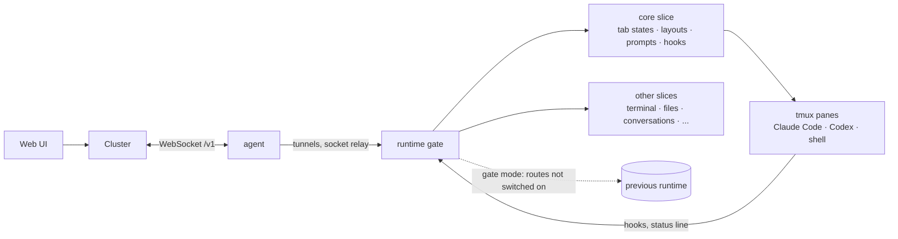

<p align="center">
  <picture>
    <source media="(prefers-color-scheme: dark)" srcset="docs/brand/harnessly-wordmark-dark.svg">
    
  </picture>
</p>

<p align="center">
  <strong>The open core of a workspace for people and coding agents.</strong><br>
  Claude Code and Codex run in tmux on your machines; harnessly knows what each of them is doing<br>
  and serves it all through one HTTP and WebSocket API.
</p>

<p align="center">
  <a href="https://github.com/ly-solutions/harnessly/actions/workflows/ci.yml"></a>
  <a href="https://github.com/ly-solutions/harnessly/actions/workflows/lint.yml"></a>
  <a href="https://pkg.go.dev/github.com/ly-solutions/harnessly"></a>
  <a href="https://goreportcard.com/report/github.com/ly-solutions/harnessly"></a>
  <a href="https://scorecard.dev/viewer/?uri=github.com/ly-solutions/harnessly"></a>
  <a href="go.mod"></a>
  <a href="https://github.com/ly-solutions/harnessly/releases"></a>
  <a href="LICENSE"></a>
</p>

<p align="center">
  <a href="#quick-start">Quick start</a> ·
  <a href="#ways-to-run">Ways to run</a> ·
  <a href="docs/README.md">Docs</a> ·
  <a href="#architecture">Architecture</a> ·
  <a href="CONTRIBUTING.md">Contributing</a>
</p>

---

## Why harnessly

- **Agents work where the code is.** Claude Code and Codex run as the real CLIs in tmux panes on the machine, next to
  its repositories and tools, and keep running when nobody has a page open.
- **You always know what every agent is doing.** A tab's state (`busy`, `needs-input`, `ready-for-review`, ...) is
  derived from the agent's hooks, status line, transcript, screen and process tree, and pushed live to every client.
- **Small static binaries, no inbound access.** The runtime (one per person) and the machine agent (one per Unix
  account) are single Go binaries without cgo. The agent keeps one WebSocket link to the cluster and tunnels the rest,
  so nothing has to reach into the machine.
- **An API first.** Workspaces, tabs, prompts, terminals, files and conversations are HTTP and WebSocket routes, so a
  web UI, a cluster or your own scripts drive the same thing.
- **Boards and documents beside the conversation.** Agents draw on [boards](https://github.com/ly-solutions/boards)
  and publish to [artifacts](https://github.com/ly-solutions/artifacts) with the addresses and tokens the runtime gives
  them; their links open in a side pane of the page, signed in, next to the conversation that made them.
- **Runs the way you run things.** A release binary, a systemd user service, a container, `docker compose up` for the
  whole workspace, a Helm chart or an Argo CD app of apps.
- **Moves in without a big bang.** In gate mode the runtime sits in front of an older runtime and takes over one slice
  of routes at a time, each compared in shadow first. In standalone mode it needs nothing else.

## Features

| | |
| --- | --- |
| **Agent tabs in tmux** | Claude Code, Codex and shells in tabs on the runtime's own tmux server; a terminal socket attaches a pty to any of them. |
| **Live tab states** | One keeper for all tabs, fed by hooks, status line, transcripts, screens and the process tree; `/api/status` and `/api/sync` sockets. |
| **Prompt delivery** | A per-tab queue that types messages and keys into an agent's pane, long prompts through an editor hand-off. |
| **Launch and resume** | Starts conversations with the runtime's hooks and settings, resumes agents that were working after a restart or a tmux reset. |
| **Idle sleep and push** | Stops Claude agents idle too long to free memory (the next prompt resumes them); web push when a turn ends or an agent asks. |
| **Conversations** | A timeline socket over the agents' transcripts, token and cost economics, subagents, turn checkpoints as git snapshots. |
| **Files and git** | Editor reads and saves, changed files and diffs, uploads, a repository sync with its upstream. |
| **Usage and limits** | Usage reports and statistics from the transcripts, provider limits with a forecast, machine load. |
| **Preview proxy** | A reverse proxy for dev servers with a DevTools record that agents can read through an MCP server. |
| **Machine agent** | Transcripts, state files with versioned writes, socket relay and TCP tunnels over a single WebSocket link. |
| **Gate and shadow** | Per-machine slice switches re-read every second, shadow comparison of answers, per-path proxy statistics. |
| **Web page** | Sign-in, workspaces, split panes with terminal and agent tabs, the conversation with live state, the machine's load; compiled into release runtimes. |
| **Boards and documents** | Agents get `BOARDS_URL`, `ARTIFACTS_URL`, tokens and their conversation id; board and document links become chips that open in a side pane, which also lists the conversation's documents. |
| **Ways to run** | Dockerfile, docker compose with boards, artifacts and MinIO, a Helm chart, Argo CD examples, a systemd unit and `make` targets. |
| **Byte-for-byte compatible** | Status codes, JSON key order, headers and ETags pinned by golden tests recorded from the previous implementation. |

## Quick start

You need Go (the version in [`go.mod`](go.mod)), `tmux`, `curl` and `jq`, on Linux or macOS.

```sh
git clone https://github.com/ly-solutions/harnessly.git
cd harnessly
make build                     # bin/runtime, bin/agent, bin/agentprobe
```

Run the runtime standalone against a throwaway home and its own tmux server, so nothing of yours is touched:

```sh
export DEMO_HOME=$(mktemp -d)
HOME=$DEMO_HOME RUNTIME_GATE_LISTEN=127.0.0.1:4321 RUNTIME_TMUX_SOCKET=harnessly-demo \
  ./bin/runtime > "$DEMO_HOME/runtime.log" 2>&1 &
sleep 1
curl -s 127.0.0.1:4321/api/health
```

```json
{"app":"harnessly","version":"0.0.0-development","commit":null}
```

On its first start the runtime wrote its config, the hook scripts and a `cli-token` into `$DEMO_HOME/.harnessly`.
Use the token to make a workspace and open a terminal tab in it:

```sh
TOKEN=$(cat "$DEMO_HOME/.harnessly/cli-token")
API=(-s -H "x-cli-token: $TOKEN" -H "content-type: application/json")
mkdir "$DEMO_HOME/project"

WS=$(curl "${API[@]}" 127.0.0.1:4321/api/workspace \
  -d "{\"name\":\"demo\",\"directory\":\"$DEMO_HOME/project\"}" | jq -r .id)

curl "${API[@]}" 127.0.0.1:4321/api/cli/tabs -d "{\"workspaceId\":\"$WS\",\"name\":\"shell\"}" \
  | tee "$DEMO_HOME/tab.json" | jq .
```

```json
{
  "tabId": "tab-zLTjzM",
  "workspaceId": "ws--i5OEb",
  "paneId": "pane-dnZ6sA",
  "sessionName": "hs-ws--i5OEb-pane-dnZ6sA-tab-zLTjzM",
  "name": "shell",
  "panelType": "terminal",
  "agentProviderId": null,
  "agentSessionId": null
}
```

Type into the tab and read its screen back:

```sh
TAB=$(jq -r .tabId "$DEMO_HOME/tab.json")
curl "${API[@]}" "127.0.0.1:4321/api/cli/tabs/$TAB/send?workspaceId=$WS" -d '{"content":"echo hello from tmux\n"}'; echo
sleep 1
curl "${API[@]}" "127.0.0.1:4321/api/cli/tabs/$TAB/result?workspaceId=$WS" | jq -r .content | grep -x 'hello from tmux'
```

```text
{"status":"sent"}
hello from tmux
```

The tab is a real tmux session: `tmux -L harnessly-demo attach` shows it. Start the machine agent next to the
runtime; it finds the runtime's secret in the same data directory and reports the version `make build` took from
`git describe`:

```sh
HOME=$DEMO_HOME AGENT_PORT=4322 RUNTIME_PORT=4321 ./bin/agent > "$DEMO_HOME/agent.log" 2>&1 &
sleep 1
curl -s 127.0.0.1:4322/healthz
```

```json
{"ok":true,"version":"0.9.0-18-g5c434a4"}
```

Clean up:

```sh
kill %1 %2
tmux -L harnessly-demo kill-server >/dev/null 2>&1
rm -rf "$DEMO_HOME"
```

To run an agent instead of a shell, start the runtime with your own `HOME` (where Claude Code and Codex keep their
logins) and ask for a `claude-code` or `codex-cli` tab with a prompt:
`{"workspaceId":"…","panelType":"claude-code","prompt":"…"}`. The tab's `cliState` in
`/api/cli/tabs/<tab>/status` then follows the agent's turn, from `busy` to `ready-for-review`.

More in [Getting started](docs/getting-started.md).

## Ways to run

```sh
make run                          # the runtime with the page on http://127.0.0.1:8022, data in ~/.harnessly
docker compose up --build         # harnessly + boards + artifacts + MinIO on http://localhost:8022
helm install ada deploy/helm/harnessly --set ownerName=Ada
```

| | |
| --- | --- |
| Plain commands | `make run`, or a release binary: `RUNTIME_GATE_LISTEN=127.0.0.1:8022 RUNTIME_GATE_UPSTREAM= ./runtime` |
| systemd | `make install install-systemd`, then `systemctl --user enable --now harnessly` — one service per Unix account; agents keep working through restarts |
| Docker | `docker build -t harnessly .` (`--target with-agents` adds Claude Code and Codex), the home folder on a volume |
| docker compose | [compose.yaml](compose.yaml): the whole workspace on one host, boards and documents wired in |
| Kubernetes | [deploy/helm/harnessly](deploy/helm/harnessly): a StatefulSet per person with a PVC for its home |
| Argo CD | [deploy/argocd](deploy/argocd): one Application, or an app of apps with boards and artifacts |

All of them, and how to give the runtime the agent CLIs, in [docs/deploy.md](docs/deploy.md).

### The web page

`web/` is the agents workspace in the browser: conversations with Claude Code and Codex in a sidebar with projects and
pins, each agent's timeline (turns, tool runs, plans, questions) with a composer that takes slash commands, files,
context and dictation, and a right pane with the terminal, a browser for the machine's dev servers, files, changes,
documents and boards ([integrations](docs/integrations.md)), GitHub and GitLab, subagents and the session's cost.
English by default, Russian with `RUNTIME_LOCALE=ru`. Release runtimes carry it; it is served at
`RUNTIME_APP_BASE_PATH` (default `/agents`, and `/` redirects there):

```sh
make runtime-web               # pnpm build in web/, then bin/runtime with the page compiled in
HOME=$(mktemp -d) RUNTIME_GATE_LISTEN=127.0.0.1:4321 ./bin/runtime &
xdg-open http://127.0.0.1:4321/   # the first visit sets the machine's password
```

`make web-check` runs what CI runs for the page; `make web-browser-test` drives it in headless Chrome against a
standalone runtime with stand-in agents (with `E2E_BOARDS_DIR` and `E2E_ARTIFACTS_DIR` naming checkouts of boards and
artifacts, the side pane too). See [the page's settings](docs/configuration.md#web-page).

## Architecture



A request reaches the **runtime gate** on the runtime's port. The gate answers every route whose [slice](docs/slices.md)
is on; in gate mode the rest goes to the previous runtime, in standalone mode there is no previous runtime and every
slice is on. The **core** keeps the tabs: it starts tmux sessions, types prompts, and learns each agent's state from
its hooks and files. The **machine agent** is the machine's only link to the cluster. Details in
[docs/architecture.md](docs/architecture.md).

## Documentation

| | |
| --- | --- |
| [Getting started](docs/getting-started.md) | build, run standalone, open tabs, run agents, connect the machine agent |
| [Architecture](docs/architecture.md) | the runtime gate, the core, tmux, the machine agent, the repository layout |
| [Slices](docs/slices.md) | every slice of routes, switching them per machine, the shadow comparison |
| [Configuration](docs/configuration.md) | every `RUNTIME_*` and `AGENT_*` variable |
| [Deploy](docs/deploy.md) | plain commands, systemd, Docker, docker compose, Helm, Argo CD |
| [Integrations](docs/integrations.md) | boards, artifacts and the agent skills |
| [Contributing](CONTRIBUTING.md) | development setup, tests and golden files, commit convention |

## Status

harnessly is young and moving fast; versions are `0.x` and the API follows the previous runtime it replaces.

- **Here now:** the machine runtime, with every route of the previous runtime in Go, gate and standalone modes, the
  machine agent (wire protocol v1), the web page on the project's own UI kit, and the boards and artifacts
  integrations.
- **Coming:** the cluster side (many machines and people behind one page), and the services' webhooks (board comments
  routed to agents, live document updates).

Follow the [changelog](CHANGELOG.md) and the [releases](https://github.com/ly-solutions/harnessly/releases).

## Contributing

Issues and pull requests are welcome. Read [CONTRIBUTING.md](CONTRIBUTING.md) first; `make help` lists the developer
tasks. Please report security problems privately, as [SECURITY.md](SECURITY.md) describes. Everyone taking part
follows the [Code of Conduct](CODE_OF_CONDUCT.md).

## Acknowledgements

harnessly stands on [tmux](https://github.com/tmux/tmux) and drives
[Claude Code](https://docs.anthropic.com/en/docs/claude-code) and [Codex](https://github.com/openai/codex). It uses
[coder/websocket](https://github.com/coder/websocket), [creack/pty](https://github.com/creack/pty),
[fsnotify](https://github.com/fsnotify/fsnotify), [goldmark](https://github.com/yuin/goldmark),
[BurntSushi/toml](https://github.com/BurntSushi/toml) and [dlclark/regexp2](https://github.com/dlclark/regexp2).

## License

[Apache License 2.0](LICENSE).
