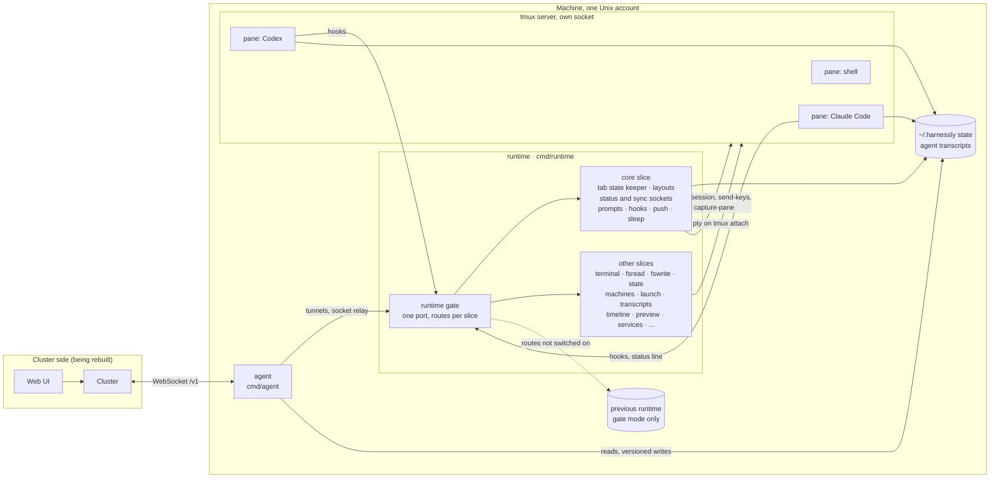

# Architecture

harnessly runs on the machines where coding agents work. It holds two programs, both static Go binaries with no cgo:

| Program | Runs | Job |
| --- | --- | --- |
| [`cmd/runtime`](../cmd/runtime) | one per person on a machine | the HTTP and WebSocket API of that person's workspaces: tmux tabs with Claude Code, Codex or a shell, their live state, prompts, files, conversations |
| [`cmd/agent`](../cmd/agent) | one per Unix account | the single link between the machine and the cluster: transcripts, state files, the runtime's sockets and tunnels to it |

A third, [`cmd/agentprobe`](../cmd/agentprobe), talks to an agent the way the cluster does, for testing.

## The runtime

The runtime is the per-person API that a workspace's pages, the agent CLIs' hooks and the machine agent call. It is
being rewritten here from an earlier Node.js implementation, called the *previous runtime* throughout the code; that
implementation is not part of this repository.

### Gate and standalone

The process always starts as the **runtime gate** on the runtime's port (`RUNTIME_GATE_LISTEN`). It runs in one of two
modes:

- **Gate** (`RUNTIME_GATE_UPSTREAM` set). The gate answers what the [slices](slices.md) switched on for the machine
  cover. Everything else (HTTP, streams and WebSocket upgrades) goes to the previous runtime on an inner port, so
  callers keep one port. A previous runtime that is down looks down: the gate drops the connection instead of
  answering for it. This is how a fleet moves over one machine and one slice at a time, with a
  [shadow](slices.md#the-shadow) comparison before each switch.
- **Standalone** (`RUNTIME_GATE_UPSTREAM` empty). There is no previous runtime and this process is the whole runtime.
  Every slice is on, whatever `state-mode.json` says, and no shadow runs. A request no route takes gets the previous
  runtime's answer to a route it did not have (404 `{"error":"Not found"}`), or 503 `{"error":"Service unavailable"}`
  for a route of it that is not answered here (or not yet, while the core starts), as a machine that is down.

In standalone mode the start-up work of the previous runtime is the gate's, byte for byte, with one writer per file:

- it takes the single-instance lock, and gives up while a runtime answering on the lock's port holds it;
- it makes the config and the pair's secret when they are missing, and keeps or makes the `cli-token`;
- it writes the `port` file, the hook, status line and Codex hook scripts, the `--settings` and MCP files, the prompt
  editor and the Codex launcher;
- it re-reads the tmux config, writes each workspace's agent prompts, and cleans up old uploads and the status line
  figures of gone conversations;
- at stop the port file and the lock go.

What the core told the previous runtime (the workspace prompts, a corrected tab state) it then does itself, and it
carries a change of the person's Claude Code plugins and skills into idle Claude tabs.

### The core

The `core` slice is the heart of the runtime:

- **Tab state keeper** ([`internal/status`](../internal/status)). The work state of every tab (`idle`, `busy`,
  `needs-input`, `ready-for-review`, ...) is learnt from the agent's hooks, its transcript, its screen and its process
  tree, and pushed to every status socket.
- **Layouts and workspaces** ([`internal/state`](../internal/state)). `workspaces.json` and each workspace's
  `layout.json` of panes and tabs.
- **Sockets** ([`internal/sockets`](../internal/sockets)). `/api/status` carries tab states, background work, the prompt
  queue and limits; `/api/sync` carries layout and workspace changes.
- **Prompts** ([`internal/prompts`](../internal/prompts)). A per-tab queue that types a person's messages and keys into
  an agent's pane, with long prompts handed over through an editor script.
- **Hooks** ([`internal/coreapi`](../internal/coreapi), [`internal/hooksetup`](../internal/hooksetup)). The scripts the
  agents call the runtime through, and the routes that receive them.
- **Web push** ([`internal/push`](../internal/push)) when a turn ends or an agent asks a question, and **idle sleep**
  ([`internal/sleep`](../internal/sleep)), which stops the processes of Claude agents that sat idle too long; the next prompt resumes the conversation.

Two keepers of one machine's tabs would fight over its files, so the core runs only while its slice is on; before that,
`core-shadow` runs a read-only keeper next to the previous runtime and logs where the two disagree.

### tmux

Tabs live on the runtime's own tmux servers (`tmux -L`, `RUNTIME_TMUX_SOCKET`, default `harnessly`), never on the
person's own server. The core starts sessions, types into panes and reads their screens
([`internal/tmux`](../internal/tmux), [`internal/screen`](../internal/screen)); the `terminal` slice attaches a pty to a
session and speaks the page's binary protocol over `/api/terminal` ([`internal/terminal`](../internal/terminal)).

### Compatibility

Where answers were the previous runtime's, they are kept byte for byte: status codes, JSON bodies and their key order
([`internal/nodejson`](../internal/nodejson) writes like `JSON.stringify`), headers, ETags and 304s, and auth exactly as
before (a page session cookie signed with the pair's secret, or the `cli-token` header). Golden files recorded from the
previous implementation's own handlers pin that down; see [CONTRIBUTING](../CONTRIBUTING.md#golden-tests).

## The machine agent

`cmd/agent` runs on every machine next to a person's runtime, one process per Unix account. It holds a single
WebSocket link to the cluster: the cluster connects to it on `/v1`, or, with `AGENT_CLUSTER_URL` and `AGENT_RUNTIME_ID`
set, it dials the cluster itself. Tokens on both directions are HS256 JWTs signed with the pair's secret. Over that link
it serves:

- the transcripts Claude Code and Codex keep for the account: list, read by whole lines, and change events that carry
  the appended lines;
- the runtime's state files (workspaces, layouts, settings), versioned writes from the cluster included;
- the runtime's status and sync sockets, relayed;
- tunnels: TCP connections to the runtime and the disk service on loopback, carried as binary frames, so nothing has
  to reach into the machine;
- loopback routes for the account's own CLIs and conversations (`/docs/*`, `/state/*`, `/automations/report`), guarded
  by a token in a 0600 file.

It also answers `GET /healthz` on its loopback port.

### Checking an agent

`cmd/agentprobe` talks to an agent the way the cluster does. `-mode compat` prints every answer of a fixed script so
two agents can be diffed, `-mode bench` measures listing, reading and event latency, and `-mode runtime` /
`-mode ingest` stand in for the runtime and the cluster. The compat script writes test entries into the agent's state
files, so point it at a throwaway data directory.

## Repository layout

| Path | What |
| --- | --- |
| `cmd/agent`, `cmd/runtime`, `cmd/agentprobe` | the programs |
| `internal/gate` | the runtime gate: slices, the proxy to the previous runtime, the shadow, socket hand-over |
| `internal/status`, `internal/state`, `internal/sockets`, `internal/prompts`, `internal/coreapi` | the core |
| `internal/tmux`, `internal/screen`, `internal/terminal`, `internal/proc` | tmux, screens, the terminal socket, the process table |
| `internal/agents/{claude,codex}`, `internal/agentdetect`, `internal/launch` | the agent CLIs: detection, launch lines, resume |
| `internal/transcript`, `internal/timeline`, `internal/sessions`, `internal/economics` | conversations read from the agents' files |
| `internal/agent` | the machine agent |
| `internal/nodejson`, `internal/jsvalue`, `internal/jscompat` | byte-for-byte JSON and the few JavaScript behaviours answers depend on |
| `tools/` | maintenance scripts |
