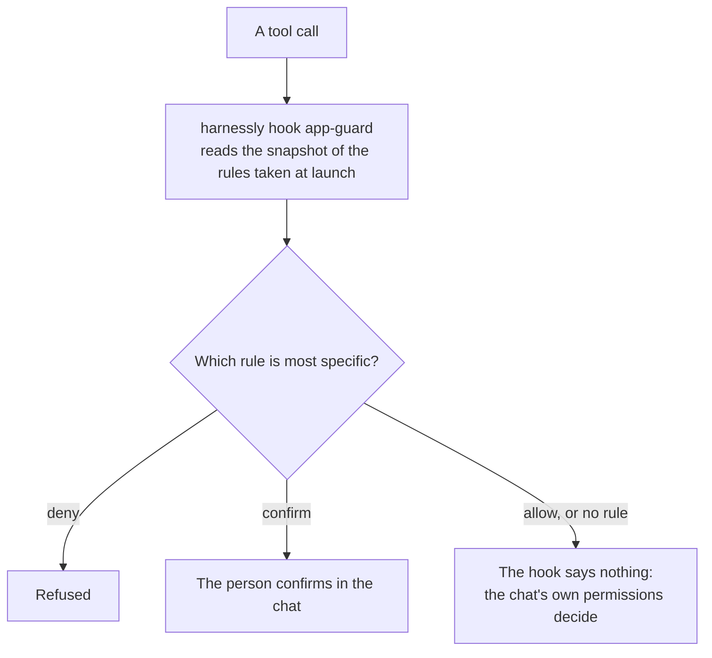

# Your first plugin

A plugin changes how the agent works in the chats where it is on. No code runs. Ten minutes from an empty folder.

## Create it

```sh
harnessly app new acme.review          # writes ./review; --dir to choose, --name for the display name
harnessly app validate ./review --strict
harnessly app dev ./review             # install the folder itself, so your edits reach it
harnessly app enable acme.review       # in the chat this tab runs; or «+» in the field, then «Приложение»
```

An app that asks for any right waits for the person after `app dev`: it is off until they agree to what it reaches with a
click in harnessly's page («Приложения» → the app's card → «Посмотреть доступы»). No command grants it, since every agent
runs the CLI too; `app explain` and `app enable` say what it waits for. This first plugin asks for nothing, so it is on
at once.

An agent at rest stops at once and the next message brings it back with the app. An agent at work keeps what it had until its
terminal stops. The scaffold writes:

```text
review/
  harnessly/app.json            # the manifest
  .claude-plugin/plugin.json    # rewritten from the manifest by every install
  instructions.md               # always in the agent's context
  skills/how-to/SKILL.md        # read by the agent on demand
  CHANGELOG.md
```

`harnessly app new` has two templates: `chat` (the default, this one) and `pane-chat` (adds a view).

## The manifest

```json
{
  "id": "acme.review",
  "name": "Review",
  "description": "Reads the diff, changes nothing, comments after you confirm",
  "version": "0.1.0",
  "harnessly": ">=0.16.68",
  "trust": "declarative",
  "targets": ["chat"],
  "permissions": [],
  "agent": {
    "instructions": "instructions.md",
    "tools": {
      "deny": ["Edit", "Write", "MultiEdit", "NotebookEdit", "Bash(git push*)"],
      "confirm": ["Bash(gh pr review*)"]
    }
  },
  "chat": { "commands": ["/review"] }
}
```

- `id` is `<publisher>.<name>`, lower case latin letters, digits and `-`. It never changes.
- `harnessly` is the range of host versions. A host outside it refuses the install with `host-version`, and `validate` does
  not check this, so test the install. Run `harnessly --version` to see yours.
- `trust`: see the [tiers](#trust-tiers).
- A target with nothing of the app in it is an error, and so is a contribution to a target the app does not list.

## What reaches the agent

At each launch, for each app on in that chat:

| You write | The agent gets | Notes |
| --- | --- | --- |
| `instructions.md` (named in `agent.instructions`) | The text in its system prompt, under `# Apps on in this chat` | Over 4 KB warns, over 16 KB is an error. Keep it short |
| `skills/<name>/SKILL.md` | A skill it reads on demand, `<plugin>:<name>` | Every folder under `skills/` loads, whatever `agent.skills` says |
| `commands/<name>.md` | A slash command, `/<plugin>:<name>` | `chat.commands` is checked against the files; Claude Code loads the folder |
| `.mcp.json` | MCP servers, started by Claude Code | See [Backend](03-backend.md) |
| `agent.tools` | The guard hook decides each tool call; `deny` and `confirm` also go to Claude's own permissions | Below |

A `declarative` or `sandboxed` package may not carry `hooks/`, `agents/`, `output-styles/` or other parts of a Claude Code plugin: they run outside the guard, and `harnessly app validate` refuses them by folder.

Instructions are always in context and cost tokens in every message: say what to do and when, and put the long parts in a skill.
Measure with `baseline: true` in an [eval](07-sharing.md#evals).

```markdown
# instructions.md
You review merge requests. Read the diff and the tests. Change nothing.
Post a comment only after the person confirms it. For the checklist, read the skill review-checklist.
```

```markdown
---
name: review-checklist
description: What to check in a merge request. Read it before you give a verdict.
---
1. Does the change do what the title says? ...
```

## Tool rules

`agent.tools` has three lists. They are a guardrail against the agent's mistakes, not a sandbox.



**`allow` grants nothing.** It only wins against a broader `deny` or `confirm`. A chat that asks before each tool still asks.

| Rule | Matches |
| --- | --- |
| `Edit` | The built-in tool. `Edit` does not cover `Write`, `MultiEdit` or `NotebookEdit`: name each one |
| `Bash(git push*)` | Each simple command of the line, so `git status && git push` is caught. `git push:*` is the same |
| `Edit(*/docs/*)` | A glob over `file_path` **exactly as Claude wrote it**, normally absolute. `Edit(docs/*)` misses `/home/me/project/docs/a.md`; start with `*/` or a full path. `**` is the same as `*` |
| `standup.save_entry`, `standup.*` | A tool of a server in `.mcp.json`, written `<server>.<tool>`. The tool keeps its underscores |
| `app.data.get`, `app.sinopia.*` | The host's tools (underscores become dots: `sinopia_set_fields` is `app.sinopia.set.fields`) |
| `mcp:*`, `*` | Every MCP tool; everything. These lose to any more specific rule |

Order inside one app: `Tool(pattern)`, then the exact name, then a mask with the longer prefix, then `mcp:*`, then `*`. On a tie `deny`
beats `confirm` beats `allow`. Across the apps of a chat any `deny` wins, then any `confirm`. An `allow` reaches only the servers of
its own app; a `deny` or `confirm` reaches any.

A line the guard cannot see into (`eval`, `sh -c`, `xargs`, `$(...)`, wrappers such as `env`, `nice`, `sudo`) turns a `deny` or
`confirm` that might apply into a confirmation.

Prefer not offering a tool to forbidding it. An agent cannot delete with a tool that does not exist, whereas a rule on a shell
line can be missed.

## Trust tiers

| Tier | What it adds | Limits |
| --- | --- | --- |
| `declarative` | The floor | No `network.connect`, `network.resources`, no `https://` view. Views' scripts do run here: the tier is not «text only» |
| `sandboxed` | Outbound addresses for views, a framed `https://` view | Everything else is the same as `declarative` |
| `trusted` | Local programs in `.mcp.json` (`command`) | Each person installs it by hand: never for a team, never in the public catalog |

## Check it

```sh
harnessly app validate ./review --strict   # every problem names its field; --strict fails on warnings
harnessly app eval ./review                # scenarios on a real agent: see Sharing
```

Next: [give it a view](02-views.md), or copy [`mr-review`](../apps/mr-review), a complete plugin with an eval.
