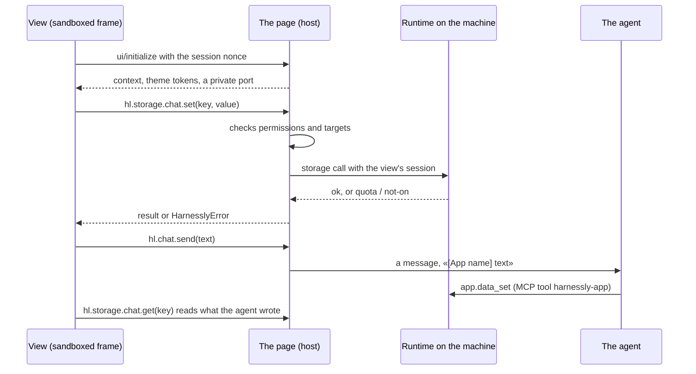

# Views: the app's interface

A view is a static page of your package. The person sees it in a pane tab, as a card in the chat, on the app's own page, or
inside a Sinopia document. It runs in the browser, in a sandbox, and everything it does beyond drawing goes through the host.

## Start

```sh
harnessly app new acme.notes --template pane-chat
harnessly app dev ./notes
harnessly app enable acme.notes
harnessly open app:acme.notes       # the pane tab; a view with the app target also opens at /apps/acme.notes?chat=<id>
```

```html
<!-- ui/index.html -->
<!doctype html>
<html>
  <head>
    <meta charset="utf-8" />
    <link rel="stylesheet" href="style.css" />
    <script src="/__hl/app-sdk.js"></script>
    <script src="main.js"></script>
  </head>
  <body><main id="root"></main></body>
</html>
```

```js
// ui/main.js: a classic script, not a module
harnessly.connect().then(async (hl) => {
  const note = (await hl.storage.chat.get('note')) ?? '';
  const area = document.createElement('textarea');
  area.value = note;
  area.disabled = hl.context.readOnly === true;
  area.addEventListener('change', () => hl.storage.chat.set('note', area.value));
  document.getElementById('root').append(area);
}).catch((e) => {
  document.getElementById('root').textContent = 'Open this inside harnessly: ' + e.code;
});
```

```json
"targets": ["chat", "pane", "app"],
"permissions": ["storage", "chat.prompt", "pane.open"],
"views": [{ "id": "main", "title": "Notes", "entry": "ui/index.html", "targets": ["pane", "app"] }]
```

## Where a view shows

| Target of the view | Where | How it opens |
| --- | --- | --- |
| `pane` | A tab of the right pane | `harnessly open app:<id>[/<view>]`, `hl.pane.open`, the agent's `app.open`. An app with only `app` views does not open here |
| `app` | `/apps/<id>?chat=<conversation>`, the whole page with the chat beside it (a column, a window, or just its field) | The pane's «во всю ширину», the sidebar's «Приложения» |
| `chat` | A card in the feed | A tool result naming it, or `hl.chat.card` |
| `sinopia.<kind>` | A panel or inspector of a document | See [Sinopia](04-sinopia.md) |

`activation.openView` names the view `harnessly open app:<id>` shows. Otherwise it is the first view with the `pane` target.

## How a view talks to the host



The agent side and the view side share **chat storage** (`app.data_*` and `hl.storage.chat` are the same data) and **workspace files**.
A view does not receive a push when the agent writes: read again, for example on `hl.on('context')` or after the agent's message, or poll
sparingly. The `tool-result` event is not connected yet.

## The sandbox

The frame is sandboxed without `allow-same-origin` on an origin of its own. Consequences:

- `localStorage` and cookies are not there. Use `hl.storage`.
- **Classic scripts only.** The frame's opaque origin sends the slot's cookie with classic scripts, stylesheets and images, but not with
  module scripts, fonts or `fetch` of your own files without credentials: those come back 401. Ship data as a script that sets a global.
  A bundler is fine if it writes one classic file (an IIFE). The SDK is also at `/__hl/app-sdk.mjs` for a bundler to import.
- No inline scripts and no `eval` (`script-src 'self'`). Inline styles are allowed.
- Nothing leaves without `network`: `connect-src` is `'none'` until `network.connect` lists a host. See [Backend](03-backend.md).
- Only the view's entry, its folder and `ui/` are served. A file up to 10 MB, dot-files never.

```json
"network": {
  "connect": ["api.example.com"],
  "resources": ["cdn.example.com"],
  "frames": ["embed.example.com"]
}
```

Entries are `host`, `*.host`, `host:port`, optionally with `https://` or `wss://`. `*` needs `network.reason` and keeps a public
listing in review.

## Design: theme and sizes

`hl.connect()` sets `<html data-theme="light|dark">`, `color-scheme`, `lang`, and these tokens on `:root`, and updates them when the theme
changes. The SDK ships no stylesheet and there are no tokens before the connect, so give every token a default.

| Token | Use | Light | Dark |
| --- | --- | --- | --- |
| `--t-bg` | The page | `#ffffff` | `#141416` |
| `--t-surface` | Cards | `#f6f6f7` | `#1c1c1f` |
| `--t-surface-hover` | Hover | `#ececee` | `#26262a` |
| `--t-text` | Main text | `#17171a` | `#ececf0` |
| `--t-text-secondary` | Secondary text | `#4a4a52` | `#b4b4bc` |
| `--t-text-muted` | Quiet text | `#76767f` | `#8a8a94` |
| `--t-border` | Borders | `#e2e2e6` | `#2e2e33` |
| `--t-border-strong` | Strong borders | `#c9c9cf` | `#44444b` |
| `--t-accent` | Accent | `#3b5bdb` | `#748ffc` |
| `--t-danger` | Errors | `#d6336c` | `#f06595` |
| `--t-success` | Success | `#2f9e44` | `#69db7c` |

The values are the guest page's; inside the app they follow the host's theme, so use the names and do not hard-code the colors. A token
whose source is empty is left out.

```css
:root { --t-bg: #ffffff; --t-text: #17171a; --t-border: #e2e2e6; --t-accent: #3b5bdb; }
html[data-theme='dark'] { --t-bg: #141416; --t-text: #ececf0; --t-border: #2e2e33; --t-accent: #748ffc; }
body { margin: 0; background: var(--t-bg); color: var(--t-text); font: 14px/1.45 system-ui, sans-serif; }
```

- A view works in both themes and from 360 px wide. A pane is narrow: lay out for it first.
- Language: `hl.context.locale` is `ru` or `en`. The host translates nothing of yours.
- Honor `hl.context.readOnly === true`: offer no way to change the document. The host refuses the writes anyway.

## The SDK

`harnessly.connect()` rejects with `host_unavailable` outside harnessly. Then `hl` has:

| Call | Permission | What it does |
| --- | --- | --- |
| `hl.context` | none | `app`, `target`, `view`, `theme`, `locale`, `chat` (null when the app is off in the chat), `readOnly`, `data` (a card's). `user` is always `null` |
| `hl.host` | none | `{name, version}` |
| `hl.on(event, fn)` | none | Working events: `context`, `theme`, and `selection` in Sinopia |
| `hl.chat.send(text)` | `chat.prompt` | A message to the agent, up to 20 000 characters, shown with the app's name on one line |
| `hl.chat.read({last})` | `chat.read` | Latest messages as `{role, text}`: default 20, at most 200 |
| `hl.chat.card(view, data)` | `chat.card` | A card at the end of the feed. Kept in this browser, at most 20 per chat, data up to 20 000 characters |
| `hl.pane.open(target)` | `pane.open` | Only `app:<id>[/<view>]` |
| `hl.tools.call('server.tool', args)` | none | A tool of your own **remote https** server. Returns the raw MCP result: check `isError` yourself. See [Backend](03-backend.md) |
| `hl.storage.<scope>.get/set/delete/keys` | `storage` | Scopes below; `get` of a missing key is `null` |
| `hl.files.read(path)`, `hl.files.write(path, text)` | `files.read:<mask>`, `files.write:<mask>` | Files of the chat's folder, as text |
| `hl.ui.confirm(text)` | none | A dialog titled with the app's real name. **Resolves a boolean.** Up to 500 characters; never times out |
| `hl.ui.toast(text)` | none | A notice, up to 500 characters |
| `hl.notify(text)` | `notify` | The same notice, up to 2000 characters |
| `hl.resize(height)` | none | The height of a card (sent by itself for cards) |
| `hl.sinopia.*` | `sinopia.*` | See [Sinopia](04-sinopia.md) |
| `hl.close()` | none | Stops listening |

Calls are limited to 60 a second per view (`rate_limited`). A call with no answer rejects with `host_unavailable` after 30 s.

The wire is MCP Apps (JSON-RPC 2.0 over `postMessage`), so a standard MCP Apps view works unchanged. Then the tokens are in
`hostContext.styles.variables` and ours under `hostContext.harnessly`.

## Storage

| Scope | Holds | Limit |
| --- | --- | --- |
| `install` | This machine's install | 5 MB |
| `user` | The person | 1 MB |
| `chat` | The chat the view is in: shared with the agent's `app.data_*` | 256 KB per chat, 20 MB over all chats |
| `space` | The team; writing needs `storage.space.write` | 10 MB |
| `doc` | A Sinopia document | 100 KB per document, 20 MB in all |

A key is 1 to 256 characters. A write past a limit is refused whole, and the view sees `host_unavailable` with the word `quota`.

## Files of the workspace

```json
"permissions": ["files.read:reports/**", "files.write:reports/*.md"]
```

`*` is a run of characters inside a name, `**` any number of folders. Up to 4 MB, text only; a file that is missing or not text rejects with `invalid_params`. The path is judged by where it really leads,
symlinks followed, and has to lie in the chat's folder and match a mask. Secrets (`.env`, `.git/`, `.ssh/`, `*.pem`, ...) are out whatever
a mask says. Writes also refuse `.claude`, `.mcp.json`, `.vscode`, `.harnessly`, `.github`, `CLAUDE.md`, `AGENTS.md`, and any dot-file no mask
names with a dot of its own. This needs a chat with the app on: a view in no chat has no workspace.

## Cards in the chat

A view with the `chat` target draws a tool result:

```json
"views": [{ "id": "card", "entry": "ui/card.html", "targets": ["chat"] }],
"chat": { "cards": ["card"] }
```

A tool of your own server (a local one too) answers with one line of JSON under 100 characters, in its `text`:

```json
{"_meta":{"ui":{"resourceUri":"ui://acme.notes/card"}},"data":{"date":"2026-11-03"}}
```

The feed draws the view under that step, with `data` in `hl.context.data`. Pass an id, and read the rest in the card. The limit and the reason are in
[Backend](03-backend.md#cards-from-a-tool). Only a tool of the app's own server may name its view.

## The agent's host tools

A chat with apps gets the MCP server `harnessly-app`. In tool rules they are `app.*`.

| Tool | Rule | What it does |
| --- | --- | --- |
| `open` | `app.open` | Opens the view in the pane |
| `data_get`, `data_set` | `app.data.get`, `app.data.set` | Chat storage by `key` |
| `ask` | `app.ask` | Puts a choice (2 to 8 options) over the view, waits up to ten minutes, answers with the option or `cancelled`; at most 5 open per chat |

Tell the agent about them in `instructions.md`: `app.ask` is how it confirms something inside your interface.

Next: [Backend](03-backend.md), or copy [`cashback`](../apps/cashback).
