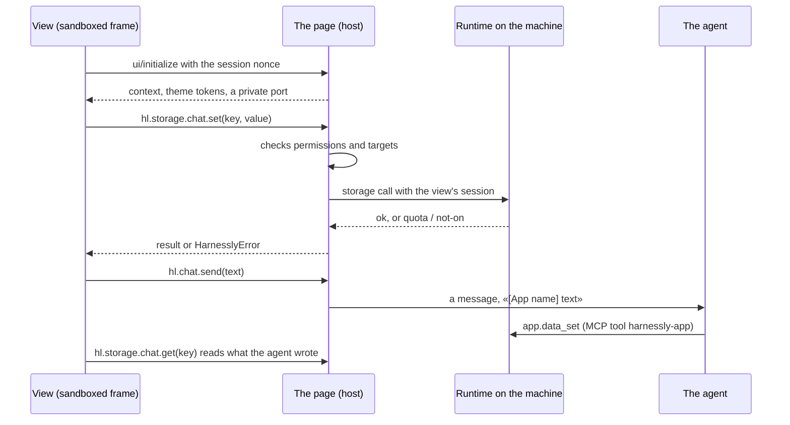

# Views: the app's interface

A view is a static page of your package. The person sees it in a pane tab, as a card in the chat, on the app's own page, or
inside a Sinopia document. It runs in the browser, in a sandbox, and everything it does beyond drawing goes through the host.

## Start

```sh
harnessly app new acme.notes --template pane-chat
harnessly app dev ./notes
harnessly app enable acme.notes
harnessly open app:acme.notes       # the pane tab; a view with the app target also opens at /apps/acme.notes?chat=<id>
```

```html
<!-- ui/index.html -->
<!doctype html>
<html>
  <head>
    <meta charset="utf-8" />
    <link rel="stylesheet" href="style.css" />
    <script src="/__hl/app-sdk.js"></script>
    <script src="main.js"></script>
  </head>
  <body><main id="root"></main></body>
</html>
```

```js
// ui/main.js: a classic script, not a module
harnessly.connect({ protocol: 2 }).then(async (hl) => {
  const got = await hl.storage.chat.get('note');
  const note = hl.refused(got) ? '' : (got ?? '');
  const area = document.createElement('textarea');
  area.value = note;
  area.disabled = hl.context.readOnly === true;
  area.addEventListener('change', () => hl.storage.chat.set('note', area.value));
  document.getElementById('root').append(area);
}).catch((e) => {
  document.getElementById('root').textContent = 'Open this inside harnessly: ' + e.code;
});
```

```json
"targets": ["chat", "pane", "app"],
"permissions": ["storage", "chat.prompt", "pane.open"],
"views": [{ "id": "main", "title": "Notes", "entry": "ui/index.html", "targets": ["pane", "app"] }]
```

## Where a view shows

| Target of the view | Where | How it opens |
| --- | --- | --- |
| `pane` | A tab of the right pane | `harnessly open app:<id>[/<view>]`, `hl.pane.open`, the agent's `app.open`. An app with only `app` views does not open here |
| `app` | `/apps/<id>?chat=<conversation>`, the whole page with the chat beside it (a column, a window, or just its field) | The pane's «во всю ширину», the sidebar's «Приложения» |
| `chat` | A card in the feed | A tool result naming it, or `hl.chat.card` |
| `sinopia.<kind>` | A panel or inspector of a document | See [Sinopia](04-sinopia.md) |

`activation.openView` names the view `harnessly open app:<id>` shows. Otherwise it is the first view with the `pane` target.

## How a view talks to the host



The agent side and the view side share **chat storage** (`app.data_*` and `hl.storage.chat` are the same data) and **workspace files**.
When the agent writes a key (`app.data_set`), the view is told at once, within a second, by the `storage` event: `hl.on('storage', ({scope, key}) => …)`.
The event names the key and never carries the value: read it again with `hl.storage.chat.get(key)`. The same event comes when another view of the
app or the view itself writes. A view hears only its own app's keys, and the area of a chat only in that chat. The stream is best effort, so also read again when the
view becomes visible (the `visibility` event). The `tool-result` event is not connected yet.

## The sandbox

The frame is sandboxed without `allow-same-origin` on an origin of its own. Consequences:

- `localStorage` and cookies are not there. Use `hl.storage`.
- **Addresses are relative.** The view is served with its session in the path (`/<session>/<app>/ui/index.html`). Classic scripts,
  module scripts, styles, fonts and `fetch` of the view's own files all work (host 0.16.198 and later), as long as the address
  is relative to the page: `main.js`, `./assets/app.js`. An address from the root (`/assets/app.js`) leaves the session out and comes
  back 401; `validate` warns of it. A bundler needs its base set to `./` (Vite: `base: './'`). The SDK is at `/__hl/app-sdk.js`
  (a classic script) and `/__hl/app-sdk.mjs` (a module); both paths work from the root. See [from zero in 5 minutes](00-five-minutes.md).
- No inline scripts and no `eval` (`script-src 'self'`). Inline styles are allowed.
- Nothing leaves without `network`: `connect-src` is `'none'` until `network.connect` lists a host. See [Backend](03-backend.md).
- Only the view's entry, its folder and `ui/` are served. A file up to 10 MB, dot-files never.

```json
"network": {
  "connect": ["api.example.com"],
  "resources": ["cdn.example.com"],
  "frames": ["embed.example.com"]
}
```

Entries are `host`, `*.host`, `host:port`, optionally with `https://` or `wss://`. `*` needs `network.reason` and keeps a public
listing in review.

## Design: theme and sizes

`hl.connect()` sets `<html data-theme="light|dark">`, `color-scheme`, `lang`, and these tokens on `:root`, and updates them when the theme
changes. The SDK ships no stylesheet and there are no tokens before the connect, so give every token a default.

**hl-ui.css.** The host's primitives on these tokens: `<link rel="stylesheet" href="/__hl/hl-ui.css">`, then `.hl-body` on `<body>`. Type (`.hl-title`, `.hl-h`, `.hl-muted`, `.hl-hint`), layout on an 8 px grid (`.hl-row`, `.hl-stack`, `.hl-grid`), `.hl-card`, `.hl-list`, a figure with its context (`.hl-stat`, `.hl-stat__value`, `.hl-stat__label`), controls (`.hl-btn`, `--primary`, `--ghost`, `--sm`, `.hl-input`, `.hl-field`, `.hl-label`), `.hl-seg` for a choice of a few in place of a native `<select>`, `.hl-table`, `.hl-skeleton` while reading and `.hl-empty` for nothing there, `.hl-pop` with `.hl-closing` for what opens and closes. Your own sheet after it wins. `harnessly app validate` warns of an inline `style=`, a native `<select>` and a colour written out instead of a token (file and line); `--strict` counts the warnings.

| Token | Use | Light | Dark |
| --- | --- | --- | --- |
| `--t-bg` | The page | `#ffffff` | `#141416` |
| `--t-surface` | Cards | `#f6f6f7` | `#1c1c1f` |
| `--t-surface-hover` | Hover | `#ececee` | `#26262a` |
| `--t-text` | Main text | `#17171a` | `#ececf0` |
| `--t-text-secondary` | Secondary text | `#4a4a52` | `#b4b4bc` |
| `--t-text-muted` | Quiet text | `#76767f` | `#8a8a94` |
| `--t-border` | Borders | `#e2e2e6` | `#2e2e33` |
| `--t-border-strong` | Strong borders | `#c9c9cf` | `#44444b` |
| `--t-accent` | Accent | `#3b5bdb` | `#748ffc` |
| `--t-danger` | Errors | `#d6336c` | `#f06595` |
| `--t-success` | Success | `#2f9e44` | `#69db7c` |

The values are the guest page's; inside the app they follow the host's theme, so use the names and do not hard-code the colors. A token
whose source is empty is left out.

```css
:root { --t-bg: #ffffff; --t-text: #17171a; --t-border: #e2e2e6; --t-accent: #3b5bdb; }
html[data-theme='dark'] { --t-bg: #141416; --t-text: #ececf0; --t-border: #2e2e33; --t-accent: #748ffc; }
body { margin: 0; background: var(--t-bg); color: var(--t-text); font: 14px/1.45 system-ui, sans-serif; }
```

- A view works in both themes and from 360 px wide. A pane is narrow: lay out for it first.
- Language: `hl.context.locale` is `ru` or `en`. The host translates nothing of yours.
- Honor `hl.context.readOnly === true`: offer no way to change the document. The host refuses the writes anyway.

## The SDK

`harnessly.connect()` rejects with `host_unavailable` outside harnessly. Then `hl` has:

| Call | Permission | What it does |
| --- | --- | --- |
| `hl.context` | none | `app`, `target`, `view`, `theme`, `locale`, `chat` (null when the app is off in the chat), `readOnly`, `data` (a card's). `user` is always `null` |
| `hl.host` | none | `{name, version}` |
| `hl.on(event, fn)` | none | Working events: `context`, `theme`, `storage` (`{scope, key}`: a key was written or deleted), `visibility` (`{visible}`: the view was hidden or shown), `agents` (`{agents}`: the list of conversations or the status of one changed; only with `agents.read`), and `selection` in Sinopia. `tool-input` and `tool-result` are not sent yet |
| `hl.chat.send(text)` | `chat.prompt` | A message to the agent, up to 20 000 characters, shown with the app's name on one line |
| `hl.chat.read({last})` | `chat.read` | Latest messages as `{role, text}`: default 20, at most 200 |
| `hl.chat.card(view, data)` | `chat.card` | A card at the end of the feed. Kept in this browser, at most 20 per chat, data up to 20 000 characters |
| `hl.pane.open(target)` | `pane.open` | `app:<id>[/<view>]`, or `chat:<id>` to open a conversation from `hl.agents.list()` (this also needs `agents.read`; otherwise `permission_denied`) |
| `hl.agents.list()` | `agents.read` | The person's conversations on this machine as `{id, title, status, provider, machine}`. `status` is `working`, `waiting` (a question, a permission or a plan waits for the person) or `free`. No message text, prompt or path. The `agents` event brings the same list when it changes |
| `hl.tools.call('server.tool', args)` | none | A tool of your own **remote https** server. Returns the raw MCP result: check `isError` yourself. See [Backend](03-backend.md) |
| `hl.storage.<scope>.get/getVersioned/set/delete/keys` | `storage` | Scopes below; `get` of a missing key is `null`. `getVersioned(key)` answers `{value, version}`; `set(key, value, {ifVersion})` answers the new version. See [Versions](#versions) |
| `hl.flow.*`, `hl.data.*` | none | **Removed.** They were never connected. A call rejects with `invalid_params` and says to use `hl.storage` |
| `hl.files.read(path)`, `hl.files.write(path, text)` | `files.read:<mask>`, `files.write:<mask>` | Files of the chat's folder, as text |
| `hl.files.list(folder)`, `hl.files.search(text, {glob})` | `files.read:<mask>` | A folder's entries and the lines that hold a text, within the masks |
| `hl.files.watch(fn)` | `files.watch` | Which files under the masks changed (names only); gives the function that stops it |
| `hl.files.pick({accept})` | none | The person picks a file in the host's dialog: `{path, text}` once, or `null` |
| `hl.git.status()`, `hl.git.diff({path, staged, ref})`, `hl.git.log({limit})` | `git.read` | git of the chat's folder, read only, secrets left out |
| `hl.events.on(kind, fn)` | `events:<kind>` | `turn`, `tool`, `message` of the chat |
| `hl.terminal.run(command, {cwd, timeout})` | `terminal.run`, `terminal.run:<mask>` | A command in the agent's sandbox: `{code, output, cut, timedOut, ms}`. See [Commands and processes](#commands-and-processes) |
| `hl.process.start/stop/list/output` | `process`, `process:<mask>` | Long commands: a dev server, a watcher |
| `hl.preview.open(port, {path})` | `process` | `localhost:<port>` in the right pane's browser |
| `hl.terminal.open({cols, rows, cwd})` | `terminal.pty` | A shell on a pty in the agent's sandbox: `{id, write, resize, close, onData, onExit}`. See [Terminal, browser and hooks](#terminal-browser-and-hooks) |
| `hl.terminal.read({lines})` | `terminal.read` | The latest lines of the chat's agent terminal and of the app's own shells |
| `hl.browser.read(tool, args)`, `hl.browser.drive(tool, args)` | `browser.read`, `browser.drive` | The chat's agent browser: look (`tabs`, `snapshot`, `screenshot`, `wait_for`) or act (`open`, `navigate`, `click`, `type`…). Answers `{content, isError}` |
| `hl.hooks.on('tool', fn)` | `hooks.agent` | Hears each tool call of the agent before it runs: `fn({tool, input, cut})` answers `{decision: 'deny', reason}` or `{context}` |
| `hl.ai.complete(prompt, {system, maxTokens, model})` | `ai` | One answer of a model, no tools: `{text, usd, spentToday, budget}`. See [The model and the agent](#the-model-and-the-agent) |
| `hl.agents.run(prompt, {title})` | `agents.run` | A task in a new chat under this one: `{id}` |
| `hl.secrets.put(name, value, {shared})` | `secrets.write[:<name>]` | Put a value into the safe, never read back: `{created}`. See [The safe](#the-safe) |
| `hl.ui.confirm(text)` | none | A dialog titled with the app's real name. **Resolves a boolean.** Up to 500 characters; never times out |
| `hl.ui.toast(text, {tone, description})` | none | A notice, up to 500 characters; tone `info`, `success`, `warning` or `error` and a second line are optional |
| `hl.keys.on(scope, handlers)` | none | Run the host's shortcut commands of a screen (`deck`, `video`, `site`, `pictures`, `files`) on the person's own keys while the view is up; returns the function that stops it |
| `hl.keys.press(chord)` | none | Pass a key pressed in the view on to the host; it runs only while the frame has the focus |
| `hl.keys.hints(commands)` | none | How the host writes the person's key of each command |
| `hl.notify(text)` | `notify` | The same notice, up to 2000 characters |
| `hl.resize(height)` | none | The height of a card (sent by itself for cards) |
| `hl.sinopia.*` | `sinopia.*` | See [Sinopia](04-sinopia.md) |
| `hl.close()` | none | Stops listening |

Calls are limited to 60 a second per view (`rate_limited`). A call with no answer rejects with `host_unavailable` after 30 s.

The wire is MCP Apps (JSON-RPC 2.0 over `postMessage`), so a standard MCP Apps view works unchanged. Then the tokens are in
`hostContext.styles.variables` and ours under `hostContext.harnessly`.

## Storage

| Scope | Holds | Limit |
| --- | --- | --- |
| `install` | This machine's install | 5 MB |
| `user` | The person | 1 MB |
| `chat` | The chat the view is in: shared with the agent's `app.data_*` | 256 KB per chat, 20 MB over all chats |
| `space` | The team; writing needs `storage.space.write` | 10 MB |
| `doc` | A Sinopia document | 100 KB per document, 20 MB in all |

A key is 1 to 256 characters. A write past a limit is refused whole, and the view sees the code `quota_exceeded`.

### Versions

Every key has a version: a counter that goes up by one with each write or delete of the key. A key never written, or kept before versions existed, is at 0.
`getVersioned(key)` answers `{value, version}`. `set(key, value)` answers the new version. To change a value you read without
overwriting what someone else wrote meanwhile (the agent, another view), hand the version back:

```js
const { value, version } = await hl.storage.chat.getVersioned('notes');
try {
  await hl.storage.chat.set('notes', [...(value ?? []), 'new'], { ifVersion: version });
} catch (e) {
  if (e.code !== 'conflict') throw e;
  // e.version is the version the key has now: read again, merge, try again. Nothing was written.
}
```

`ifVersion: 0` writes only if the key was never written. A `set` without `ifVersion` writes as it always did. The agent has the same contract in
`app.data_get` (answers `{"value", "version"}`) and `app.data_set` (`ifVersion`; refuses with `conflict` and the current version).

## Files of the workspace

```json
"permissions": ["files.read:reports/**", "files.write:reports/*.md"]
```

`*` is a run of characters inside a name, `**` any number of folders. Up to 4 MB, text only; a file that is missing or not text rejects with `invalid_params`. The path is judged by where it really leads,
symlinks followed, and has to lie in the chat's folder and match a mask. Secrets (`.env`, `.git/`, `.ssh/`, `*.pem`, ...) are out whatever
a mask says. Writes also refuse `.claude`, `.mcp.json`, `.vscode`, `.harnessly`, `.github`, `CLAUDE.md`, `AGENTS.md`, and any dot-file no mask
names with a dot of its own. This needs a chat with the app on: a view in no chat has no workspace.

## Commands and processes

```json
"permissions": ["terminal.run:npm test*", "process"]
```

`terminal.run` alone runs any command through the shell; `terminal.run:<mask>` runs only the commands the mask matches
(`*` is any run of characters), as a program and its words: no `;`, `&&`, `|`, `$`, quotes. A `*` never stands
for an option: `npm test*` runs `npm test:unit`, not `npm test --registry=…`; write the options the app needs in the
mask (`npm test -- --grep *`). Both are high: the install
screen says what they can do, and every run goes into the app's journal.

A command runs in the same sandbox as the agent of the chat: in the chat's folder (or `cwd` inside it), with the
registry and the packages read-only, `~/.ssh`, `~/.config`, the safe and the tools' logins out of sight, an environment
with no secret (PATH, HOME, the locale, `CI=1`), 1800 s of processor time, 120 s by default and 600 s at most of wall
time, and 1 MiB of output. What it leaves behind dies with it. A machine that cannot make the sandbox (no bubblewrap,
no user namespaces) runs nothing and answers `host_unavailable`.

`process` alone starts any command, `process:<mask>` only what its masks match, as above. `hl.process.start` keeps a command running until `hl.process.stop`, until the app is turned off in the chat or loses
`process`, or until the runtime stops: 4 per app in a chat. `hl.process.output(id, {since})` gives what it printed from
an offset and the next one; the machine keeps the last 256 KiB. `hl.preview.open(5173)` shows the port in the pane.

While the agent calls one of the view's tools (and 30 s after the view answers), a call of a high or critical right asks
the person in the host's own dialog, which the view cannot draw or answer: the agent gets no more through an app than
the person allowed. The dialog shows the whole command; one longer than 1500 characters is refused. The runtime
checks it too: in that time it runs only what the person said yes to. A no is the refusal `permission_denied`. [`docs/apps/runner`](../apps/runner) is the example.

## Terminal, browser and hooks

```json
"permissions": ["terminal.pty", "hooks.agent", "background"]
```

`terminal.pty` (critical) gives a full shell on a pty in the same sandbox as `terminal.run`: bytes in with `write`,
bytes out through `onData`, `resize(cols, rows)`, `onExit(code)`. 4 shells per app in a chat, 16 on the machine; the
journal keeps when a shell opened and closed, never what was typed. While the agent uses the view, each `write` asks the
person with its whole text. [`docs/apps/terminal`](../apps/terminal) is the example: an xterm.js terminal as fast as
the built-in one.

`terminal.read` (high) reads what the chat's agent terminal and the app's own shells show, 200 lines by default and 2000
at most. `browser.read` and `browser.drive` (high) go through the agent's own browser tools for the chat: a tab the
person holds stays theirs, and passwords, files, network logs and page scripts are not given to an app.

`hooks.agent` (critical) lets a view hear each tool call of the chat's agent before it runs. A hook stops the call or
adds context for the agent; it never changes the call's arguments. Every app that hears is asked at once; any stop
wins, contexts add up. A view that does not answer in 5 s lets the call through, and the app's journal says so. With
`hooks.strict` (critical, its own line on the install screen) silence stops the call instead, and so does a call too
big to show the view (`cut: true`). A stop shows in the feed as «Остановлено приложением X» with a button that turns
that app's hook off on the machine. [`docs/apps/guard`](../apps/guard) is the example: it stops `rm -rf` and `git push --force`.

A hook needs a live view. `background` (critical) keeps the app's first pane view running hidden while a chat it is on
in is open, so its hooks and events work without the person opening it; the view gets `visibility` `{visible: false}`.

## The model and the agent

```json
"permissions": ["ai", "agents.run"],
"budget": { "usdPerDay": 1, "runsPerDay": 5 }
```

Both rights are high and spend the person's model, so each has a budget of the day, declared in the manifest and shown
on the install screen in the right's line («до $1 в день», «до 5 раз в день»). Without `budget` an app gets $0.50 and 3
chats a day; the host caps them at $5 and 20. A version that spends more asks the person again. The day ends at 00:00
UTC.

`hl.ai.complete` asks the person's own Claude once, with no tools, no settings and no session: `model` is `fast` (the
default) or `smart`, the prompt is up to 20 000 characters, the answer up to `maxTokens` (1024 by default, 8192 at
most). The call is made only when its worst price fits in what is left of the day; the model is capped to that, and the
day is charged what it reports. Past the budget the call rejects with `quota_exceeded` and the model is not asked. Two
calls of an app run at once.

`hl.agents.run` starts the chat's agent in a new chat nested under this one, in the same folder, with the prompt as its
first message and the app's name in its title. The person sees it in the sidebar and can stop it. Each run counts
against `runsPerDay`.

While the agent uses the view, both ask the person in the host's dialog with the whole prompt. Every call goes into the
app's journal with what it cost and what is left.

## The safe

```json
"permissions": ["secrets:token", "secrets.write", "secrets.write:GITHUB_TOKEN"],
"secrets": [{ "name": "token", "description": "The service's key", "optional": true }]
```

`hl.secrets.put(name, value)` puts a value into the person's safe; nothing gives it back to a view. With `secrets.write`
(medium) an app keeps its own secrets, those it declares in `secrets` and holds `secrets:<name>` for: say the key a
service gave it after the person signed in. They live apart from the person's, under the app's id, and the machine puts
them into the app's server calls as if the person had typed them in «О приложении».

`hl.secrets.put(name, value, {shared: true})` replaces the person's secret of that name, the one the agent uses with
`harnessly secret run`. It needs `secrets.write:<name>` for that very name (high: the install screen says the app can
swap the agent's key); while the agent uses the view, the host asks the person and names the secret, not its value.
The secret keeps its limits: one that only other projects may use is not replaced from this chat, and a new one is
for the chat's project only.

The answer is `{created}`; the journal records the name and whose it is, never the value.

## Cards in the chat

A view with the `chat` target draws a tool result:

```json
"views": [{ "id": "card", "entry": "ui/card.html", "targets": ["chat"] }],
"chat": { "cards": ["card"] }
```

A tool of your own server (a local one too) answers with JSON in its `text`, up to 64 KB:

```json
{"_meta":{"ui":{"resourceUri":"ui://acme.notes/card"}},"data":{"date":"2026-11-03"}}
```

The feed draws the view under that step, with `data` in `hl.context.data`. Only a tool of the app's own server may name its view.

## The chat's own interface

An app on in a chat can put three things into the chat itself, in `chat` of `app.json`:

```json
"chat": {
  "commands": ["/check"],
  "cards": ["card"],
  "starters": [{ "text": "Check the cashback in the mockup" }],
  "buttons": [
    { "id": "check", "title": "Check", "icon": "scan-search", "command": "/check" },
    { "id": "open", "title": "Cashbacks", "view": "main" }
  ],
  "links": [{ "match": "https://*.bank.example/cashback/*", "card": "card" }]
}
```

| Field | Where it shows | Rules |
| --- | --- | --- |
| `starters[]` | Lines under the field of an empty chat; a click puts the text into the field, nothing is sent | up to 4, 1–140 characters each |
| `buttons[]` | Icons at the field; more than three of all apps go into one «⋯» menu | up to 3; `id` a-z0-9-; a `title`; `command` (one of `chat.commands`, it goes into the field) or `view` (a view with the `pane` target), one of the two |
| `links[]` | A link alone in its paragraph of a message: the app's card stands under it, with `{"url": "<the link without its query and fragment>"}` in `hl.context.data` | up to 8; `match` is `https://<host>/<path>`, the host may start with `*.` (the host and its subdomains; not a whole zone like `*.co.uk`), the path may end with `*`, no path takes every path; `card` is one of `chat.cards` |

### «@» in the field

`"mentions": { "title": "Tasks", "tool": "tracker.find" }` in `chat` makes «@» ask the app as the person types: the
machine calls that tool of the app's MCP server (from `.mcp.json`, with its secrets filled in by the machine) with
`{"query": "<what is typed>"}` and lists the answer under `title`, beside the chat's files and chats. The tool answers
`{"items": [{"label": "ABC-1 Payment form", "detail": "in progress", "insert": "ABC-1"}]}` — as `structuredContent` or
as JSON in its first text content. Up to 8 items; `insert` goes into the field. The call has 2 s: a slower app, one that
is off or waits for the person's consent is left out. The tool has to be quick and must not change anything.

Search (⌘K) lists the commands of the apps on in the chat on screen and opens any installed app by its name: nothing to declare.
An app's `icon` is a Lucide name the host draws; one it does not have shows nothing, so check it in the app's window first.

## The agent's host tools

A chat with apps gets the MCP server `harnessly-app`. In tool rules they are `app.*`.

| Tool | Rule | What it does |
| --- | --- | --- |
| `open` | `app.open` | Opens the view in the pane |
| `data_get`, `data_set` | `app.data.get`, `app.data.set` | Chat storage by `key` |
| `ask` | `app.ask` | Puts a choice (2 to 8 options) over the view, waits up to ten minutes, answers with the option or `cancelled`; at most 5 open per chat |
| `widget_show` | `app.widget.show` | Draws a chat view of an app on in this chat with the given `data`, under this step |
| `widget_render` | `app.widget.render` | Draws a widget the agent writes itself: `html`, `css`, `script`, `data` |

Tell the agent about them in `instructions.md`: `app.ask` is how it confirms something inside your interface.

## Widgets in the chat

A widget is a card the agent puts in the feed when it decides to, not only as a tool's result. Shown again with the same `id`, it changes
where it stands: an app's view gets the new data as the `data` event and in `hl.context.data`, the agent's own widget reloads. The step
that drew it says `widget <id> shown`; a step that changes it says `widget <id> changed` and draws nothing new.

```sh
harnessly widget show acme.notes/card --data '{"date":"2026-11-03"}' --id today   # an app's chat view; the app is on in this chat
harnessly widget render --title "Sales" --html @w.html --css @w.css --js @w.js --data @rows.json --id sales
harnessly widget list
harnessly widget remove sales
```

In a chat with apps the same is the host tools `widget_show` and `widget_render`. An agent's own widget runs in the same sandbox as a view,
with no network at all: `window.widgetData` holds its data, `window.echarts` draws charts, `/__hl/widget.css` gives base styles (`.row`,
`.muted`, `.stat`, `.chart`, `button.primary`, tables), and `harnessly.connect()` gives `hl.chat.send(text)` for a button that answers the
agent. The markup takes no inline script: put it in `--js`. Limits: data 64 KB, html 128 KB, css 64 KB, js 256 KB, 200 widgets per chat.

A plugin teaches its agent when to show which widget in `instructions.md` or a skill; `harnessly app new acme.x --template widget`
starts one with a chat view.

Next: [Backend](03-backend.md), or copy [`cashback`](../apps/cashback).
