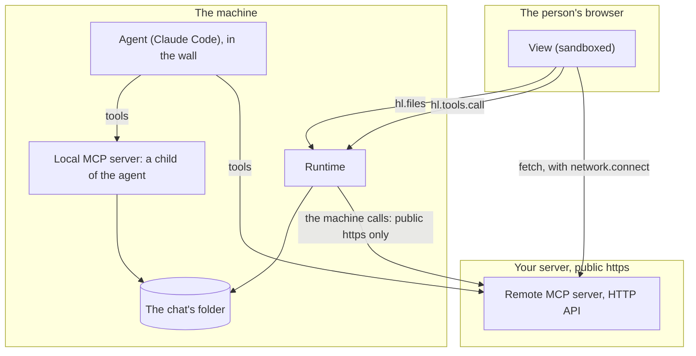
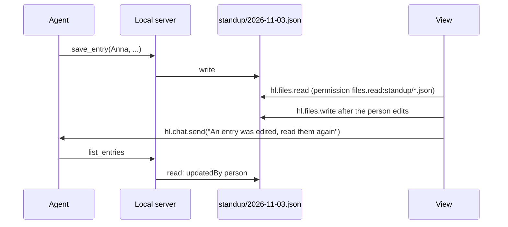

# Backend: where your code runs

**The host runs no server for an app.** There is no process it starts, supervises or proxies. An app that needs code beyond the browser
has three places to put it, and each reaches different things. Choose by who has to call it.



## Choose

| You need | Do this | Tier |
| --- | --- | --- |
| The agent to use a public API | A remote server in `.mcp.json` | `declarative` |
| A view to call that same server | `hl.tools.call('server.tool', args)`, public https, no secrets | `declarative` or `sandboxed` |
| A view to call your own API directly, with tokens of its own | `network.connect` and `fetch` | `sandboxed` |
| Pictures or fonts from a CDN | `network.resources` | `sandboxed` |
| A whole page from your server | `entry: "https://…"` with `network.frames`. It has no bridge and no SDK session | `sandboxed` |
| The agent to run a local program | A `command` server in `.mcp.json` | `trusted` |
| Data shared by that program and a view | Files of the chat's folder | `trusted`, `files.*` |
| A value stored per person, seen by a view and the agent | `hl.storage.chat` and `app.data_*` | any |
| A secret for the agent | `harnessly secret`, see [Agents](05-agents.md#secrets) | any |
| A secret per install, handed to a view or a server | **Not supported** | |

## A remote MCP server

```json
{
  "mcpServers": {
    "bank": {
      "type": "http",
      "url": "https://bank.example.com/mcp",
      "headers": { "x-app": "cashback" }
    }
  }
}
```

The agent gets its tools from Claude Code at launch. A view reaches the same tools:

```js
const res = await hl.tools.call('bank.get_categories', { month: '2026-11' });
if (res.isError) throw new Error(res.content?.[0]?.text);
```

What `hl.tools.call` does:

- **The machine makes the call, not the browser**, so it refuses to be a way into the person's network. It resolves the name and checks the address: `https://`
  and a public address only. Loopback, private ranges, link-local and carrier-grade NAT (`100.64.0.0/10`) are `network_denied`; other schemes and `command` servers are `policy_blocked`. No
  proxy, no redirects.
- Each call is a new connection: `initialize`, `notifications/initialized`, `tools/call`. 30 s overall, a 4 MB answer, JSON or an event stream.
- **A header containing `${` is not sent** on this path. Literal headers are, and anyone holding the package reads them. So a view's call cannot carry a per-person secret: authorize by what your
  server knows, or by a token the person signs in for (below). In the agent's use of the same server, `${VAR}` is Claude Code's expansion from its environment.
- You get the raw MCP result. `isError: true` is not an error of the call: check it.
- Failures arrive as a word only: `host_unavailable` for unreachable and timeout, `policy_blocked` for refusals and a JSON-RPC error.

A minimal server, no dependencies, is in [`standup/remote-server-example/server.mjs`](../apps/standup/remote-server-example/server.mjs). It was run against a hand-written
client and Claude Code. It speaks stateless Streamable HTTP, one JSON-RPC message per POST:

```text
POST /mcp  initialize                  200 application/json, protocolVersion, capabilities.tools
POST /mcp  notifications/initialized   202, no body
POST /mcp  tools/list                  200, the tools with inputSchema
POST /mcp  tools/call                  200, { content: [{ type: "text", text }], structuredContent? }
GET  /mcp                              405 (no event stream is required)
```

## A view calling your API with fetch

```json
"trust": "sandboxed",
"network": { "connect": ["api.example.com"] }
```

The browser makes this call, so the machine's address rules do not apply, and a person's internal host works if their browser can reach it. The frame's origin is opaque, and this was tested in Chromium:

- Every request carries **`Origin: null`**. Without CORS headers the fetch fails.
- `Access-Control-Allow-Origin: *`, or echoing `null`, works. `Authorization` and JSON bodies cause a preflight: answer `OPTIONS` too, and put the header on the real response as well.
- `credentials: 'include'` fails with `*`. It works with `null` echoed, `Access-Control-Allow-Credentials: true` and a cookie with `SameSite=None; Secure`, but browsers that block third-party cookies drop it (Safari and Chrome's blocking were not tested).

**Use a bearer token.** Let the person sign in on your site, have them paste or receive a token, and keep it in `hl.storage.user`. Then only your app's views can read it.

```js
const token = await hl.storage.user.get('token');
const res = await fetch('https://api.example.com/standup', { headers: { Authorization: 'Bearer ' + token } });
```

Allowing `Origin: null` means any sandboxed page may call you, so the token has to be what authorizes a request, not the origin.

## A local program

```json
{
  "mcpServers": {
    "standup": { "command": "node", "args": ["${CLAUDE_PLUGIN_ROOT}/backend/server.mjs"] }
  }
}
```

This needs `"trust": "trusted"`. The trusted tier is installed by hand by each person, and is in no catalog. All of the following was observed with a real agent:

- **Claude Code starts it**, as a child of the agent, for the life of that launch. harnessly neither starts nor supervises it, so it does not run when no agent does. When it crashes, its tools are gone until the agent restarts.
- `${CLAUDE_PLUGIN_ROOT}` expands to the package's folder.
- **Its working folder is the chat's folder.** So `./standup/` in the server is `standup/` in `hl.files`. That folder is the one the chat was started in: chats started in one folder share these files, and a chat in another folder or a worktree has its own.
- **It runs inside the wall** in a chat with apps. It can write the chat's folder and cannot write its own package. The app's storage and the safe's files are not there.
- It inherits the agent's environment, including `HARNESSLY_CLI_TOKEN_FILE`, the launch's confined token: what the agent may do through the runtime, such as `harnessly secret run`, your program and its dependencies may too. Vet them as you would the agent.
- **A view cannot call it**: `hl.tools.call` is `policy_blocked`, and it has no port. Share data through files:



- `hl.files.read` of a file that does not exist rejects with `invalid_params`, as does text it cannot read. Treat that as «no data yet».
- **Put no file content into `hl.chat.send`.** The agent reads that message as the person's words, so a name from a file could give it instructions. Send fixed text, and have it read the data through a tool.
- **The rules belong in the server.** `instructions.md` asks; the program decides. In the example, `save_entry` refuses to empty an entry, and refuses an entry the person edited unless it is given the `updatedAt` the agent read.
- Neither side locks. If both write in the same instant, the last one wins: read just before you write, and keep each write small.

A local server could open a port of its own and be listed in `network.connect`, but it lives only while the agent does, so a view would find it gone. Prefer files.

## Cards from a tool

A tool of your own server can name a card:

```json
{ "_meta": { "ui": { "resourceUri": "ui://acme.thing/card" } }, "data": { "date": "2026-11-03" } }
```

**Today the feed reads this from the agent's transcript, where a result is only the first line of its text, cut at 100 characters.** So the whole answer has to be one line of JSON under 100 characters, in the
tool's `text`: pass an id or a date, and have the card read the rest from a file or storage. Longer data shows no card. The view reads it as `hl.context.data`.

## Secrets, once more

| Where | Today |
| --- | --- |
| Manifest `secrets` | Nothing reads them |
| A header with `${VAR}`, agent's use | Claude Code expands it from the agent's environment |
| A header with `${VAR}`, `hl.tools.call` | The header is not sent |
| The agent | `harnessly secret run --env VAR=name -- command` |
| A view | A token the person gave it, in `hl.storage.user` |
| A local server | It inherits the agent's environment, and may run `harnessly secret run` like the agent. Not tested from inside the runtime's wall |

Next: [the worked example](08-worked-example.md).
