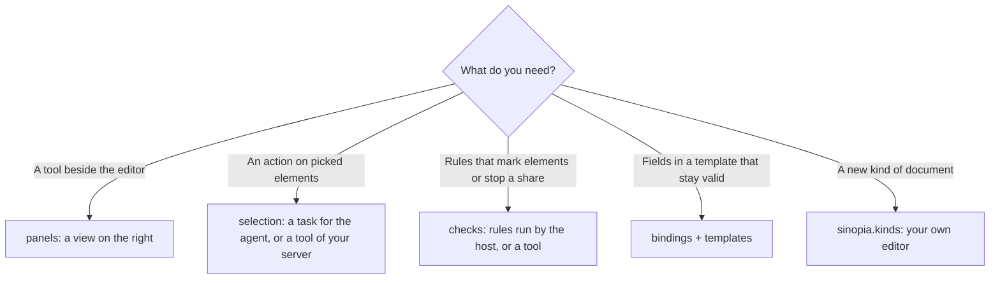
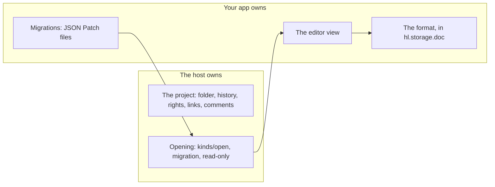

# Sinopia: apps inside documents

An app can work inside the documents of Sinopia (sites `site`, presentations `slides`, video `video`, design systems `ds`), add panels,
checks and selection items, or add a whole type of document. The [reference](../apps.md#sinopia) has every field.

## Choose what to add



## Turn it on in documents

```json
"targets": ["sinopia.slides"],
"activation": { "on": ["document"] }
```

`document` is the working value of `activation.on`: the app is on in every document of the kinds it targets. `sinopia.*` is all the host's
kinds (not the kinds apps add). The views need the same target.

## A panel and a check, no server

The whole of [`deck-lint`](../apps/deck-lint) is this:

```json
"permissions": ["sinopia.read"],
"views": [{ "id": "panel", "entry": "ui/panel.html", "targets": ["sinopia.slides"] }],
"sinopia": {
  "panels": [{ "id": "lint", "view": "panel", "title": "Check" }],
  "selection": [{ "id": "shorten", "title": "Shorten", "agent": "Cut the text in half" }],
  "checks": [{
    "id": "deck", "on": ["save", "share"], "blockShare": "error",
    "rules": [{ "id": "wordy", "select": "p", "level": "error", "maxWords": 30, "message": "{n} words, the limit is {limit}" }]
  }]
}
```

- A check runs when the boards change (`save`) and when the document is shared or published (`share`). A finding marks the element.
  `blockShare` (`error` or `warning`) is the level from which the share and publish buttons show the findings instead of opening.
- A rule has one limit: `maxWords`, `maxChars` (the element's own text) or `minFontPx` (its inline `font-size`). `when` is not evaluated yet.
- A check or selection item can instead call `<server>.<tool>` of your server, and that server **must be listed in `agent.mcp`**: this is
  the one thing that field is for. The tool must be remote and https, because the machine makes the call. It answers
  `{findings: [{node, level, message, rule?, fix?}]}`.
- The share gate is the editor's: a link given by a gateway or a public address is not stopped by it.

## The Document API

The same for a view and for the agent (`app.sinopia.*`). It works on documents with `meta/` and `.dc.html` boards.

| View | Agent's tool | Permission | What it does |
| --- | --- | --- | --- |
| `document()` | `sinopia_document` | `sinopia.read` | Kind, title, boards, revision |
| `selection()` | `sinopia_selection` | `sinopia.read` | What the person picked, up to 50 |
| `node(id)`, `query(selector)` | `sinopia_node`, `sinopia_query` | `sinopia.read` | Elements, up to 500; text clipped at 300 characters |
| `fields()` | `sinopia_fields` | `sinopia.read` | Bound fields with values |
| `mark(nodes, opts)` | `sinopia_mark` | `sinopia.read` | Marks on the board |
| `patch(ops)` | `sinopia_patch` | `sinopia.write` | `setText`, `setStyle`, `setAttr`, `insert`, `remove`, `setField`: all or none, one history entry |
| `setFields(patch)` | `sinopia_set_fields` | `sinopia.write` | Bound fields, checked against the schema |
| `boards.add(...)` | `sinopia_boards_add` | `sinopia.write` | A board from a template |
| `comment(node, text)` | `sinopia_comment` | `sinopia.comment` | A note on an element |
| `render()` | `sinopia_render` | `sinopia.export` | Not available: `host_unavailable` |

A node carries a fingerprint `fp`: present it in a change and the change is refused if the element moved on. A board another chat holds a
claim on is refused with `policy_blocked`.

## Bindings and templates

```json
"sinopia": {
  "bindings": { "schema": "schema/card.json", "inspector": "inspector", "lockUnbound": true },
  "templates": ["templates/card"]
}
```

```html
<!-- templates/card/board.dc.html -->
<h2 data-hl-field="title">Title</h2>
<a data-hl-field="link" data-hl-attr="href">Open</a>
```

A click on a bound element opens the `inspector` view on that field, and an open one gets the `selection` event. Every written value must
meet the JSON Schema, and `lockUnbound` refuses hand edits of elements with no binding. [`cashback`](../apps/cashback) does this.

## A document type of your own

```json
"targets": ["sinopia.acme.moodboard"],
"permissions": ["sinopia.kind", "sinopia.read", "storage"],
"views": [{ "id": "editor", "entry": "ui/editor.html", "targets": ["sinopia.acme.moodboard"] }],
"sinopia": { "kinds": [{
  "id": "acme.moodboard", "title": "Moodboard", "icon": "ui/moodboard.svg", "editor": "editor",
  "schema": "schema/moodboard.json", "schemaVersion": 2, "dataKey": "board",
  "migrations": { "1": "migrations/1-to-2.json" }
}] }
```



- The name is your app's id, or that with up to two more segments. An app adds at most 8 types, and a name another app holds is refused with
  `kind-taken`.
- `dataKey` names the key of `hl.storage.doc` that holds the document; keep it under 100 KB.
- There is a migration step for every version before the current one, each an RFC 6902 JSON Patch. It runs when the document opens, all or
  nothing, and the old value stays under `<dataKey>@v<N>`. A document that does not fit, or is newer than the app, opens read-only with the
  reason.
- `hl.context.readOnly === true` also comes when the person's role is below edit. The host refuses writes then.
- Without the app, the document stays and shows that it needs the app.
- `guest` is refused at validate: not supported yet.

Copy [`moodboard`](../apps/moodboard).

## A document type made of a Sinopia site

A type may be a Sinopia site with the app's additions instead of an editor of its own: `"extends": "site"` on the type.

```json
"permissions": ["sinopia.kind", "app.extend"],
"sinopia": { "kinds": [{ "id": "acme.proto", "title": "Прототип", "extends": "site", "schemaVersion": 1 }] }
```

- Its documents are site projects: they open in Sinopia's own editor, with the chat's right pane, and the library lists them
  with the type's name as their label (on the card and on the editor's bar). «Новый документ» of the type makes one.
- The address of an app's document (`/designly/doc/<id>`) opens such a document in Sinopia's editor, so a link from anywhere
  lands in its place.
- The app is on in every document of its type (no `activation.on` needed), and only there: its panels, checks and
  selection items name `sinopia.acme.proto`, so they never show in Sinopia's other sites, and no other app's site
  additions show in its documents.
- `editor` is optional. It needs the permission `app.extend`, and the deployment's admin lists the apps that may do it:
  `HARNESSLY_APPS_EXTEND=acme.proto,acme.other` (or `*`) in the runtime's environment. An app not listed offers no such
  type, and its documents say that the admin has not allowed it.
- A view with `"pinned": true` and the target `sinopia.<type>` is the app's tab in the chat's right pane beside every
  document of the type: the pane's first tab, shown when the document opens, never closed, and in no other document.
  It is bound to the document and the chat, like a panel (`hl.context.document`, `hl.workflow`). One per app.

```json
"views": [{ "id": "status", "title": "Статус", "entry": "views/status.html", "targets": ["sinopia.acme.proto"], "pinned": true }]
```

## Statuses of a document

An app whose documents go through stages (a prototype of a mobile screen: draft → on review → approved → in development →
test → released → stopped) names them in the manifest's `workflow`. The host keeps every document's status and its
journal, and checks who makes each move: the app only draws them.

```json
"workflow": {
  "statuses": [
    { "id": "draft", "title": "Черновик", "edit": true },
    { "id": "review", "title": "На ревью", "tone": "info" },
    { "id": "approved", "title": "Согласован", "tone": "success" },
    { "id": "dev", "title": "В разработке" }
  ],
  "transitions": [
    { "from": "draft", "to": "review", "title": "Отправить на ревью" },
    { "from": "review", "to": "approved", "title": "Согласовать", "role": "manage" },
    { "from": "review", "to": "draft", "title": "Вернуть на доработку", "role": "manage" },
    { "from": "approved", "to": "dev", "title": "Взять в разработку" }
  ]
},
"agent": {
  "tools": {
    "when": [{ "status": ["review", "approved"], "deny": ["Edit", "Write"] }]
  }
}
```

- The app needs a `sinopia.<kind>` target. Up to 16 statuses and 64 moves; an id is `a-z0-9-`; `tone` is `neutral`,
  `info`, `warning`, `success` or `danger`.
- `role` is the least project role that makes the move: `view`, `comment`, `edit` (the default), `manage`, `owner`.
- **Versions.** A status belongs to a version of the document: its number and a hash of its content (its pages and what the
  app keeps in `hl.storage.doc`). The first status starts every version and must have `edit: true`. While the current
  status has `edit`, the version follows the changes. A change to a version whose status has no `edit` does not touch it:
  the next version starts, in the first status, and the earlier one keeps its status in `versions`.
- **The view.** `hl.workflow.get()` answers `{version, hash, status, statuses, moves, role, journal, versions}`; each move
  says whether this person's role makes it (`allowed`). `hl.workflow.move(to, {version, hash, note})` makes one: name the
  version the person saw, and a document changed since is refused as `conflict` (read again). A move the role does not
  allow is `permission_denied`. Draw one action from `moves`, and keep the button busy while it runs.
- **The decision and its version.** Every move keeps the project as it was decided on as a named version of Sinopia's
  history («v2 · На ревью», in the editor's «Версии»): the move's journal entry carries it as `rev`, and `link` opens it
  read only. One version of the document keeps one point, and only a person who may edit the project adds it. Who may
  make a move is the transition's `role`, checked by the host.
- **Notifications.** When a person of the project other than the machine's owner makes a move, the owner's devices get a
  push («Анна: «Черновик» → «На ревью», v2») that opens the document.
- **The agent.** The chat the view is in works on that document: its agent is told the status and version at its next
  turn, and `agent.tools.when` adds rules that hold only in those statuses (with no document known, none of them holds).
  A chat that works on several documents of the app keeps each one's status, and the strictest word among them decides.
  The guard reads the status from the launch's own folder, which the agent cannot write. Claude's built-in rules never
  carry them: they are the guard's.
- Under a hub the status lives with the document's storage, in the hub: the same on every machine of the space.
