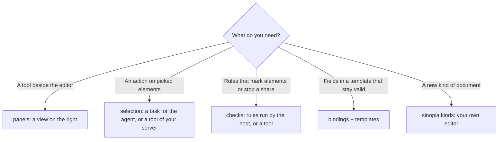
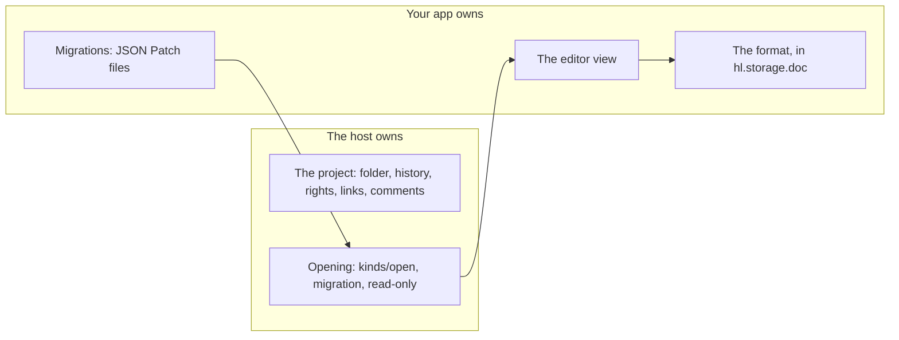

# Sinopia: apps inside documents

An app can work inside the documents of Sinopia (sites `site`, presentations `slides`, video `video`, design systems `ds`), add panels,
checks and selection items, or add a whole type of document. The [reference](../apps.md#sinopia) has every field.

## Choose what to add



## Turn it on in documents

```json
"targets": ["sinopia.slides"],
"activation": { "on": ["document"] }
```

`document` is the working value of `activation.on`: the app is on in every document of the kinds it targets. `sinopia.*` is all the host's
kinds (not the kinds apps add). The views need the same target.

## A panel and a check, no server

The whole of [`deck-lint`](../apps/deck-lint) is this:

```json
"permissions": ["sinopia.read"],
"views": [{ "id": "panel", "entry": "ui/panel.html", "targets": ["sinopia.slides"] }],
"sinopia": {
  "panels": [{ "id": "lint", "view": "panel", "title": "Check" }],
  "selection": [{ "id": "shorten", "title": "Shorten", "agent": "Cut the text in half" }],
  "checks": [{
    "id": "deck", "on": ["save", "share"], "blockShare": "error",
    "rules": [{ "id": "wordy", "select": "p", "level": "error", "maxWords": 30, "message": "{n} words, the limit is {limit}" }]
  }]
}
```

- A check runs when the boards change (`save`) and when the document is shared or published (`share`). A finding marks the element.
  `blockShare` (`error` or `warning`) is the level from which the share and publish buttons show the findings instead of opening.
- A rule has one limit: `maxWords`, `maxChars` (the element's own text) or `minFontPx` (its inline `font-size`). `when` is not evaluated yet.
- A check or selection item can instead call `<server>.<tool>` of your server, and that server **must be listed in `agent.mcp`**: this is
  the one thing that field is for. The tool must be remote and https, because the machine makes the call. It answers
  `{findings: [{node, level, message, rule?, fix?}]}`.
- The share gate is the editor's: a link given by a gateway or a public address is not stopped by it.

## The Document API

The same for a view and for the agent (`app.sinopia.*`). It works on documents with `meta/` and `.dc.html` boards.

| View | Agent's tool | Permission | What it does |
| --- | --- | --- | --- |
| `document()` | `sinopia_document` | `sinopia.read` | Kind, title, boards, revision |
| `selection()` | `sinopia_selection` | `sinopia.read` | What the person picked, up to 50 |
| `node(id)`, `query(selector)` | `sinopia_node`, `sinopia_query` | `sinopia.read` | Elements, up to 500; text clipped at 300 characters |
| `fields()` | `sinopia_fields` | `sinopia.read` | Bound fields with values |
| `mark(nodes, opts)` | `sinopia_mark` | `sinopia.read` | Marks on the board |
| `patch(ops)` | `sinopia_patch` | `sinopia.write` | `setText`, `setStyle`, `setAttr`, `insert`, `remove`, `setField`: all or none, one history entry |
| `setFields(patch)` | `sinopia_set_fields` | `sinopia.write` | Bound fields, checked against the schema |
| `boards.add(...)` | `sinopia_boards_add` | `sinopia.write` | A board from a template |
| `comment(node, text)` | `sinopia_comment` | `sinopia.comment` | A note on an element |
| `render()` | `sinopia_render` | `sinopia.export` | Not available: `host_unavailable` |

A node carries a fingerprint `fp`: present it in a change and the change is refused if the element moved on. A board another chat holds a
claim on is refused with `policy_blocked`.

## Bindings and templates

```json
"sinopia": {
  "bindings": { "schema": "schema/card.json", "inspector": "inspector", "lockUnbound": true },
  "templates": ["templates/card"]
}
```

```html
<!-- templates/card/board.dc.html -->
<h2 data-hl-field="title">Title</h2>
<a data-hl-field="link" data-hl-attr="href">Open</a>
```

A click on a bound element opens the `inspector` view on that field, and an open one gets the `selection` event. Every written value must
meet the JSON Schema, and `lockUnbound` refuses hand edits of elements with no binding. [`cashback`](../apps/cashback) does this.

## A document type of your own

```json
"targets": ["sinopia.acme.moodboard"],
"permissions": ["sinopia.kind", "sinopia.read", "storage"],
"views": [{ "id": "editor", "entry": "ui/editor.html", "targets": ["sinopia.acme.moodboard"] }],
"sinopia": { "kinds": [{
  "id": "acme.moodboard", "title": "Moodboard", "icon": "ui/moodboard.svg", "editor": "editor",
  "schema": "schema/moodboard.json", "schemaVersion": 2, "dataKey": "board",
  "migrations": { "1": "migrations/1-to-2.json" }
}] }
```



- The name is your app's id, or that with up to two more segments. An app adds at most 8 types, and a name another app holds is refused with
  `kind-taken`.
- `dataKey` names the key of `hl.storage.doc` that holds the document; keep it under 100 KB.
- There is a migration step for every version before the current one, each an RFC 6902 JSON Patch. It runs when the document opens, all or
  nothing, and the old value stays under `<dataKey>@v<N>`. A document that does not fit, or is newer than the app, opens read-only with the
  reason.
- `hl.context.readOnly === true` also comes when the person's role is below edit. The host refuses writes then.
- Without the app, the document stays and shows that it needs the app.
- `guest` is refused at validate: not supported yet.

Copy [`moodboard`](../apps/moodboard).
