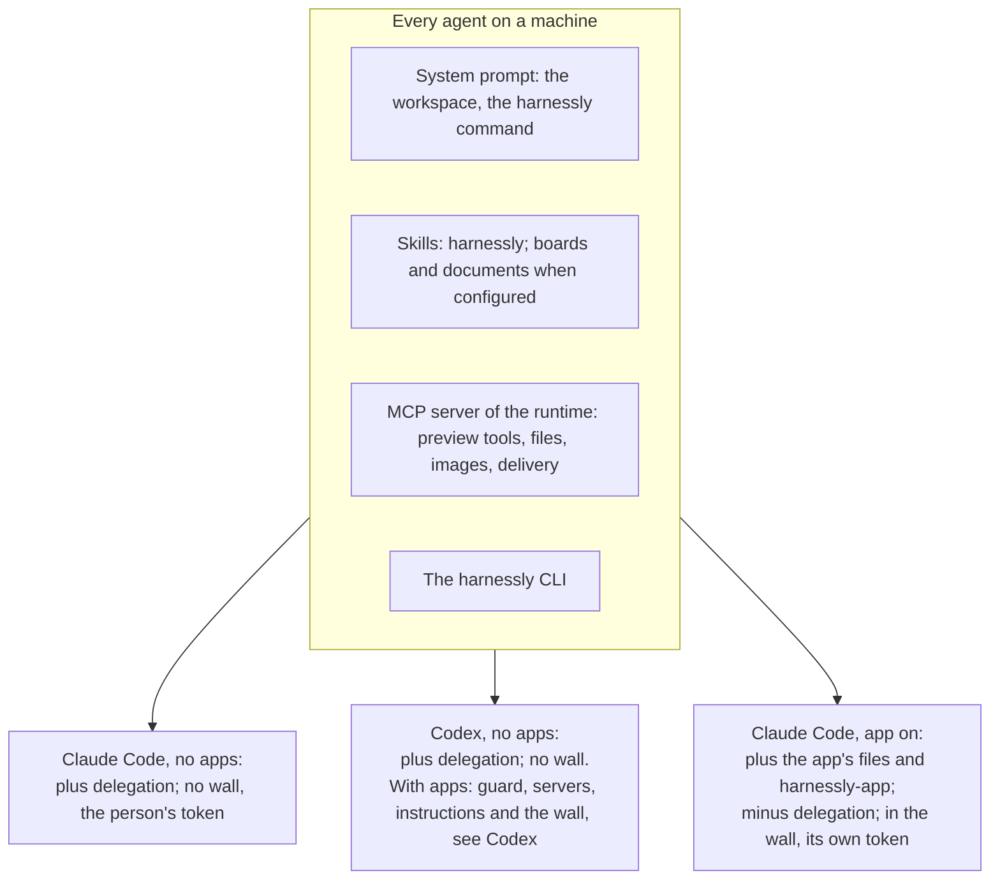
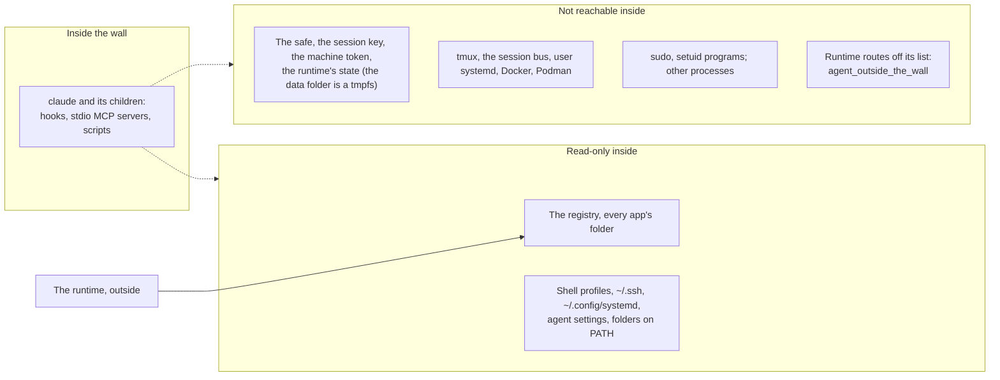

# Agents: what they get, and how an agent writes an app

This page is for two readers: an author deciding what the app's agent can do, and an agent with no memory that was asked to write an app.

## If you are an agent asked to write an app

1. `harnessly app docs` lists this guide. Read `overview`, then the page for your level. `harnessly app docs export ./hl-docs` gives you
   the example packages to copy and search.
2. **Work in a chat with no apps on.** In a chat with any app on, the source folder of every installed app is read-only, and you cannot run
   `app dev`, `install` or `enable`. Check with `harnessly app list` and whether `HARNESSLY_CLI_TOKEN_FILE` is set; if it is, ask the person
   to open a new chat without apps, or write a new folder and hand over the commands.
3. Write the package, then `harnessly app validate DIR --strict`.
4. `harnessly app dev DIR` installs it. Then `harnessly open app:<id>` shows its view to the person.
5. To test the agent side, write `evals/*.json` and run `harnessly app eval DIR`. This starts a real agent in an empty folder. To test it in a
   real chat, ask the person to turn the app on in another chat, or start one with `delegate_task` and run `harnessly app enable` for it.
6. Do not turn the app on in your own chat while you are writing it: from then on your chat cannot edit the source of any installed app.
7. Say what you checked and what you could not: a view's rendering needs a browser.

## What each chat gets



The MCP server is called `harnessly` by default; a deployment can rename it with `RUNTIME_MCP_SERVER`. Its tools:

| Tools | For |
| --- | --- |
| `preview_slots`, `preview_network`, `preview_console`, `preview_server_log`, `preview_get_settings`, `preview_set_throttle`, `preview_block`, `preview_set_cache`, `preview_clear` | DevTools of the page open in the pane |
| `deliver_file` | Handing a file to the person |
| `generate_images`, `wait_images` | Pictures |
| `file_selection`, `file_show` | The file beside the chat |
| `delegate_task`, `read_conversation`, `send_to_conversation`, `wait_conversation`, `list_children` | Another agent. Not in a chat with apps |
| `sinopia_view_*`, `sinopia_frame`, `sinopia_check`, `sinopia_video_render` | Only in a chat working in a video project |

## When the app is on

The person turns an app on in a chat with the row over the field. Two more ways come from `activation.on`:

```json
"activation": { "on": ["always", "command:/tasks"] }
```

- `always`: on in every new Claude chat of the machine, when the person installed the app themselves (a team's app is not). Every such
  chat runs inside the wall, so keep it for a plugin the person wants everywhere.
- `command:/tasks`: a message that starts with `/tasks` turns the app on in that chat first, then goes to the agent. One app per command;
  the agent's own commands (`/clear`, `/model`, ...) are refused by the check.

The commands in `chat.commands` also show up in the `/` palette of the chat's input field, in a group named after the app, with the
description from the `description:` line of `commands/<name>.md`. They are listed while the app is on in that chat. Choosing one puts
`/<plugin>:<name>` into the field, and it goes to the agent like any typed command. A built-in command keeps its name: if an app command
has the same name, the palette lists it as `<plugin>:<name>`.

## Context the app hands the agent

`agent.context` names a tool of the app's own remote MCP server (`"<server>.<tool>"`) whose answer the agent should see:

```json
"agent": { "context": [{ "id": "queue", "tool": "api.queue", "mode": "on-activation" }] }
```

A hook of the chat calls the tool of every `on-activation` item on `SessionStart` and on each `UserPromptSubmit`, and hands the text
to the agent as `additionalContext`, **only when it differs from the last one sent to that chat** (a hash is kept per chat, app and
item). So the conversation carries the context once per change, not once per message. A cleared or new chat gets it again; a resumed
one does not. A tool that fails, answers an error or answers nothing adds nothing and stops nothing. The answer is cut at 16 KB. The
tool takes no arguments. `on-demand` items are checked and not sent.

## Validators: checks of the agent's turn

`agent.validators` runs local scripts, so it needs `trust: "trusted"`: the install and update lists them among the rights (like `hooks/`), and the scripts get only `PATH`, `HOME`, `LANG`, `LC_*`, `TMPDIR` and `HARNESSLY_*` in their environment. It runs a script of the package after a tool call or before the agent ends its turn, and tells the agent what is wrong:

```json
"agent": { "validators": [
  { "id": "tests", "on": "PostToolUse", "match": "Edit", "run": "checks/tests.py", "maxRetries": 3 },
  { "id": "done", "on": "Stop", "run": "checks/done.sh" }
] }
```

- `id`: lower case letters, digits, `-`; unique in the app.
- `on`: `PostToolUse` or `Stop`.
- `match`: a tool mask as in `agent.tools` (`Edit`, `Bash(git *)`, `server.*`); only for `PostToolUse`, empty is every tool.
- `run`: a file of the package. `.py` runs as `python3 -I`, anything else must be executable. It starts in the package folder, gets the hook's JSON on stdin and has 30 s.
- `maxRetries`: 1..10, default 3.

Exit code `0` is a pass. Exit code `2` is a failure: the first 4 KB of stdout is the remark, and the hook answers `{"decision":"block","reason":...}`, so the agent reads it and fixes the work (after a Stop it carries on instead of ending). Any other code, a timeout or a script that cannot start blocks nothing and is written to the hook's stderr.

Failures in a row are counted per chat and validator (a file beside the launch's policy snapshot). After `maxRetries` blocks the next failure is let go: a Stop ends the turn (the count starts afresh), a `PostToolUse` stops blocking until the validator passes once. A pass resets the count. `stop_hook_active` needs no handling in the script: the hook counts the retries itself.

## What the app weighs

Everything in the system prompt is paid for on every turn, so it is counted:

- `instructions.md`: at most 16 KB per app (more fails the check), a warning past 4 KB.
- **The chat's budget** for the instructions of all its apps together is 48 KB (about 12k tokens; a token is estimated as bytes / 4).
  An app that takes the chat past it is **still turned on**: the answer of `harnessly app enable` says so (`warning: ...`), and the person
  decides what to take off.
- The app's page, "About the app", shows `~N tokens of instructions`.
- `harnessly app validate --strict` prints `context weight: ~N tokens per turn` for the package: the instructions, the names,
  descriptions and schemas of the tools of every remote server in `agent.mcp` (the first page of `tools/list`), and the server's own
  `instructions`. Past 16 KB (~4k tokens) it is a warning, which `--strict` fails on. A server that does not answer is a warning too:
  its weight is unknown, not zero.

## Access by kind of chat

| Capability | Claude, no apps | Claude, app on | Codex, no apps |
| --- | --- | --- | --- |
| `app docs`, `new`, `validate` | yes | yes | yes |
| `app list`, `channels`, `shares` | yes | yes | yes |
| `app dev`, `install` | yes | **no** | yes |
| `app enable` in its own chat | yes | **no** | yes |
| `app disable` in a chat with apps | page only (`use-page`) | **no** | page only |
| `app remove`, `promote`, `rollback`, `team`, `share`, `public` (any subcommand, `public list` too), `update` | yes | **no** | yes |
| `app publish --channel dev\|beta` | yes | yes | yes |
| `app publish --channel stable`, `--team` | yes | **no** | yes |
| `app eval` | yes | not tested in the wall | yes (runs Claude Code) |
| `harnessly open app:<id>` | yes | yes | yes |
| Edit the source of an installed or dev app | yes | **no**: any installed app, even one not on here | yes |
| Edit the chat's own files | yes | yes | yes |
| `preview_*` tools | yes | yes | yes |
| Delegation tools | yes | **no** | yes |
| `tab create`, `send`, `close`, `result`, `peers send` | yes | **no** (`agent_outside_the_wall`) | yes |
| `tab list`, `tab status`, `workspaces`, `peers` | yes | yes | yes |
| `deliver`, `notify`, `ask`, `secret`, `design`, `site`, `api-guide` | yes | yes | yes |
| `harnessly-app` tools | no | yes | no |
| The app's instructions, skills, commands, tool rules | no | yes | no |
| Wall | no | yes, where bwrap works | no |

`app eval` uses the person's own Claude Code login. `--agent codex` is not supported yet (it refuses with a message): the scenarios run on Claude Code's print mode and its event stream, and Codex's `exec` has a different one.

## Codex

Apps can be turned on in a Codex chat too. What works there, and how it differs from Claude Code:

| | Claude Code | Codex |
| --- | --- | --- |
| Tool rules (`allow`, `deny`) | the app-guard hook | the same guard and the same rules, as a Codex `PreToolUse` hook |
| `confirm` | the person is asked | **refused**: Codex's hook has no "ask" |
| Instructions | appended to the system prompt | joined to the developer instructions |
| Skills | plugin skills | **a list in the instructions**: the path of each `SKILL.md`, to be read before use |
| MCP servers of the app | the plugin's `.mcp.json` | `mcp_servers.plugin_<app>_<server>` flags; a server with `${secret:}` goes through the runtime's proxy as for Claude |
| Local server that uses a secret | gets the value in a file of the launch | **left out**: a value on Codex's command line could be read by any process of the machine |
| `harnessly-app` tools | yes | no |
| Context items (`agent.context`) | on the start of a turn | not yet |
| Wall, the launch's own token | yes | yes, the same wall |

The differences are deliberate:

- **`confirm` becomes `deny`.** Codex's `PreToolUse` takes only a refusal; an "ask" is dropped and the call goes on, which would turn a
  confirmation into a permission. The agent reads the reason ("Codex has no step where the person confirms a call") and does it another
  way. If a rule must not block Codex, write it as `allow`.
- **Tools are mapped by a table.** Codex's shell tools (`shell`, `shell_command`, `exec_command`, `local_shell`, `unified_exec`) are `Bash` to the
  rules; `apply_patch` is `Edit` and `Write` for every file the patch names (an `Add`, `Update`, `Delete` or `Move to` line); `read_file`,
  `list_dir` and `grep_files` are `Read` and `Grep`; `mcp__<server>__<tool>` keeps its name. Tools that change nothing (`update_plan`,
  `view_image`, `web_search`) are not judged. **A tool the table does not know is refused**, and so is a call whose command or patch
  cannot be read: the guard never lets through what it cannot read.
- **The hooks cannot be edited by the agent.** The guard is a `-c hooks.PreToolUse=[…]` flag of the launch line, first among the hooks, before the
  runtime's and the person's. There is no file in which the agent could remove it. Codex lets a call go on when a hook fails, so the launch
  checks that the guard answers and does not start without one that does.

## The wall

The agent of a chat with apps runs in a mount namespace. Writing a registry file, a package or a source folder fails in the kernel with
«Read-only file system», whatever program does it.

The app guard adds the same rule for the shell: a command that names a package or the registry is refused, unless it only
reads it (`cat`, `ls`, `grep`, `head` and the like) or runs a skill's own script from its package
(`python3 -I <skill folder>/pulse.py KEY`, alone or under
`harnessly secret run --env V=name --`). Write that command with the path spelled out: a line with `$VAR`, `$(…)`, `VAR=x` before a program or a
redirection into the package is refused. A skill that needs more (render a widget, fetch with a secret) does it inside
its script.



This matters for what you ask of an app's agent:

- `npm i -g` into the home folder, changing shell profiles, `sudo` and Docker do not work in a chat with apps. Do that in a chat without apps or
  the person's terminal.
- A local `.mcp.json` program runs inside the wall too. It cannot read app storage or the safe.
- `git` over ssh works, with the person's `~/.ssh/config`.
- A machine without `bwrap`, or with user namespaces refused, starts the chat without the wall and says so: a log warning, the machine check
  `apps_boundary`, a line in «О приложении». What a machine needs is in the [reference](../apps.md#what-keeps-the-agent-out-of-the-apps).
  A deployment that sets `RUNTIME_APPS_REQUIRE_WALL=1` does not start such a chat: it fails with the reason and the command that puts it right.

What stays open, by nature: the agent runs as the person, so it reads the person's files outside the data folder, uses the safe by name and has
the network. `network` in the manifest binds views, not the agent. Code it writes in the project is run later by whoever runs it. A chat without
apps has no wall at all. A Codex chat with apps has the same wall as Claude Code, around the Codex process.

## Secrets

Manifest `secrets` are for your server, not for the agent: the person puts the value in from «О приложении» and the machine fills `${secret:name}` into the server's headers (see [Secrets, once more](03-backend.md#secrets-once-more)). The agent can neither read nor ask for them. For a secret of the agent's own, it asks the safe of the machine by name.

```sh
harnessly secret ask my-api-key --why "the bank API for the cashback app"   # the person puts it in, outside the chat
harnessly secret run --env API_KEY=my-api-key -- ./call-the-api.sh           # the value is in the command's environment, masked in its output
```

Say this in your `instructions.md`. Never ask the person to paste a secret into the chat. A view has no way to get a secret, so a backend a view
calls has to authenticate in another way: see [Backend](03-backend.md).
