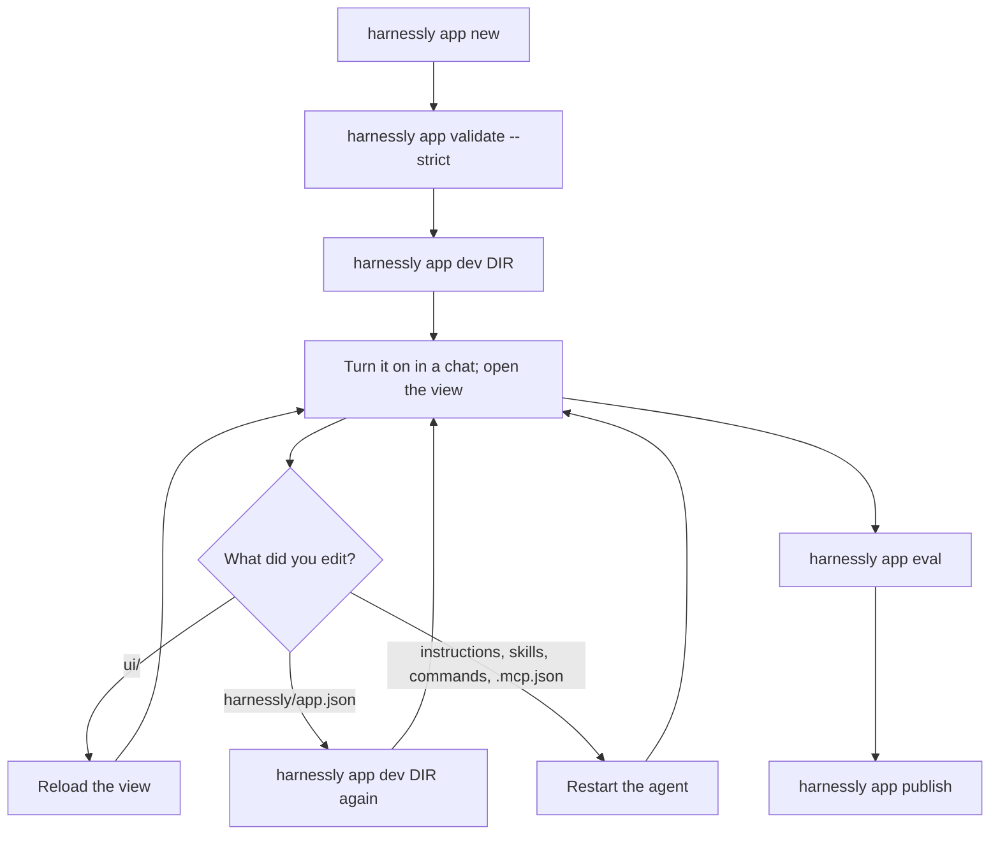

# Debugging: the loop, limits and every error

## The development loop

| You edited | It takes effect | How |
| --- | --- | --- |
| Files in `ui/` | On the next load | The «Отладка» panel's reload, or reopen the tab. Served with `no-cache` |
| `harnessly/app.json`: targets, permissions, views, rules, network, trust | **Only after** `harnessly app dev DIR` again | The manifest is copied into the registry at install |
| `.mcp.json`, for `hl.tools.call` | The next call | |
| `.mcp.json`, for the agent | The agent's next launch | Below |
| `instructions.md`, `skills/`, `commands/` | The agent's next launch | Below |

The agent takes its package at launch. An agent at work keeps what it had. Stop its terminal, and the next message restarts it; or switch the app off
and on in the page. A copy from `app install` never sees later edits: reinstall it.

## Where to look

| Question | Where |
| --- | --- |
| Is the package valid? | `harnessly app validate DIR --strict` names the field |
| Which bridge calls did the view make? Which failed? | «Отладка», for a dev install: under the view in the pane, or in «…» on `/apps/<id>`. Method, right, `ok` or the code, and storage keys per scope |
| Console of the view | The browser's own DevTools: inspect the frame. `preview_console` does not capture a view's console |
| Which of its own files did the view load? | `preview_network` lists them. It does not show bridge calls or the view's `fetch` to other hosts |
| Does the agent have the tools? | Ask it; or `/mcp` in its terminal |
| Was a tool call refused by a rule? | The refusal in the chat names the rule. `harnessly hook app-guard --policy <file>` decides one call by hand |
| Does the machine have the wall? | «Проверка машины» in settings, check `apps_boundary` |
| Why did the install fail? | The command's message, then the [codes](#route-and-cli-words) |

**Testing a view with no chat.** A view session is issued by the page, so a CLI cannot mount a view in a chat. For a headless browser, make a guest
link: `harnessly app share <id> --view <view> --ttl 1d --write`, then drive `/apps/guest/<token>/` with Playwright. The guest has the real SDK, the theme and
`hl.storage`; every other call answers `permission_denied`. So the guest link tests layout and storage, not the chat or files. The view needs the
`app` target.

**Slots.** Each view holds one of the machine's six preview slots, shared with dev servers in the pane. When they run out, the oldest page reloads.

## Machine requirements

- The runtime and `harnessly` on the PATH of the agent's shell, which the runtime links by itself.
- Claude Code with a login for chats with apps and for evals; `tmux` for tabs.
- For the wall: `bwrap`, unprivileged user namespaces (on Ubuntu with AppArmor's restriction, the `bwrap-userns-restrict` profile), and a kernel with Landlock
  (5.13; 6.12 for signal and socket scopes).

## Limits

| What | Limit |
| --- | --- |
| Package | 50 MB, 5000 files (`.git`, `node_modules` skipped); as an archive for a catalog, 16 MB |
| One view file | 10 MB |
| `instructions` | Warning over 4 KB, error over 16 KB |
| Apps per chat | 8 |
| Document types per app | 8 |
| Storage | See [Views](02-views.md#storage). Key 1 to 256 characters |
| `hl.files` | 4 MB a call, text only |
| `hl.tools.call` | 30 s, 4 MB answer, https and a public address |
| Bridge | 60 calls a second per view; no answer in 30 s is `host_unavailable` |
| Message from a view | 20 000 characters; notify 2000; toast and confirm 500 |
| `hl.chat.read` | 200 messages |
| `hl.chat.card` | 20 000 characters of data, 20 cards per chat |
| View session | One hour unused, 12 hours at most, renewed by itself every ten minutes |
| Agent token | 30 days; a resume issues a new one |
| `app.ask` | 10 minutes, 5 open per chat, 2 to 8 options (80 characters), question 300 |
| Guest links | 7 days by default, 30 at most, 500 live; guest storage body 256 KB |
| Sinopia | 50 selected nodes, `query` 500 nodes, text clipped at 300, marks 200 per source and 1000 per project, note 300, checks scan 1500 nodes |
| Stable gate | Eval pass rate at least 0.8 (`--threshold`) |

## Errors a view sees

`HarnesslyError.code`:

| Code | Means | Do |
| --- | --- | --- |
| `permission_denied` | The right is missing; the app is off in this chat; a protected file; a document opened read-only | Add the permission, then `app dev` again. Turn the app on. Check the mask |
| `not_in_target` | The view's target is not in the app's `targets`, or `open` refuses the view there | Fix `targets` and `views[].targets` |
| `policy_blocked` | No such server in your `.mcp.json`; the server is not https; the remote tool's JSON-RPC error; a board another chat holds | A view cannot call a `command` server: see [Backend](03-backend.md) |
| `network_denied` | The tool's address is not public | Use a public https address, or ask the admin to list the host in `RUNTIME_APPS_INTERNAL_HOSTS` |
| `host_not_allowed` | The server is no `https://` one and no listed internal host | Use https |
| `tls_untrusted` | The server's certificate ends in no root the machine trusts | The admin adds the organization's root with `RUNTIME_APPS_CA_FILE` |
| `upstream_error` | The server answered an HTTP error or no JSON-RPC | Look at the server's log |
| `rate_limited` | Over 60 calls a second | Slow down, batch |
| `host_unavailable` | Outside harnessly; no chat; `hl.flow`, `hl.data` and other things not connected; the machine did not answer; the runtime answered `quota`, `not-on`, `failed` | Read the error's message for the word |
| `invalid_params` | A bad argument; an unknown view for a card; data too big | See the limits |

The view gets only the runtime's error word. The longer reason is in the runtime's log.

## Route and CLI words

| Word | HTTP | Means | Do |
| --- | --- | --- | --- |
| `not-on` | 403 | The app is off in that chat | Turn it on from the page |
| `use-page` | 409 | `app disable` from a tab in a chat with apps | The person uses the page's switch |
| `no-chat` | 404 | `app enable` from a tab with no known chat | Run it in the chat's tab, or use the page |
| `agent_cannot_change_apps` | 403 | The agent of a chat with apps tried to change apps | The person does it, or use a chat without apps |
| `agent_outside_the_wall` | 403 | The agent's route is off its list (new tabs, peers, terminal) | Do it outside a chat with apps |
| `kind-taken` | 409 | Another installed app adds this document type | Rename the type |
| `host-version` | 409 | The manifest's `harnessly` range excludes this host, **or** another installed app has the same plugin name (`a.b-c` and `a-b.c`) | Check `harnessly --version`, then the names |
| `invalid` | 422 | The package has errors; `problems` lists them | `app validate --strict` |
| `bad-request` | 400 | The body is not exactly the expected JSON | |
| `not-found` | 404 | The app is not installed | |
| `unsupported` | 409 | Apps asked for a Codex chat | Use a Claude Code chat |
| `changed` | | A public entry changed after it was shown | Look again, then install |
| `bad-answer`, `no-copy`, `conflict` | 400, 409, 409 | An `ask` answered with a non-option; a document copy; a write conflict | |

## Common surprises

| You see | Because |
| --- | --- |
| The view's own `fetch('data.json')` or font is 401 | The opaque origin sends no cookie with CORS-mode loads: use a classic script that sets a global |
| Edits to permissions change nothing | Run `app dev` again |
| The agent says the tool is missing | It started before the edit: restart it. Then check `.mcp.json`, and for an eval that the case mocks that server |
| `Edit(docs/*)` does not stop an edit | Claude sends absolute paths, and `Edit` does not cover `Write` |
| An `allow` rule does not stop the prompts | `allow` grants nothing |
| `hl.tools.call` to a local server is `policy_blocked` | Only public https remote servers: see [Backend](03-backend.md) |
| `host-version` on an example | Its range is above your host: check it |
| A tool's card does not appear | Its answer is not JSON with `_meta.ui.resourceUri`, is over 64 KB, or the tool is not from the app's own server: see [Backend](03-backend.md#cards-from-a-tool) |
| `app dev` added `.claude-plugin/plugin.json` | The install writes it into your folder: commit it |
| `.harnessly/` appeared in the package | `app eval` writes its report there: add it to `.gitignore` |
| The view's styles flash at load | There are no tokens before `connect`: give defaults |
| The agent cannot edit its own app | It is in a chat with an app on: see [Agents](05-agents.md) |
