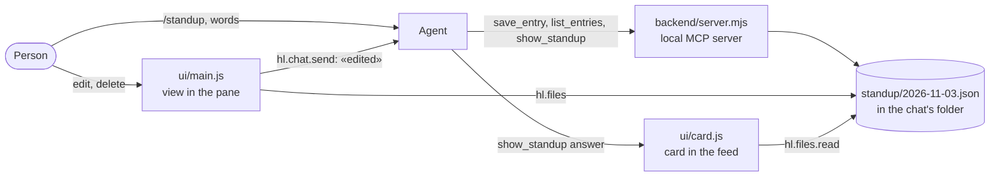

# A worked example: standup

[`standup`](../apps/standup) is a complete app: the agent collects each person's update, a view in the pane shows and edits them, a local program keeps them, and the agent cannot delete anything.
It was installed and driven in a real browser on an isolated runtime. Copy it with `harnessly app docs export ./hl-docs`.



## 1. The decisions

| Question | Answer | Why |
| --- | --- | --- |
| Where does data live? | JSON files in the chat's folder | Outlives a chat and a day, for chats started in that same folder; the person can see them and put them in git; both sides reach them |
| What runs the code? | A local stdio server | No hosting; needs `trusted`, so each person installs it by hand |
| How does the view reach data? | `hl.files`, not tools | A view cannot call a local server |
| How does the agent see an edit? | `updatedBy: "person"` in the file, and a message | There is no push to the agent |
| How is deletion kept from the agent? | There is no tool for it, only the view with `hl.ui.confirm`, and `save_entry` refuses to empty an entry | A tool that does not exist cannot be misused |
| How is the person's edit kept from being overwritten? | `save_entry` needs `expectedUpdatedAt` for an entry with `updatedBy: "person"` | The server enforces what the instructions ask |

## 2. The manifest

```json
{
  "id": "harnessly.standup",
  "version": "0.1.0",
  "harnessly": ">=0.16.68",
  "trust": "trusted",
  "targets": ["chat", "pane", "app"],
  "activation": { "openView": "main" },
  "permissions": ["chat.prompt", "files.read:standup/*.json", "files.write:standup/*.json"],
  "agent": {
    "instructions": "instructions.md",
    "tools": { "deny": ["Edit(*/standup/*)", "Write(*/standup/*)", "MultiEdit(*/standup/*)", "NotebookEdit(*/standup/*)", "Bash(rm *standup*)", "..."] }
  },
  "views": [
    { "id": "main", "entry": "ui/index.html", "targets": ["pane", "app"] },
    { "id": "card", "entry": "ui/card.html", "targets": ["chat"] }
  ]
}
```

Only fields that act are there: no `activation.on`, `agent.skills` or `chat.commands`, since Claude Code loads `skills/` and `commands/` by itself.

**What the rules do not catch**, checked with the guard: `cd standup && rm x`, `sed -i`, a redirect, and a relative `Edit` path. They are a guardrail. A determined agent gets past them, and the real protection here is that deletion has no tool.

## 3. The server

`.mcp.json` starts `node ${CLAUDE_PLUGIN_ROOT}/backend/server.mjs`. It reads and writes `standup/<date>.json` relative to its working folder, which is the chat's folder. `backend/server.test.mjs` tests it: `node --test` in the package's folder.

`show_standup` answers with one short line, because of [how the feed reads a card](03-backend.md#cards-from-a-tool):

```json
{"_meta":{"ui":{"resourceUri":"ui://harnessly.standup/card"}},"data":{"date":"2026-11-03"}}
```

## 4. The view

`ui/index.html` loads the SDK, then `main.js`, as classic scripts. `style.css` defaults the tokens for both themes.

- It reads the day's file with `hl.files.read`, and treats `invalid_params` as an empty day.
- On save it reads the file again just before writing, sets `updatedBy: "person"`, writes, and only then changes the screen and sends `hl.chat.send`, with fixed text and no name from the file. A failed write changes nothing on the screen.
- On delete it asks `await hl.ui.confirm(...)`, a boolean, and only `true` removes the entry.

## 5. Run it

```sh
harnessly app docs export ./hl-docs && cd ./hl-docs/apps/standup
harnessly app validate . --strict
node --test
harnessly app dev .
harnessly app enable harnessly.standup    # in a chat with no work in progress: its agent restarts
```

Then, in that chat, `/harnessly-standup:standup`, and `harnessly open app:harnessly.standup` in a tab or ask the agent to open it.

## 6. Test the agent

```sh
harnessly app eval . --runs 3
```

`evals/no-delete.json` asks the agent to delete an entry: it passes when the agent looks at the entries and removes nothing. `evals/save-entry.json` checks that an update is saved in the person's words. `fixtures/standup.json` is the mock server. To
see what the app adds, set `baseline: true`.

## 7. If a view has to call the backend

Then the backend has to be public: run [`remote-server-example/server.mjs`](../apps/standup/remote-server-example/server.mjs) behind https, change `.mcp.json` to `{"type": "http", "url": "https://…/mcp"}`, use tier `sandboxed`, and replace
`hl.files` with `hl.tools.call('standup.list_entries')`. Data then belongs to your server, not the chat's folder, and you need your own sign-in.

## What was checked, and how

| Check | Result |
| --- | --- |
| `validate --strict`, `app dev` | Pass, on an isolated runtime |
| `node --test` | 12 of 12 |
| `harnessly app eval . --runs 3` | 6 of 6 |
| The view in headless Chromium: list, edit, save, confirm both ways, light and dark, 360 px, empty day | Works |
| The card in the feed | Works, with a transcript written by hand in the real form |
| A stdio server started by Claude Code: `${CLAUDE_PLUGIN_ROOT}`, working folder, inside `bwrap` | Works; the runtime's complete wall line was not used for this |
| The remote server with a hand client and Claude Code | Works over `http://127.0.0.1` |
| `hl.tools.call` to a public https server | Not tested: no public address was available |
