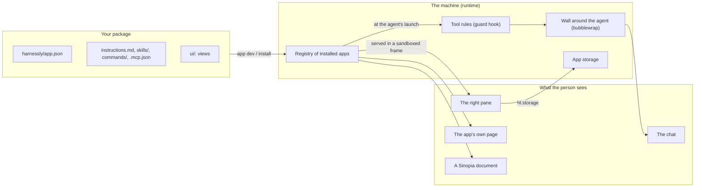
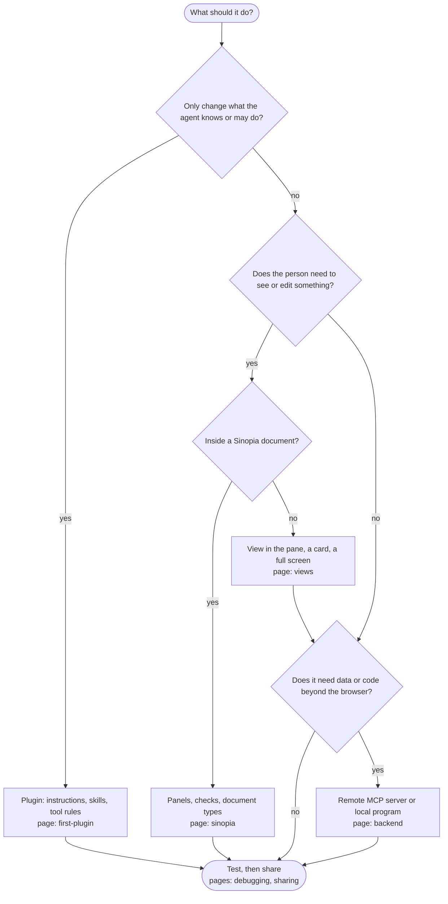

# Build apps and plugins

This guide takes you from an empty folder to a published app: a plugin that only changes how the agent works, a view in the
right pane, a full screen of its own, a backend, a Sinopia document type. Every statement here was checked against the code of
this version, and each page says plainly what does not exist yet.

Reading on a machine? The guide is built into the binary, and needs no network and no source checkout:

```sh
harnessly app docs                # the pages
harnessly app docs views          # one page
harnessly app docs export ./docs  # the pages and the example packages in a folder, to search and copy
```

## What an app is

An app is a folder: a Claude Code plugin plus one manifest, `harnessly/app.json`. A **plugin** is an app with no views. You turn
it on where you work, and only there.



Two sides of an app never meet directly. The **agent side** (instructions, skills, MCP servers, tool rules) is read when the
agent starts. The **view side** (`ui/`) runs in the person's browser in a sandbox. They share data through the chat, the app's
chat storage and files of the workspace.

## Which page do I need

Climb only as far as your idea requires. Each step adds to the one before it.



| Level | You write | Trust tier | Example |
| --- | --- | --- | --- |
| 1. Plugin | `instructions.md`, a skill, a command, tool rules | `declarative` | [`mr-review`](../apps/mr-review) |
| 2. View | Level 1 + HTML and JS in `ui/`, chat storage | `sandboxed` | [`cashback`](../apps/cashback) |
| 3. Full screen and cards | The same view with the `app` target, a view with the `chat` target | `sandboxed` | [`cashback`](../apps/cashback), [`standup`](../apps/standup) |
| 4. Backend for the agent and views | `.mcp.json`: a remote server, or a local program | `declarative` or `sandboxed` for remote, `trusted` for local | [`standup`](../apps/standup) |
| 5. Sinopia additions | Panels, selection items, checks, bindings | `sandboxed` | [`deck-lint`](../apps/deck-lint) |
| 6. A document type of your own | An editor view, a JSON Schema, migrations | `sandboxed` | [`moodboard`](../apps/moodboard) |

## The pages

0. [From zero to a working view in 5 minutes](00-five-minutes.md): `app new`, `dev`, the first view, and the Vite + React recipe.
1. [Your first plugin](01-first-plugin.md): the package, the manifest, instructions, skills, commands, tool rules.
2. [Views](02-views.md): UI in the pane, cards, a full screen, the SDK, theme tokens, storage, files.
3. [Backend](03-backend.md): what can run where, and which way to choose. There is no host-run server.
4. [Sinopia](04-sinopia.md): panels, checks, selection items, bindings, document types.
5. [Agents](05-agents.md): what an agent gets in each kind of chat, and how an agent writes an app without tripping the wall.
6. [Debugging](06-debugging.md): the development loop, what is picked up when, limits, every error code.
7. [Sharing](07-sharing.md): versions, channels, the team's catalog, the public catalog, links, evals as a gate.
8. [A worked example](08-worked-example.md): `standup` from start to finish.
9. [Compatibility](09-compatibility.md): what stays stable across updates.
10. [Sign-in](10-auth.md): who calls your backend — the platform token, corporate SSO, OAuth, and every refused sign-in.
11. [An existing site](11-existing-site.md): the agent drives your admin panel — the loader line, state, action, screen, the answer and its issues.
12. [Notices](12-notices.md): ask the person in the smart notice — choice, confirm, field, code, a view of your own; never secrets.

The [reference](../apps.md) has every field and every call.

## What is not built

Some fields pass `harnessly app validate` and do nothing. Do not design around them. The tools for working around each are
in the pages above.

| Thing | State |
| --- | --- |
| Manifest `backend.url`, `storage`, `activation.template`, `views[].height` | Checked, unused |
| Manifest `when` | Refused: a condition is set on tool rules by the document's status, `agent.tools.when` ([Statuses](04-sinopia.md#statuses-of-a-document)) |
| `activation.on`: `manual` | Checked, turns nothing on (`view` is refused). `document`, `always`, `command:/x` and `openView` act |
| `agent.skills`, `agent.flow`, `agent.exclusive` | Checked, unused. Claude Code loads all of `skills/` whatever the list says |
| `agent.context` | Items with `mode: on-activation` are sent (see [Agents](05-agents.md#context-the-app-hands-the-agent)); `on-demand` is checked, not used |
| Events `tool-result`, `tool-input` | Not sent by the page: the event never comes. The `data` event comes to a chat view shown as a widget |
| `hl.flow.*`, `hl.data.*` | Removed from the SDK: a call rejects with `invalid_params` |
| `hl.sinopia.render()` | `host_unavailable` |
| A tab of the app pinned in the pane beside its document | A view with `pinned: true` on `sinopia.<type>` of a type made of a site ([04](04-sinopia.md#a-document-type-made-of-a-sinopia-site)) |
| A link to the decision on a version, notifications of a move | `journal[].rev` and `link` of `hl.workflow.get()`, a push to the machine's owner ([04](04-sinopia.md#statuses-of-a-document)); not to people on other machines |
| Permission `users.read` | Accepted, no call needs it |
| A server process run by the host | Does not exist. See [Backend](03-backend.md) |
| Apps in Codex chats | Refused (`unsupported`). A Codex agent can still write and check an app |
