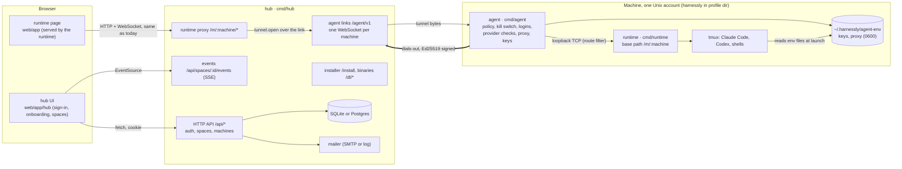

# The hub

The hub is the server people sign in to. It knows accounts, spaces (teams), the machines a space connected and which
agents are ready on them, and it carries a person's browser to the runtime of a machine. It does not run agents and
does not keep conversations: agents, code, transcripts and every agent login stay on the machines.

It is one static Go binary, `cmd/hub`, in this repository (Apache-2.0, `CGO_ENABLED=0` like the rest). The same binary
runs a self-hosted installation and the public cloud; what differs is configuration ([OSS and cloud](#oss-and-cloud)).

The exact contract (every endpoint, frame and variable) is [api.md](api.md); who builds what is [plan.md](plan.md).

## Components

| Part | Where | Job |
| --- | --- | --- |
| hub | `cmd/hub`, `internal/hub/...` | accounts and sign-in, spaces and invites, machine registry, agent links, the runtime proxy, the installer and binaries, the hub UI's files |
| hub UI | `web/app/hub`, built into `web/dist-hub`, embedded into the hub with the `hubui` tag | sign-in, the onboarding of the mockup «Инициализация», a space's home and settings |
| agent | `cmd/agent`, `internal/agent` | unchanged link protocol v1, plus protocol 2: registration, signed dial, preflight with disk and RAM, agent install, logins, provider checks, proxy, sealed keys, runtime sessions, local policy and kill switch |
| runtime | `cmd/runtime` | unchanged; started by the installer under the base path `/m/<machine id>` with `RUNTIME_HUB_URL` set |
| installer | `deploy/install/install.sh`, served by the hub at `/install` | downloads the binaries from the hub, sets up the profile, registers the machine, starts the services |

## How the pieces talk

### Browser ↔ hub

The hub UI is a single-page app the hub serves for every UI route ([api.md, UI routes](api.md#ui-routes)). It calls
`/api/*` with the session cookie and listens to one Server-Sent Events stream per open space for live changes
(machine online, install steps, a login link appearing). Every resource the stream announces also has a GET, so a lost
stream costs a refetch, never a wrong screen.

### Hub ↔ machine agent

The machine dials the hub: one outbound WebSocket (`wss://<hub>/agent/v1`) per agent, kept by the agent with the
existing back-off (pause up to 5 s, ping every 15 s, 45 s of silence drops it). No inbound port, works behind NAT. The
frames are protocol v1 as it is today (request with `id` → one response, events without `id`, tunnel bytes as binary
frames); protocol 2 only adds operations and events ([api.md, agent link](api.md#agent-link-protocol-2)).

The hub keeps the links in memory, one per machine; a second connection of the same machine replaces the first
(close code 4011). That makes the hub **one replica**, as the closed cluster's gateway is today. Several replicas need a
link directory (who holds which machine) and a hop between replicas; that is after launch.

### Reaching a runtime through the hub

A person opens a machine from the hub UI; the page they get is the runtime's own page, the same one `make run` serves,
carried through the hub:

1. The browser asks `GET /m/<machine>/...` (path mode) or `https://<machine>.<runtime domain>/m/<machine>/...`
   (subdomain mode, below).
2. The hub checks the hub session (or the runtime-origin cookie) and that the person is a member of the machine's
   space.
3. It asks the agent once for a **runtime session** (`runtime.session`): the agent signs a page-session token with the
   runtime's own pair secret, exactly the token a password sign-in would give, valid 12 h. The hub caches it per
   person × machine and never stores it.
4. Each request goes through a tunnel (`tunnel.open`, target `runtime`) as plain HTTP/1.1, WebSocket upgrades included.
   The hub replaces the browser's `Cookie` header with the runtime cookie only, drops `Authorization`, sets
   `X-Forwarded-Host`/`-Proto`, and removes any `Set-Cookie` for the runtime cookie from the answer. The browser never
   holds a runtime token.
5. The runtime serves under `RUNTIME_APP_BASE_PATH=/m/<machine>` (set by the installer), so no path is rewritten, and
   its same-origin guard (`internal/sameorigin`) holds because the browser talks to one origin.

On the machine the tunnel does not land on the runtime's port directly: the agent passes it through a small HTTP filter
that enforces the local policy's route rules (terminal off, denied prefixes) before proxying to `127.0.0.1:RUNTIME_PORT`.
With the terminal off it is deny-by-default for writes: only a list of routes passes, with the body read as the runtime
reads it. A policy file the agent's account can write can only narrow the policy while the agent runs.

**Origins.** A runtime page runs the machine's JavaScript. Served on the hub's origin it could call the hub API with the
person's cookie, so a compromised machine could act as the person in the hub. Two modes:

- **Subdomain mode** (`HUB_RUNTIME_DOMAIN=run.example.net`, the cloud's mode and required there, needed for anything
  shared): each machine gets its own origin `https://<machine id>.run.example.net`. The hub UI opens a machine through
  `GET /api/machines/<id>/open`, which returns a URL with a one-minute, single-use ticket; the runtime origin trades it
  for its own host-only cookie (`__Host-hl_run` on https, `hl_run` otherwise; 12 h, `SameSite=Strict`) and answers with a page that refreshes into the clean
  URL (not a 302: a browser holds the origin that began a navigation against every request of its redirect chain, and a
  Strict cookie would not go with the redirect). Machines are isolated from the hub and from each other. Needs a wildcard
  DNS record and a wildcard certificate, and the domain should be a registrable domain of its own: the origins of one
  registrable domain are the same *site*, cookies travel between them and a page of one may set cookies for all of them
  (`SameSite=Strict` does not tell siblings apart). `config.Load` checks it with the public suffix list
  (`golang.org/x/net/publicsuffix`): a machine domain on the hub's registrable domain is a warning (log and
  `check-config`), the cloud edition refuses to start with one unless `HUB_ALLOW_SAME_SITE_RUNTIME=1`, and a domain that
  is a parent of the hub's host is refused everywhere. Because the same-site case cannot be closed, every cookie the hub
  sets on https is `__Host-` prefixed (`__Host-hl_session`, `__Host-hl_oauth` for the OAuth state, `__Host-hl_run`;
  Secure, `Path=/`, no `Domain`): a browser keeps such a cookie only when the host itself set it, so a sibling machine
  cannot fix a state or a machine session in a person's browser (session fixation, login CSRF), and the hub never reads
  the plain name on https. The next paragraph covers the rest.
- **Path mode** (default when `HUB_RUNTIME_DOMAIN` is empty, refused by the cloud edition): `/m/<machine>/` on the hub's
  origin. For single-host and small setups where the machines are trusted as much as the hub; the hub logs it at start,
  `check-config` prints it, and the docs say so. The hub enforces the trust it asks for: in this mode `proxy.admit` and
  `GET /api/machines/<id>/open` refuse (403 `machine_untrusted`, with the explanation to set `HUB_RUNTIME_DOMAIN`) every
  machine whose creator (`machines.created_by`) is not an instance administrator, as `adminFor` computes it, however
  open `HUB_SIGNUP` is. A member can make a space and a machine and invite an administrator in; without this the
  machine's script would act as that administrator on the hub's origin. It cannot be sandboxed: a `Content-Security-Policy: sandbox` without
  `allow-same-origin` gives the page an opaque origin, which sends no cookies, and the runtime would not work with it.

**Between pages of the machines' origins.** Every request to a machine's page (both modes) that did not come from the
page itself is refused with 403 `cross_site`: `Sec-Fetch-Site` other than `same-origin`/`none` (else an `Origin` that is
not the machine's), unless it is a GET/HEAD navigation of a whole page (`Sec-Fetch-Mode: navigate` with
`Sec-Fetch-Dest: document`): a person following a link, the hub's button, a redirect from the hub. A frame navigation
(`iframe`, `frame`, `embed`, `object`) of another origin is refused too, and every answer of a machine gets
`Content-Security-Policy: frame-ancestors 'self'` (and `X-Frame-Options: SAMEORIGIN` unless the machine sent its own), so a
page of another site cannot show a machine under its buttons. The sockets (`/ws`) are refused before the upgrade by the
same check. Browsers without Fetch Metadata are left with the `Origin` check, which is the reason to give machines a registrable domain of their own.

The runtime's preview slots (its extra ports) are not carried by the hub in this version: the installer sets
`RUNTIME_PREVIEW_LISTEN=off`. Boards and artifacts integrations work as before when configured on the runtime.

### Hub ↔ runtime, everything else

Nothing. The hub does not read state files, transcripts, statuses or sync sockets in this version; it asks the agent
not to send those events (`link.subscribe`). Conversations, tabs and terminals are the runtime page's, through the
proxy. Projecting conversations into the database (spec B3) is after launch.

## Accounts and sessions

**Identities.** A user has an email (unique, lower-cased) and any number of identities `(provider, subject)`: email
code, GitHub, Yandex ID, any OIDC provider, plus passkeys. Linking rules:

- an identity that exists signs its user in;
- signed in, a new identity is linked to the current user;
- signed out, a new identity whose provider *verifies* the email (GitHub's primary verified email, OIDC
  `email_verified=true`, the email code itself) joins the user with that email, or creates one;
- Yandex ID does not say whether an email is verified: it never joins an existing user by email. If the email is taken
  the sign-in is refused with `account_exists` ("войдите по почте и привяжите Яндекс в настройках");
- the last way to sign in cannot be removed.

**Providers by configuration.** Email code is always on: with SMTP it mails the code; without SMTP it writes the code to
the hub log, marked `DEV`, which is what a single-host installation uses. Passkeys are on unless switched off (RP ID =
the public URL's host; changing the domain loses the passkeys, sign in by email and add a new one). GitHub, Yandex and
each OIDC provider are on when their client id and secret are set. `GET /api/config` tells the UI which ones are on;
the UI shows nothing else.

**Sign-up policy.** `HUB_SIGNUP=open` (default) lets anyone create an account; `invite` lets in only the admins
(`HUB_ADMIN_EMAILS`) and people with a valid invite. With no admin emails set, the first account becomes the
instance admin (and, in `invite` mode, is the only one let in with no invite). With admins named, an empty user table is
not a door: a stranger who finds the hub before the administrator signs in is refused like any other. The first-account
check is serialised in the database (a Postgres advisory lock; SQLite writers are already in line), so two parallel first
sign-ins cannot both become the admin. The admin is the only one who can claim [this machine](#this-machine).

**Session.** An opaque 32-byte random token in a cookie, its SHA-256 in `sessions`. Cookie `__Host-hl_session`
(`Secure; HttpOnly; SameSite=Lax; Path=/`), or `hl_session` without `Secure` when the public URL is plain http
(development). 30 days absolute, 14 days idle; the hub refreshes `last_seen_at` at most once a minute. Sign-out deletes
the row. A new sign-in is an `auth_events` row.

**CSRF.** Every request that changes something (`POST`, `PUT`, `PATCH`, `DELETE`) must be `application/json` (except
the OAuth callbacks, which are GETs carrying a state bound to a cookie) and must not be cross-site by
`internal/sameorigin.CrossSite` (Sec-Fetch-Site, else Origin vs Host). SameSite=Lax keeps the cookie off cross-site
subrequests anyway. The agent endpoints (`/agent/*`) carry no cookie and are exempt.

**Abuse limits** (in memory, single replica): email codes 5 per address per hour and 20 per IP (IPv6 by /64) per hour,
code checks 5 per challenge, registration 30 per IP per hour, sign-in attempts 30 per IP per 10 minutes. Answers to
"send me a code" never reveal whether an account exists (except `signup_closed` in invite mode).

## Spaces

A space is a team: a name, a slug (used in UI addresses), members with a role. It is not the runtime's *workspace*
(a folder on a machine) and the code never calls it that.

- **owner**: everything: rename, invite, remove members, add and remove machines, install agents, log agents in, set
  proxies, keys and secrets.
- **member**: sees the space's machines and opens them (the runtime page); cannot change machines or agents.

A person can be in several spaces; the UI address names the space (`/s/<slug>`). A space always keeps at least one
owner.

**Invites.** By email: a 128-bit random token (only its hash stored), 7 days, single use, valid only for a signed-in
user whose email matches. By link: same token form, role member, `max_uses` (default 20) and 1–7 days (default 7),
revocable; who joined is kept (`invite_uses`). Without SMTP an email invite is still made and its link is returned to
the owner and written to the log.

**One runtime per machine.** The runtime is single-person today: every member who opens a machine sees the same tabs.
Separate runtimes per member on one machine is after launch.

## Data model

One schema for SQLite and Postgres: ids are `TEXT`, times are `BIGINT` milliseconds since the epoch, flags are
`INTEGER` 0/1, JSON is `TEXT`. Queries are written with `?` placeholders and rebound to `$n` for Postgres. Migrations
are embedded files `internal/hub/store/migrations/NNNN_name.sql`, applied in order at start under
`schema_migrations(version)`.

Ids are 20 characters of lower-case base32 (100 random bits): safe in URLs and as a DNS label.

| Table | Columns (key ones) | Notes |
| --- | --- | --- |
| `users` | `id`, `email` unique, `name`, `is_admin`, `created_at`, `last_login_at` | |
| `identities` | `id`, `user_id`, `provider`, `subject`, `email`, `email_verified`, `created_at`; unique `(provider, subject)` | provider: `email`, `github`, `yandex`, `oidc:<id>` |
| `passkeys` | `id`, `user_id`, `credential_id` unique (base64url), `credential` (go-webauthn JSON), `name`, `created_at`, `last_used_at` | |
| `sessions` | `token_hash` PK, `kind` (`hub`/`run`), `user_id`, `machine_id` (run only), `created_at`, `expires_at`, `last_seen_at`, `ip`, `user_agent` | `run`: the runtime-origin cookie of subdomain mode |
| `auth_challenges` | `id`, `kind` (`email`, `passkey_login`, `passkey_register`, `oauth`), `email`, `code_hash`, `data`, `attempts`, `expires_at`, `created_at`, `ip` | code hash: SHA-256 of salt‖code; OAuth state, PKCE verifier, nonce and `next` in `data` |
| `spaces` | `id`, `slug` unique, `name`, `created_by`, `created_at`, `onboarding_step` | |
| `memberships` | `space_id`, `user_id`, `role`, `created_at`; PK both | |
| `invites` | `id`, `space_id`, `kind`, `email`, `token_hash` unique, `role`, `max_uses`, `uses`, `expires_at`, `revoked_at`, `created_by`, `created_at` | |
| `invite_uses` | `invite_id`, `user_id`, `used_at` | |
| `machines` | `id`, `space_id` (null: the unclaimed local machine), `name`, `hostname`, `os`, `arch`, `unix_user`, `profile`, `via`, `key_pub` unique, `enc_pub`, `agent_version`, `created_by`, `created_at`, `last_seen_at`, `revoked_at`, `info` | `info`: last preflight report and agent statuses as JSON, for offline display |
| `registration_codes` | `code_hash` PK, `space_id`, `created_by`, `profile`, `local`, `expires_at`, `used_at`, `machine_id` | 30 minutes, single use |
| `agent_connections` | `machine_id`, `provider`, `installed`, `version`, `login_state`, `auth_mode`, `provider_verdict`, `checked_at`; PK both | never a secret |
| `machine_env` | `machine_id`, `name`, `delivered_at`, `delivered_by`; PK both | names of delivered secrets only |
| `auth_events` | `id`, `user_id`, `kind`, `ip`, `user_agent`, `detail`, `created_at` | sign-in, link, passkey added, invite accepted, machine registered or revoked |

The hub never stores: agent API keys or login tokens, secret values, proxy credentials, runtime session tokens,
registration codes or invite tokens in clear, the machine's private keys.

## Machines

### Registration and Ed25519

1. An owner asks for a registration code (`POST /api/spaces/<id>/machines/codes`, with the isolation profile). The hub
   returns `hx_` + 24 base32 characters (120 bits), valid 30 minutes, single use, and the install command:
   `curl -fsSL https://<hub>/install | sudo sh -s -- --token hx_… --profile dir` (`sudo` for `dir` only).
2. The installer downloads `runtime` and `agent` for the machine's OS and architecture from the hub (`/dl/*`, checked
   against the SHA-256 in `/dl/manifest.json`), prepares the profile, then runs `harnessly-agent register`.
3. `harnessly-agent register` makes two key pairs: **Ed25519** (identity: signs every dial) and **X25519** (receives sealed
   keys). It posts the code and both public keys to `POST /agent/register` and gets the machine id, the dial URL and
   the runtime's base path. It writes `machine.json` (0600) with the private keys and those values.
4. The services start: the runtime under `/m/<machine id>`, the agent dialing `wss://<hub>/agent/v1`. Each dial carries
   an `Authorization: Harnessly-Ed25519 …` header: machine id, time, a random nonce and the signature over them and
   the hub's host. The hub checks the key of that machine, the time (±120 s) and that the nonce is new (kept 5 min).
5. The machine appears in the space's stream as `online`; the hub runs `hello`, `link.subscribe`, `preflight.run` and
   `agents.status`.

Revoking a machine (`DELETE /api/machines/<id>`) sets `revoked_at`, closes its link with code 4010 and refuses its key
from then on; the agent stops dialing and says so in its log. Files on the machine stay; the installer's manifest
removes them (`install.sh --uninstall`).

A leaked hub database gives public keys only: nobody can dial as a machine with them.

**The HS256 pair secret stays** for the closed cluster and for anyone who runs the agent with `AGENT_CLUSTER_URL` and
`AGENT_RUNTIME_ID` as today: without `machine.json` (or with `AGENT_AUTH=hs256`) the agent dials and listens exactly as
before. The hub itself speaks only Ed25519.

### What the hub can do to a machine, and the local brake

The link reaches the runtime, and the runtime starts shells and agents: **whoever controls the hub can run code on
every connected machine**. The docs and the onboarding say this plainly. The machine keeps the last word:

- **Local policy**, a TOML file the hub cannot change: `/etc/harnessly/policy.toml` (profiles `dir` and `container`,
  root-owned) or `~/.config/harnessly/policy.toml` (profile `full`). It switches off whole capabilities (terminal,
  agent logins, key and secret delivery, agent install, runtime sessions, tunnels) and denies route prefixes of the
  runtime. A refused operation answers `policy_denied`; the hub shows "запрещено настройками машины". The agent
  reports the policy in `hello` and when the file changes.
- **Kill switch**: `harnessly-agent off` (or the file `disabled` next to the policy, or in the agent's data folder)
  closes the link within a second and keeps it closed until `harnessly-agent on`. `systemctl stop harnessly-agent`
  does the same without the agent.
- **Local audit**: the agent appends every operation that changes something (login, key, secret, install, proxy,
  runtime session, tunnel open) with its time to `~/.harnessly/agent-audit.log`, never with a secret.

### Isolation profiles

Chosen when connecting; the choice is part of the install command.

| Profile | UI | What the installer does |
| --- | --- | --- |
| `dir` (recommended) | «В отдельной папке» | needs root once: creates the Unix user `harnessly` (no sudo, home `/var/lib/harnessly`), the work folder `/srv/harnessly/work` (`RUNTIME_WORKSPACE_DIR`), system units `harnessly-runtime` and `harnessly-agent` running as that user with systemd hardening (`NoNewPrivileges`, `ProtectSystem=strict` with the home and work folder writable, `PrivateTmp`), the root-owned policy file |
| `container` | «В контейнере» | runs the image named by the hub's `HUB_CONTAINER_IMAGE` with Docker or Podman, home on a named volume, entrypoint starting runtime and agent; offered only when the hub has an image configured, otherwise the card is disabled |
| `full` | «С вашим доступом» | user units under the current account (systemd `--user` with linger on Linux, launchd on macOS); agents see everything that account sees. The UI asks for «Понимаю и подтверждаю» before it shows the command |

Linux (systemd) and macOS (`full` only) are supported; Windows is not (tmux), and the onboarding says so.

### Ways to connect (mockup step «Машины»)

| Way | This version |
| --- | --- |
| «Эта машина» | self-hosted only, when the hub was started with a local machine next to it (`compose.hub.yaml`): the hub writes a local registration code into a shared file, the local agent registers into no space, and the instance admin claims it into a space with one button |
| «Свой сервер» | the install command above |
| «Свой сервер по SSH» | the hub connects once with the **space's own** Ed25519 SSH key (one per space, shown only to the space's owners at `GET /api/spaces/{id}/machines/ssh`, to be added to `authorized_keys`; the private half is in the database sealed with AES-256-GCM under `HUB_SECRET_KEY` or the `secret_key` file of the data folder), after the owner has confirmed the server's host key fingerprint (the first request only shakes hands and reports it; the repeat carries `hostKeyFingerprint`), runs the same install command and forgets the session. Only public addresses are dialed (private, loopback, link-local and the IPv6 forms that hide an IPv4 address are refused; the name is resolved once and the checked address is used) unless a self-hosted hub sets `HUB_SSH_ALLOW_PRIVATE`. Profile `dir` needs root or passwordless sudo, otherwise the check fails with that message |
| «Свой сервер за Teleport» | disabled («Скоро») |
| «Наша ВМ» | disabled, as in the mockup |

## Agents on machines (mockup step «Агенты»)

Per machine and agent the UI shows one of: missing («Поставим за минуту»), installed but not signed in («Нужно
войти»), ready («Готов к работе»), installing (a plan of steps), no access to the provider. Gemini CLI is always
«Скоро».

- **Install** is a job on the machine with five steps — system, provider, download, install, verify — streamed as
  events. Claude Code: Anthropic's native installer into `~/.local/bin`. Codex: npm into `~/.local` (needs Node.js 20+,
  which Codex's launcher needs anyway; without it the system step fails and says so).
- **Provider access** is a network check from the machine (DNS, TCP, TLS to the provider's hosts, one light request
  without a key): `ok`, `network` or `rejected` with the server's status and text as they are. No country logic. A
  failure offers «Указать прокси».
- **Proxy** goes around the agent launch, never into the agents' settings: `HTTPS_PROXY`, `HTTP_PROXY`, `NO_PROXY` in
  an env file the launch lines source, for all agents or for one. A `socks5://` proxy gets a local HTTP bridge on
  `127.0.0.1` inside the agent process. It applies to agent tabs, their logins and provider checks, never to the
  agent's link to the hub.
- **Login**, three ways:
  1. *By link*: Claude — the agent runs `claude auth login` in its own wide tmux pane, finds the URL on the screen,
     sends it to the UI, types the pasted code into the pane, and confirms with `claude auth status`. Codex — device
     code (`codex app-server` login with device code, or `codex login --device-auth` read from the screen): the UI
     shows the link and the code to enter on OpenAI's page, and waits.
  2. *In the console*: the agent opens a terminal tab in the runtime with the login command typed in; the UI opens
     that tab through the hub and polls the status.
  3. *API key*: (a) pasted in the UI, sealed in the browser to the machine's X25519 key, relayed by the hub as an
     opaque blob, opened and checked on the machine, stored in the agent env file (0600); (b) exported by the person
     on the machine; the agent checks the variable is visible to a login shell and the provider accepts it.
  After any of them the status says how the agent is signed in (subscription, key, cloud) and warns when a key in the
  environment overrides a subscription login.

**Access step** («Доступы»): GitHub and GitLab tokens and arbitrary secrets are delivered the same sealed way to every
machine of the space as environment variables of the agents (`GH_TOKEN`, `GITLAB_TOKEN`, or the name given; a name must
look like a secret, see [api.md](api.md): `GITLAB_HOST` and other addresses are not accepted); the hub keeps only the
names. «SSH-ключ для Git» asks each machine to make a key and shows the public halves.

## OSS and cloud

One binary, one schema. What changes is configuration:

| | Self-hosted | Cloud |
| --- | --- | --- |
| `HUB_EDITION` | `self-hosted` | `cloud` |
| Database | SQLite file (default) or Postgres | Postgres |
| Email code | SMTP, or the code in the log | SMTP of a transactional provider |
| Passkeys | on | on |
| GitHub, Yandex | when the owner registers apps | on |
| OIDC | any number (Keycloak, Authentik, GitLab, …) | off |
| «Эта машина» | when started with `compose.hub.yaml` | hidden |
| Runtime origin | path mode (only machines an administrator connected), or subdomain mode with a wildcard | subdomain mode, required |
| SSH to private addresses | refused; `HUB_SSH_ALLOW_PRIVATE=on` allows | refused |
| Container profile | when `HUB_CONTAINER_IMAGE` is set | when `HUB_CONTAINER_IMAGE` is set |

Not in this version (named so nobody stubs them): conversation projection into the database, several hub replicas,
agent self-update (re-run the install command), Teleport, «Наша ВМ», signed release artefacts beyond SHA-256 over TLS,
bubblewrap around agent launches, captcha, recovery codes, SAML/SCIM, Gemini.
