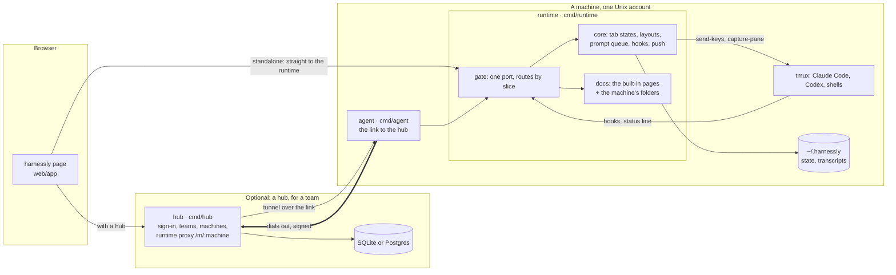
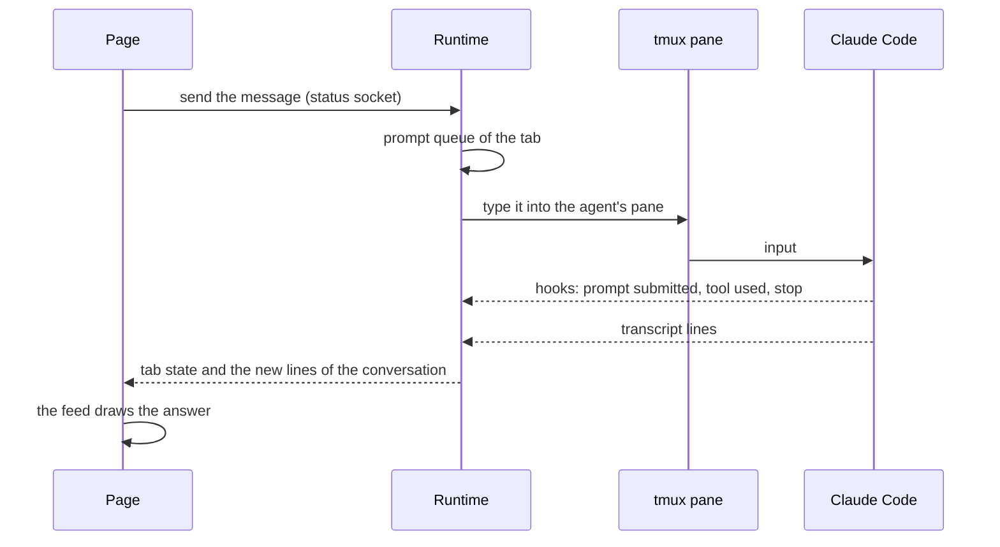
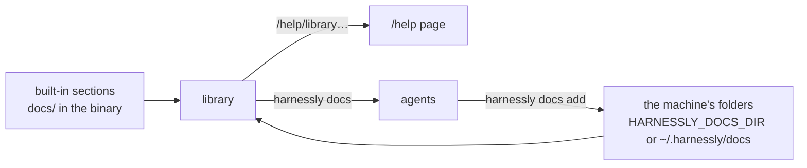

# How harnessly is built

harnessly is a few static Go programs and one web page. Agents, code, transcripts and every login of an agent stay
on the machines; the servers in front of them only carry the person to the right machine.

## The whole picture

| Program | Runs | Job |
| --- | --- | --- |
| **runtime** (`cmd/runtime`) | one per person on a machine | the API and the page of that person's workspaces: tabs with agents, their state, prompts, files, the right pane's tools, this documentation |
| **agent** (`cmd/agent`) | one per Unix account | the single link between the machine and a hub: tunnels to the runtime, policy, the agents' logins |
| **hub** (`cmd/hub`) | one per team or install | the server people sign in to: accounts, teams, machines, and the proxy that carries a browser to a machine's runtime |
| **harnessly** (`cmd/harnessly`) | in every pane | the agents' command: show things in the pane, start other agents, the safe, the docs |

A machine works **without a hub**: the runtime alone serves the page on its port (standalone). A hub is what a team
adds to sign in from anywhere and to reach several machines.

## A message, from the field to the agent and back

The runtime knows what an agent is doing from its hooks, its transcript, its screen and its process tree, and pushes
the state of every tab to every open page. A message written while the agent works waits in the tab's queue.

## The documentation itself

A section is a folder with a `section.json`. The library is the built-in sections and then the machine's own folders,
read again on every ask; a local section with a built-in id adds pages to it. See
[your own documentation](../self-host/own-docs.md).

## Deeper

- [Architecture of the runtime](../architecture.md): the gate and its two modes, the core, tmux, the repository.
- [Slices](../slices.md): switching routes per machine, the shadow comparison.
- [The hub](../hub/architecture.md) and [its contract](../hub/api.md).
- [The design engine](../design-engine.md) and [design pages](../design-pages.md).
- [Compared](../comparison.md): harnessly next to similar tools.
