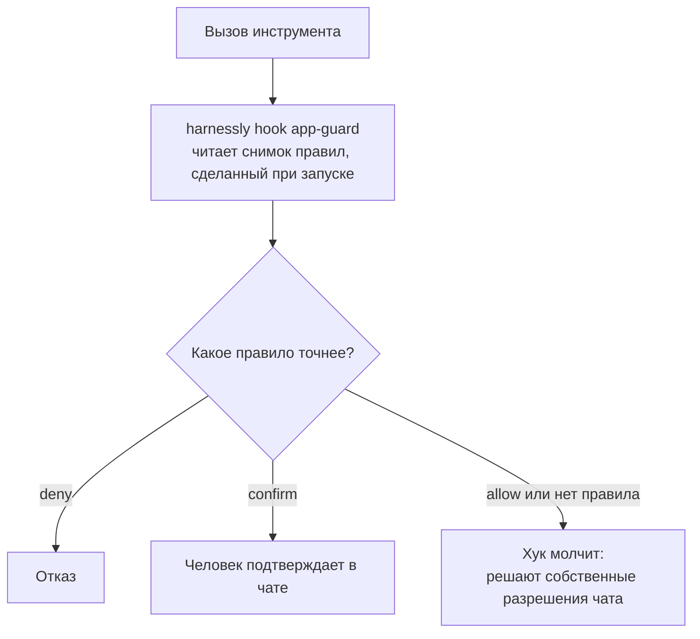

# Первый плагин

Плагин меняет работу агента в тех чатах, где он включён. Никакой код не запускается. Десять минут от пустой папки.

## Создание

```sh
harnessly app new acme.review          # пишет ./review; --dir задаёт папку, --name задаёт отображаемое имя
harnessly app validate ./review --strict
harnessly app dev ./review             # ставит саму папку, так что правки доходят сразу
harnessly app enable acme.review       # в чате этой вкладки; или «+» в поле, затем «Приложение»
```

Приложение, которое просит любое право, после `app dev` ждёт человека: оно выключено, пока человек не согласится на его
доступы кликом на странице harnessly («Приложения» → карточка приложения → «Посмотреть доступы»). Никакая команда этого
не делает: CLI запускают и агенты. `app explain` и `app enable` говорят, чего оно ждёт. Этот первый плагин ничего не
просит, поэтому включается сразу.

Агент в покое останавливается сразу, а следующее сообщение возвращает его уже с приложением. Агент за работой сохраняет прежнее, пока его терминал не остановится. Заготовка создаёт:

```text
review/
  harnessly/app.json            # манифест
  .claude-plugin/plugin.json    # переписывается из манифеста при каждой установке
  instructions.md               # всегда в контексте агента
  skills/how-to/SKILL.md        # агент читает по требованию
  CHANGELOG.md
```

У `harnessly app new` четыре шаблона: `chat` (по умолчанию, этот), `pane-chat` (добавляет вид), `widget` (карточка в чате) и `vite` (вид на Vite + React; см. [от нуля за 5 минут](00-five-minutes.md)).

## Манифест

```json
{
  "id": "acme.review",
  "name": "Review",
  "description": "Reads the diff, changes nothing, comments after you confirm",
  "version": "0.1.0",
  "harnessly": ">=0.16.68",
  "trust": "declarative",
  "targets": ["chat"],
  "permissions": [],
  "agent": {
    "instructions": "instructions.md",
    "tools": {
      "deny": ["Edit", "Write", "MultiEdit", "NotebookEdit", "Bash(git push*)"],
      "confirm": ["Bash(gh pr review*)"]
    }
  },
  "chat": { "commands": ["/review"] }
}
```

- `id` имеет вид `<publisher>.<name>`: строчные латинские буквы, цифры и `-`. Он не меняется никогда.
- `harnessly` это диапазон версий хоста. Хост вне диапазона отклоняет установку с `host-version`. `validate` этого не проверяет, поэтому проверяйте установкой. Свою версию покажет `harnessly --version`.
- `trust`: см. [уровни доверия](#уровни-доверия).
- Цель, в которой нет ничего от приложения, это ошибка. Ошибка и вклад в цель, которой нет в списке приложения.

## Что попадает к агенту

При каждом запуске, для каждого приложения, включённого в этом чате:

| Вы пишете | Агент получает | Примечания |
| --- | --- | --- |
| `instructions.md` (имя в `agent.instructions`) | Текст в системном промпте, под заголовком `# Apps on in this chat` | Больше 4 КБ даёт предупреждение, больше 16 КБ ошибку. Пишите коротко |
| `skills/<name>/SKILL.md` | Скилл, который агент читает по требованию, `<plugin>:<name>` | Грузится каждая папка в `skills/`, что бы ни было в `agent.skills` |
| `commands/<name>.md` | Слэш-команду `/<plugin>:<name>` | `chat.commands` сверяется с файлами; Claude Code грузит папку |
| `.mcp.json` | MCP-серверы, которые запускает Claude Code | См. [Бэкенд](03-backend.md) |
| `agent.tools` | Хук-страж решает по каждому вызову инструмента | Ниже |

Инструкции всегда в контексте и стоят токенов в каждом сообщении. Пишите, что делать и когда, а длинное выносите в скилл. Замерить можно через `baseline: true` в [оценке](07-sharing.md#оценки).

```markdown
# instructions.md
You review merge requests. Read the diff and the tests. Change nothing.
Post a comment only after the person confirms it. For the checklist, read the skill review-checklist.
```

```markdown
---
name: review-checklist
description: What to check in a merge request. Read it before you give a verdict.
---
1. Does the change do what the title says? ...
```

## Правила инструментов

В `agent.tools` три списка. Это защита от ошибок агента, а не песочница.



**`allow` ничего не даёт.** Он лишь побеждает более широкий `deny` или `confirm`. Чат, который спрашивает перед каждым инструментом, продолжит спрашивать.

| Правило | Что совпадает |
| --- | --- |
| `Edit` | Встроенный инструмент. `Edit` не покрывает `Write`, `MultiEdit` и `NotebookEdit`: называйте каждый |
| `Bash(git push*)` | Каждая простая команда строки, так что `git status && git push` ловится. `git push:*` то же самое |
| `Edit(*/docs/*)` | Глоб по `file_path` **ровно в том виде, как его написал Claude**, обычно абсолютном. `Edit(docs/*)` не поймает `/home/me/project/docs/a.md`: начинайте с `*/` или с полного пути. `**` то же, что `*` |
| `standup.save_entry`, `standup.*` | Инструмент сервера из `.mcp.json`, пишется `<server>.<tool>`. Подчёркивания в имени инструмента остаются |
| `app.data.get`, `app.sinopia.*` | Инструменты хоста (подчёркивания становятся точками: `sinopia_set_fields` это `app.sinopia.set.fields`) |
| `mcp:*`, `*` | Каждый MCP-инструмент; вообще всё. Проигрывают любому более точному правилу |

Порядок внутри одного приложения: `Tool(pattern)`, затем точное имя, затем маска с более длинным префиксом, затем `mcp:*`, затем `*`. При равенстве `deny` сильнее `confirm`, а `confirm` сильнее `allow`. Среди приложений чата побеждает любой `deny`, затем любой `confirm`. `allow` действует только на серверы своего приложения; `deny` и `confirm` действуют на любые.

Строка, в которую страж не видит (`eval`, `sh -c`, `xargs`, `$(...)`, обёртки вроде `env`, `nice`, `sudo`), превращает `deny` или `confirm`, которые могли бы сработать, в запрос подтверждения.

Лучше не выдавать инструмент, чем запрещать его. Агент не удалит тем, чего нет, а правило на строке оболочки можно обойти.

## Уровни доверия

| Уровень | Что добавляет | Ограничения |
| --- | --- | --- |
| `declarative` | Нижний | Нет `network.connect`, `network.resources`, нет окна с `https://`. Скрипты окон здесь работают: уровень не значит «только текст» |
| `sandboxed` | Исходящие адреса для окон, окно с `https://` во фрейме | Остальное как у `declarative` |
| `trusted` | Локальные программы в `.mcp.json` (`command`) | Каждый человек ставит вручную: никогда для команды, никогда в публичный каталог |

## Проверка

```sh
harnessly app validate ./review --strict   # каждая проблема называет своё поле; --strict падает на предупреждениях
harnessly app eval ./review                # сценарии на настоящем агенте: см. «Публикация»
```

Дальше: [добавьте окно](02-views.md) или скопируйте [`mr-review`](../../apps/mr-review), полный плагин с оценкой.
