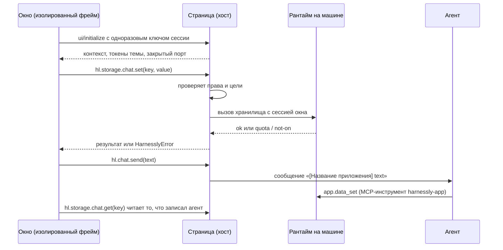

# Окна: интерфейс приложения

Окно это статичная страница вашего пакета. Человек видит её во вкладке панели, карточкой в чате, на отдельной странице приложения или внутри документа Sinopia. Она работает в браузере, в песочнице, и всё, что она делает кроме рисования, идёт через хост.

## Старт

```sh
harnessly app new acme.notes --template pane-chat
harnessly app dev ./notes
harnessly app enable acme.notes
harnessly open app:acme.notes       # вкладка панели; окно с целью app открывается и по /apps/acme.notes?chat=<id>
```

```html
<!-- ui/index.html -->
<!doctype html>
<html>
  <head>
    <meta charset="utf-8" />
    <link rel="stylesheet" href="style.css" />
    <script src="/__hl/app-sdk.js"></script>
    <script src="main.js"></script>
  </head>
  <body><main id="root"></main></body>
</html>
```

```js
// ui/main.js: обычный скрипт, не модуль
harnessly.connect().then(async (hl) => {
  const note = (await hl.storage.chat.get('note')) ?? '';
  const area = document.createElement('textarea');
  area.value = note;
  area.disabled = hl.context.readOnly === true;
  area.addEventListener('change', () => hl.storage.chat.set('note', area.value));
  document.getElementById('root').append(area);
}).catch((e) => {
  document.getElementById('root').textContent = 'Open this inside harnessly: ' + e.code;
});
```

```json
"targets": ["chat", "pane", "app"],
"permissions": ["storage", "chat.prompt", "pane.open"],
"views": [{ "id": "main", "title": "Notes", "entry": "ui/index.html", "targets": ["pane", "app"] }]
```

## Где показывается окно

| Цель окна | Где | Как открывается |
| --- | --- | --- |
| `pane` | Вкладка правой панели | `harnessly open app:<id>[/<view>]`, `hl.pane.open`, `app.open` у агента. Приложение только с окнами `app` здесь не открывается |
| `app` | `/apps/<id>?chat=<conversation>`: вся страница, чат рядом (колонкой, окном или одним полем) | «во всю ширину» в панели, «Приложения» в боковой панели |
| `chat` | Карточка в ленте | Результат инструмента, который её называет, или `hl.chat.card` |
| `sinopia.<kind>` | Панель или инспектор документа | См. [Sinopia](04-sinopia.md) |

`activation.openView` называет окно, которое показывает `harnessly open app:<id>`. Иначе это первое окно с целью `pane`.

## Как окно говорит с хостом



Сторона агента и сторона окна делят **хранилище чата** (`app.data_*` и `hl.storage.chat` это одни и те же данные) и **файлы рабочей папки**. Когда агент пишет ключ (`app.data_set`), окно узнаёт об этом сразу, не позже секунды, по событию `storage`: `hl.on('storage', ({scope, key}) => …)`. Событие называет ключ и не несёт значения: прочитайте ключ заново через `hl.storage.chat.get(key)`. Оно приходит и когда пишет другое окно приложения или само окно. Окно слышит только ключи своего приложения, а область чата только в этом чате. Доставка по возможности, поэтому читайте заново и когда окно снова видно (событие `visibility`). Событие `tool-result` пока не подключено.

## Песочница

Фрейм изолирован без `allow-same-origin`, на собственном источнике. Отсюда следует:

- `localStorage` и cookie нет. Используйте `hl.storage`.
- **Только обычные скрипты.** Непрозрачный источник фрейма отправляет cookie слота с обычными скриптами, стилями и картинками, но не с модулями, шрифтами и `fetch` ваших файлов без credentials: они возвращают 401. Данные отдавайте скриптом, который задаёт глобальную переменную. Сборщик подойдёт, если он пишет один обычный файл (IIFE). SDK есть и в `/__hl/app-sdk.mjs`, чтобы сборщик мог его импортировать.
- Нет встроенных скриптов и нет `eval` (`script-src 'self'`). Встроенные стили разрешены.
- Наружу ничего не уходит без `network`: `connect-src` равен `'none'`, пока `network.connect` не назовёт хост. См. [Бэкенд](03-backend.md).
- Отдаются только точка входа окна, её папка и `ui/`. Файл до 10 МБ, файлы с точкой в начале имени никогда.

```json
"network": {
  "connect": ["api.example.com"],
  "resources": ["cdn.example.com"],
  "frames": ["embed.example.com"]
}
```

Записи имеют вид `host`, `*.host`, `host:port`, при желании с `https://` или `wss://`. `*` требует `network.reason` и оставляет публичную публикацию на ревью.

## Дизайн: тема и размеры

`hl.connect()` задаёт `<html data-theme="light|dark">`, `color-scheme`, `lang` и эти токены на `:root`, а при смене темы обновляет их. SDK не приносит таблицы стилей, а до подключения токенов нет, поэтому дайте каждому токену значение по умолчанию.

**hl-ui.css.** Примитивы хоста на этих токенах: `<link rel="stylesheet" href="/__hl/hl-ui.css">` и `.hl-body` на `<body>`. Текст (`.hl-title`, `.hl-h`, `.hl-muted`, `.hl-hint`), раскладка по сетке 8 px (`.hl-row`, `.hl-stack`, `.hl-grid`), `.hl-card`, `.hl-list`, число с контекстом (`.hl-stat`, `.hl-stat__value`, `.hl-stat__label`), элементы управления (`.hl-btn`, `--primary`, `--ghost`, `--sm`, `.hl-input`, `.hl-field`, `.hl-label`), `.hl-seg` для выбора из нескольких вместо нативного `<select>`, `.hl-table`, `.hl-skeleton` на время чтения и `.hl-empty`, когда ничего нет, `.hl-pop` с `.hl-closing` для того, что открывается и закрывается. Ваша таблица стилей после неё побеждает. `harnessly app validate` предупреждает об инлайн-`style=`, нативном `<select>` и цвете, записанном вместо токена (файл и строка); `--strict` считает предупреждения.

| Токен | Назначение | Светлая | Тёмная |
| --- | --- | --- | --- |
| `--t-bg` | Страница | `#ffffff` | `#141416` |
| `--t-surface` | Карточки | `#f6f6f7` | `#1c1c1f` |
| `--t-surface-hover` | Наведение | `#ececee` | `#26262a` |
| `--t-text` | Основной текст | `#17171a` | `#ececf0` |
| `--t-text-secondary` | Второстепенный текст | `#4a4a52` | `#b4b4bc` |
| `--t-text-muted` | Приглушённый текст | `#76767f` | `#8a8a94` |
| `--t-border` | Границы | `#e2e2e6` | `#2e2e33` |
| `--t-border-strong` | Сильные границы | `#c9c9cf` | `#44444b` |
| `--t-accent` | Акцент | `#3b5bdb` | `#748ffc` |
| `--t-danger` | Ошибки | `#d6336c` | `#f06595` |
| `--t-success` | Успех | `#2f9e44` | `#69db7c` |

Значения взяты со страницы гостя. Внутри приложения они следуют теме хоста, поэтому используйте имена и не вписывайте цвета жёстко. Токен с пустым источником пропускается.

```css
:root { --t-bg: #ffffff; --t-text: #17171a; --t-border: #e2e2e6; --t-accent: #3b5bdb; }
html[data-theme='dark'] { --t-bg: #141416; --t-text: #ececf0; --t-border: #2e2e33; --t-accent: #748ffc; }
body { margin: 0; background: var(--t-bg); color: var(--t-text); font: 14px/1.45 system-ui, sans-serif; }
```

- Окно должно работать в обеих темах и от ширины 360 px. Панель узкая: верстайте сначала под неё.
- Язык: `hl.context.locale` равен `ru` или `en`. Ваши тексты хост не переводит.
- Учитывайте `hl.context.readOnly === true`: не давайте способа менять документ. Хост всё равно отклонит запись.

## SDK

`harnessly.connect()` отклоняется с `host_unavailable` вне harnessly. Иначе у `hl` есть:

| Вызов | Право | Что делает |
| --- | --- | --- |
| `hl.context` | нет | `app`, `target`, `view`, `theme`, `locale`, `chat` (null, если приложение в чате выключено), `readOnly`, `data` (у карточки). `user` всегда `null` |
| `hl.host` | нет | `{name, version}` |
| `hl.on(event, fn)` | нет | Рабочие события: `context`, `theme`, `storage` (`{scope, key}`: ключ записан или удалён), `visibility` (`{visible}`: окно скрыто или показано), `agents` (`{agents}`: список бесед или статус одной изменился; только с `agents.read`) и `selection` в Sinopia. `tool-input` и `tool-result` пока не приходят |
| `hl.chat.send(text)` | `chat.prompt` | Сообщение агенту до 20 000 символов, показывается с названием приложения в одну строку |
| `hl.chat.read({last})` | `chat.read` | Последние сообщения в виде `{role, text}`: по умолчанию 20, не больше 200 |
| `hl.chat.card(view, data)` | `chat.card` | Карточка в конце ленты. Хранится в этом браузере, не больше 20 на чат, данные до 20 000 символов |
| `hl.pane.open(target)` | `pane.open` | `app:<id>[/<view>]` или `chat:<id>`, чтобы открыть беседу из `hl.agents.list()` (для этого нужно ещё и `agents.read`, иначе `permission_denied`) |
| `hl.agents.list()` | `agents.read` | Беседы человека на этой машине в виде `{id, title, status, provider, machine}`. `status`: `working`, `waiting` (ждёт вопрос, разрешение или план) или `free`. Без текста сообщений, промптов и путей. Событие `agents` приносит тот же список, когда он меняется |
| `hl.tools.call('server.tool', args)` | нет | Инструмент вашего **удалённого https**-сервера. Возвращает сырой результат MCP: `isError` проверяйте сами. См. [Бэкенд](03-backend.md) |
| `hl.storage.<scope>.get/getVersioned/set/delete/keys` | `storage` | Области ниже; `get` несуществующего ключа даёт `null`. `getVersioned(key)` отвечает `{value, version}`; `set(key, value, {ifVersion})` отвечает новой версией. См. [Версии](#версии) |
| `hl.flow.*`, `hl.data.*` | нет | **Убраны.** Они никогда не были подключены. Вызов отклоняется с `invalid_params` и подсказывает `hl.storage` |
| `hl.files.read(path)`, `hl.files.write(path, text)` | `files.read:<mask>`, `files.write:<mask>` | Файлы папки чата, как текст |
| `hl.files.list(folder)`, `hl.files.search(text, {glob})` | `files.read:<mask>` | Содержимое папки и строки, где встречается текст, в пределах масок |
| `hl.files.watch(fn)` | `files.watch` | Какие файлы под масками изменились (только имена); возвращает функцию, которая перестаёт следить |
| `hl.files.pick({accept})` | нет | Человек выбирает файл в диалоге хоста: один раз `{path, text}` или `null` |
| `hl.git.status()`, `hl.git.diff({path, staged, ref})`, `hl.git.log({limit})` | `git.read` | git папки чата, только чтение, секреты исключены |
| `hl.events.on(kind, fn)` | `events:<kind>` | `turn`, `tool`, `message` чата |
| `hl.terminal.run(command, {cwd, timeout})` | `terminal.run`, `terminal.run:<mask>` | Команда в песочнице агента: `{code, output, cut, timedOut, ms}`. См. [Команды и процессы](#команды-и-процессы) |
| `hl.process.start/stop/list/output` | `process`, `process:<mask>` | Долгие команды: dev-сервер, наблюдатель |
| `hl.preview.open(port, {path})` | `process` | `localhost:<port>` во встроенном браузере правой панели |
| `hl.terminal.open({cols, rows, cwd})` | `terminal.pty` | Оболочка на pty в песочнице агента: `{id, write, resize, close, onData, onExit}`. См. [Терминал, браузер и хуки](#терминал-браузер-и-хуки) |
| `hl.terminal.read({lines})` | `terminal.read` | Последние строки терминала агента в чате и своих оболочек приложения |
| `hl.browser.read(tool, args)`, `hl.browser.drive(tool, args)` | `browser.read`, `browser.drive` | Браузер агента в чате: смотреть (`tabs`, `snapshot`, `screenshot`, `wait_for`) или действовать (`open`, `navigate`, `click`, `type`…). Ответ `{content, isError}` |
| `hl.hooks.on('tool', fn)` | `hooks.agent` | Слышит каждый вызов инструмента агентом до запуска: `fn({tool, input, cut})` отвечает `{decision: 'deny', reason}` или `{context}` |
| `hl.ai.complete(prompt, {system, maxTokens, model})` | `ai` | Один ответ модели, без инструментов: `{text, usd, spentToday, budget}`. См. [Модель и агент](#модель-и-агент) |
| `hl.agents.run(prompt, {title})` | `agents.run` | Задача в новом чате под этим: `{id}` |
| `hl.secrets.put(name, value, {shared})` | `secrets.write[:<имя>]` | Положить значение в сейф без чтения: `{created}`. См. [Сейф](#сейф) |
| `hl.ui.confirm(text)` | нет | Диалог с настоящим именем приложения в заголовке. **Возвращает boolean.** До 500 символов; время не ограничено |
| `hl.ui.toast(text, {tone, description})` | нет | Уведомление до 500 символов; тон `info`, `success`, `warning` или `error` и вторая строка — по желанию |
| `hl.keys.on(scope, handlers)` | нет | Команды клавиш экрана хоста (`deck`, `video`, `site`, `pictures`, `files`) на клавишах человека, пока вид открыт; возвращает функцию, которая это прекращает |
| `hl.keys.press(chord)` | нет | Передать хосту клавишу, нажатую в виде; срабатывает, только пока фокус во фрейме |
| `hl.keys.hints(commands)` | нет | Как хост пишет клавишу человека для каждой команды |
| `hl.notify(text)` | `notify` | То же уведомление, до 2000 символов |
| `hl.resize(height)` | нет | Высота карточки (карточки отправляют её сами) |
| `hl.sinopia.*` | `sinopia.*` | См. [Sinopia](04-sinopia.md) |
| `hl.close()` | нет | Перестаёт слушать |

Вызовов не больше 60 в секунду на окно (`rate_limited`). Вызов без ответа отклоняется с `host_unavailable` через 30 с.

Протокол это MCP Apps (JSON-RPC 2.0 поверх `postMessage`), поэтому стандартное окно MCP Apps работает без изменений. Тогда токены лежат в `hostContext.styles.variables`, а наши в `hostContext.harnessly`.

## Хранилище

| Область | Что хранит | Лимит |
| --- | --- | --- |
| `install` | Установку на этой машине | 5 МБ |
| `user` | Человека | 1 МБ |
| `chat` | Чат, в котором окно: делится с `app.data_*` агента | 256 КБ на чат, 20 МБ на все чаты |
| `space` | Команду; для записи нужно `storage.space.write` | 10 МБ |
| `doc` | Документ Sinopia | 100 КБ на документ, 20 МБ всего |

Ключ это от 1 до 256 символов. Запись сверх лимита отклоняется целиком, и окно видит код `quota_exceeded`.

### Версии

У каждого ключа есть версия: счётчик, который растёт на единицу с каждой записью или удалением ключа. Ключ, который не писали или хранили до появления версий, имеет версию 0. `getVersioned(key)` отвечает `{value, version}`. `set(key, value)` отвечает новой версией. Чтобы изменить прочитанное значение и не затереть то, что тем временем записал кто-то другой (агент, другое окно), верните версию:

```js
const { value, version } = await hl.storage.chat.getVersioned('notes');
try {
  await hl.storage.chat.set('notes', [...(value ?? []), 'new'], { ifVersion: version });
} catch (e) {
  if (e.code !== 'conflict') throw e;
  // e.version это версия ключа сейчас: прочитайте заново, слейте, повторите. Ничего не записано.
}
```

`ifVersion: 0` пишет, только если ключ ещё не писали. `set` без `ifVersion` пишет как раньше. У агента тот же договор: `app.data_get` отвечает `{"value", "version"}`, `app.data_set` принимает `ifVersion` и отказывает с `conflict` и текущей версией.

## Файлы рабочей папки

```json
"permissions": ["files.read:reports/**", "files.write:reports/*.md"]
```

`*` это цепочка символов внутри имени, `**` любое число папок. До 4 МБ, только текст; отсутствующий файл или не текст отклоняется с `invalid_params`. Путь оценивается по тому, куда он ведёт на самом деле, с раскрытием симлинков, и должен лежать в папке чата и подходить под маску. Секреты (`.env`, `.git/`, `.ssh/`, `*.pem` и другие) исключены, что бы ни говорила маска. Запись также отказывает для `.claude`, `.mcp.json`, `.vscode`, `.harnessly`, `.github`, `CLAUDE.md`, `AGENTS.md` и любого файла с точкой в начале имени, который не назван маской с собственной точкой. Для этого нужен чат с включённым приложением: у окна вне чата рабочей папки нет.

## Команды и процессы

```json
"permissions": ["terminal.run:npm test*", "process"]
```

`terminal.run` без маски выполняет любую команду через оболочку; `terminal.run:<mask>` выполняет только команды, которые
подходят под маску (`*` это любая цепочка символов), как программу и её слова: без `;`, `&&`, `|`, `$` и кавычек. `*`
никогда не заменяет опцию: `npm test*` запустит `npm test:unit`, но не `npm test --registry=…`; опции, которые нужны
приложению, пишите в маске (`npm test -- --grep *`). Оба права высокого класса: экран установки говорит, что они
позволяют, и каждый запуск попадает в журнал приложения.

Команда идёт в той же песочнице, что и агент чата: в папке чата (или в `cwd` внутри неё), реестр и пакеты только на
чтение, `~/.ssh`, `~/.config`, сейф и входы инструментов не видны, окружение без секретов (PATH, HOME, локаль, `CI=1`),
1800 с процессорного времени, по умолчанию 120 с и не больше 600 с по часам, до 1 МиБ вывода. Всё, что она оставила
работать, умирает вместе с ней. Машина, где песочницу не сделать (нет bubblewrap или пользовательских пространств
имён), ничего не запускает и отвечает `host_unavailable`.

`process` без маски запускает любую команду, `process:<mask>` только то, что подходит под маски, как выше.
`hl.process.start` держит команду, пока не вызван `hl.process.stop`, пока приложение не выключено в чате или не
потеряло `process`, или пока не остановлен рантайм: до 4 на приложение в чате. `hl.process.output(id, {since})` даёт
напечатанное с отступа и следующий отступ; машина хранит последние 256 КиБ. `hl.preview.open(5173)` показывает порт в
панели.

Пока агент вызывает инструмент окна (и 30 с после ответа окна), вызов права высокого или критического класса
спрашивает человека в собственном диалоге хоста, который окно не может ни нарисовать, ни нажать: через приложение агент
не получает больше, чем разрешил человек. Диалог показывает команду целиком; длиннее 1500 символов вызов отклоняется.
Рантайм проверяет это сам: в это время он выполняет только то, на что человек сказал «да». Отказ человека приходит как
`permission_denied`. Пример: [`docs/apps/runner`](../../apps/runner).

## Терминал, браузер и хуки

```json
"permissions": ["terminal.pty", "hooks.agent", "background"]
```

`terminal.pty` (критический) даёт полноценную оболочку на pty в той же песочнице, что и `terminal.run`: байты внутрь
через `write`, наружу через `onData`, `resize(cols, rows)`, `onExit(code)`. До 4 оболочек на приложение в чате и 16 на
машину; журнал помнит, когда оболочка открылась и закрылась, но не что в ней набирали. Пока агент пользуется окном,
каждый `write` спрашивает человека и показывает текст целиком. Пример: [`docs/apps/terminal`](../../apps/terminal),
терминал на xterm.js, не медленнее встроенного.

`terminal.read` (высокий) читает, что показывают терминал агента в чате и собственные оболочки приложения: по умолчанию
200 строк, не больше 2000. `browser.read` и `browser.drive` (высокий) идут через собственные инструменты браузера
агента в этом чате: вкладка, которую держит человек, остаётся его, а пароли, файлы, сетевые журналы и скрипты страницы
приложению не отдаются.

`hooks.agent` (критический) даёт окну слышать каждый вызов инструмента агентом чата до того, как он выполнится. Хук
останавливает вызов или добавляет агенту контекст; аргументы вызова он не меняет никогда. Все приложения, которые
слышат, спрашиваются сразу; любой стоп побеждает, контексты складываются. Окно, которое не ответило за 5 с, пропускает
вызов, и журнал приложения это записывает. С `hooks.strict` (критический, отдельная строка на экране установки)
молчание, наоборот, останавливает вызов, как и вызов слишком большой, чтобы показать его окну (`cut: true`). Стоп
виден в ленте как «Остановлено приложением X» с кнопкой, которая выключает хук этого приложения на машине. Пример:
[`docs/apps/guard`](../../apps/guard), останавливает `rm -rf` и `git push --force`.

Хуку нужно живое окно. `background` (критический) держит первое окно приложения для панели скрытым, пока открыт чат,
где приложение включено: его хуки и события работают, даже если человек окно не открывал; окно получает `visibility`
`{visible: false}`.

## Модель и агент

```json
"permissions": ["ai", "agents.run"],
"budget": { "usdPerDay": 1, "runsPerDay": 5 }
```

Оба права высокого класса и тратят модель человека, поэтому у каждого есть бюджет на день: его объявляет манифест, а
экран установки показывает в строке права («до $1 в день», «до 5 раз в день»). Без `budget` приложение получает $0,50
и 3 чата в день; больше $5 и 20 хост не даёт. Версия, которая тратит больше, спрашивает человека заново. День
заканчивается в 00:00 UTC.

`hl.ai.complete` один раз спрашивает собственный Claude человека, без инструментов, настроек и сессии: `model` это
`fast` (по умолчанию) или `smart`, промпт до 20 000 символов, ответ до `maxTokens` (по умолчанию 1024, не больше 8192).
Вызов делается, только если его худшая цена помещается в остаток дня; модель ограничена этой суммой, а день платит
столько, сколько сказала модель. Сверх бюджета вызов отклоняется с `quota_exceeded`, модель не спрашивается. Два вызова
одного приложения идут одновременно.

`hl.agents.run` запускает агента чата в новом чате под этим, в той же папке, с промптом первым сообщением и названием
приложения в заголовке. Человек видит чат в боковой панели и может его остановить. Каждый запуск считается в
`runsPerDay`.

Пока агент пользуется окном, оба вызова спрашивают человека в диалоге хоста и показывают промпт целиком. Каждый вызов
попадает в журнал приложения с ценой и остатком.

## Сейф

```json
"permissions": ["secrets:token", "secrets.write", "secrets.write:GITHUB_TOKEN"],
"secrets": [{ "name": "token", "description": "Ключ сервиса", "optional": true }]
```

`hl.secrets.put(name, value)` кладёт значение в сейф человека; прочитать его обратно окно не может. С `secrets.write`
(средний класс) приложение хранит свои секреты — те, что объявлены в `secrets` и на которые есть `secrets:<имя>`:
например, ключ, который сервис выдал после входа человека. Они лежат отдельно от секретов человека, под id приложения,
и машина подставляет их в серверные вызовы приложения так же, как если бы человек ввёл их в «О приложении».

`hl.secrets.put(name, value, {shared: true})` заменяет секрет человека с этим именем — тот, которым агент пользуется
через `harnessly secret run`. Нужно право `secrets.write:<имя>` ровно на это имя (высокий класс: экран установки
предупреждает, что приложение сможет подменить ключ агента); пока агент пользуется окном, хост спрашивает человека и
показывает имя секрета, но не значение. Ограничения секрета остаются: тот, что открыт только другим проектам, из этого
чата не заменить, а новый открыт только проекту чата.

Ответ — `{created}`; в журнал попадают имя и чей секрет, значение — никогда.

## Карточки в чате

Окно с целью `chat` рисует результат инструмента:

```json
"views": [{ "id": "card", "entry": "ui/card.html", "targets": ["chat"] }],
"chat": { "cards": ["card"] }
```

Инструмент вашего сервера (в том числе локального) отвечает JSON в своём поле `text`, до 64 КБ:

```json
{"_meta":{"ui":{"resourceUri":"ui://acme.notes/card"}},"data":{"date":"2026-11-03"}}
```

Лента рисует окно под этим шагом, а `data` попадает в `hl.context.data`. Назвать своё окно может только инструмент собственного сервера приложения.

## Свои места в чате

Приложение, включённое в чате, может добавить в сам чат три вещи — в `chat` файла `app.json`:

```json
"chat": {
  "commands": ["/check"],
  "cards": ["card"],
  "starters": [{ "text": "Проверь кешбэк в макете" }],
  "buttons": [
    { "id": "check", "title": "Проверить", "icon": "scan-search", "command": "/check" },
    { "id": "open", "title": "Кешбэки", "view": "main" }
  ],
  "links": [{ "match": "https://*.bank.example/cashback/*", "card": "card" }]
}
```

| Поле | Где видно | Правила |
| --- | --- | --- |
| `starters[]` | Строки под полем пустого чата; клик кладёт текст в поле, ничего не отправляет | до 4, по 1–140 символов |
| `buttons[]` | Иконки у поля; если у всех приложений их больше трёх — одно меню «⋯» | до 3; `id` из a-z0-9-; `title`; `command` (одна из `chat.commands`, уходит в поле) или `view` (вид с целью `pane`), что-то одно |
| `links[]` | Ссылка одна в абзаце сообщения: под ней карточка приложения, в `hl.context.data` — `{"url": "<ссылка без query и якоря>"}` | до 8; `match` — `https://<хост>/<путь>`, хост может начинаться с `*.` (сам хост и поддомены; не целая зона вроде `*.co.uk`), путь может кончаться `*`, без пути — любой путь; `card` — одна из `chat.cards` |

### «@» в поле

`"mentions": { "title": "Задачи", "tool": "tracker.find" }` в `chat` — и «@» спрашивает приложение, пока человек
печатает: машина вызывает этот тул MCP-сервера приложения (из `.mcp.json`, секреты подставляет машина) с
`{"query": "<что набрано>"}` и показывает ответ под `title` рядом с файлами и чатами. Тул отвечает
`{"items": [{"label": "ABC-1 Форма оплаты", "detail": "в работе", "insert": "ABC-1"}]}` — в `structuredContent` или
JSON-ом в первом текстовом блоке. До 8 пунктов; `insert` уходит в поле. На ответ 2 с: медленное, выключенное или
ждущее согласия приложение просто не показывается. Тул должен быть быстрым и ничего не менять.

Поиск (⌘K) сам показывает команды приложений этого чата и открывает любое установленное приложение по имени — объявлять ничего не нужно.
`icon` — имя иконки Lucide, которую рисует хост; неизвестная не видна, проверь её в окне приложения.

## Инструменты хоста для агента

Чат с приложениями получает MCP-сервер `harnessly-app`. В правилах инструментов они записываются как `app.*`.

| Инструмент | Правило | Что делает |
| --- | --- | --- |
| `open` | `app.open` | Открывает окно в панели |
| `data_get`, `data_set` | `app.data.get`, `app.data.set` | Хранилище чата по `key` |
| `ask` | `app.ask` | Кладёт выбор (от 2 до 8 вариантов) поверх окна, ждёт до десяти минут, отвечает вариантом или `cancelled`; не больше 5 открытых на чат |
| `widget_show` | `app.widget.show` | Рисует под этим шагом окно для чата у приложения, включённого в этом чате, с данными `data` |
| `widget_render` | `app.widget.render` | Рисует виджет, который агент пишет сам: `html`, `css`, `script`, `data` |

Расскажите агенту о них в `instructions.md`: через `app.ask` он подтверждает что-либо внутри вашего интерфейса.

## Виджеты в чате

Виджет это карточка, которую агент кладёт в ленту, когда решит сам, а не только как результат инструмента. Показанный снова с тем же
`id`, он меняется на месте: окно приложения получает новые данные событием `data` и в `hl.context.data`, свой виджет агента
перезагружается. Шаг, который его нарисовал, отвечает `widget <id> shown`; шаг, который его поменял, отвечает `widget <id> changed` и нового не рисует.

```sh
harnessly widget show acme.notes/card --data '{"date":"2026-11-03"}' --id today   # окно приложения для чата; приложение включено в этом чате
harnessly widget render --title "Продажи" --html @w.html --css @w.css --js @w.js --data @rows.json --id sales
harnessly widget list
harnessly widget remove sales
```

В чате с приложениями то же самое делают инструменты хоста `widget_show` и `widget_render`. Свой виджет агента работает в той же
песочнице, что и окно, совсем без сети: в `window.widgetData` его данные, `window.echarts` рисует графики, `/__hl/widget.css` даёт базовые
стили (`.row`, `.muted`, `.stat`, `.chart`, `button.primary`, таблицы), а `harnessly.connect()` даёт `hl.chat.send(text)` для кнопки,
которая отвечает агенту. Встроенный скрипт в разметке не работает: кладите его в `--js`. Лимиты: данные 64 КБ, html 128 КБ, css 64 КБ,
js 256 КБ, 200 виджетов на чат.

Когда какой виджет показывать, плагин объясняет своему агенту в `instructions.md` или в скилле; `harnessly app new acme.x --template widget`
начинает плагин с окном для чата.

Дальше: [Бэкенд](03-backend.md) или скопируйте [`cashback`](../../apps/cashback).
