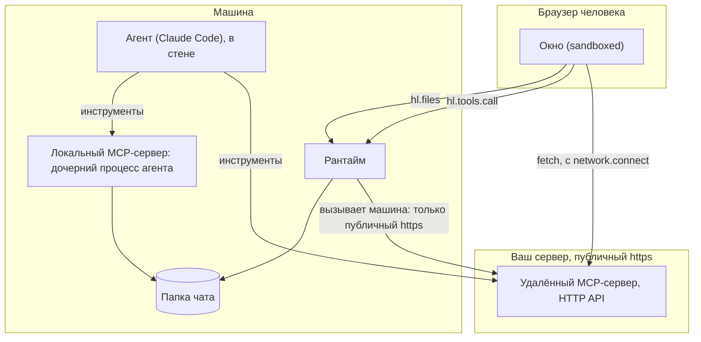
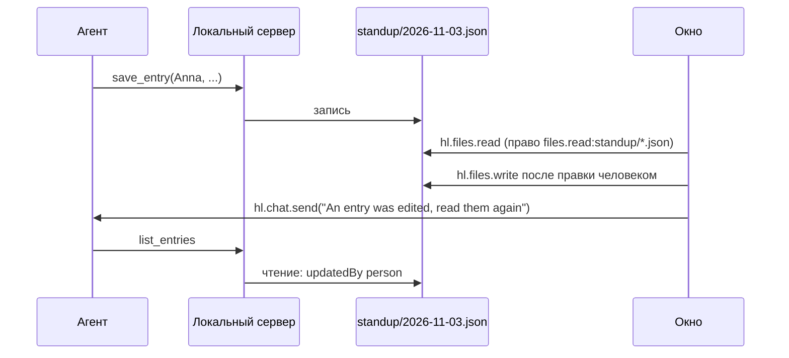

# Бэкенд: где работает ваш код

**Хост не запускает для приложения никакого сервера.** Нет процесса, который он стартует, надзирает или проксирует. Если приложению нужен код за пределами браузера, для него есть три места, и каждое достаёт до разного. Выбирайте по тому, кто должен его вызывать.



## Выбор

| Вам нужно | Сделайте так | Уровень |
| --- | --- | --- |
| Чтобы агент пользовался публичным API | Удалённый сервер в `.mcp.json` | `declarative` |
| Чтобы окно вызывало тот же сервер | `hl.tools.call('server.tool', args)`, публичный https, без секретов | `declarative` или `sandboxed` |
| Чтобы окно напрямую вызывало ваш API со своими токенами | `network.connect` и `fetch` | `sandboxed` |
| Картинки или шрифты с CDN | `network.resources` | `sandboxed` |
| Целая страница с вашего сервера | `entry: "https://…"` с `network.frames`. У неё нет моста и нет сессии SDK | `sandboxed` |
| Чтобы агент запускал локальную программу | Сервер с `command` в `.mcp.json` | `trusted` |
| Данные, общие для этой программы и окна | Файлы папки чата | `trusted`, `files.*` |
| Значение на человека, видимое окну и агенту | `hl.storage.chat` и `app.data_*` | любой |
| Секрет для агента | `harnessly secret`, см. [Агенты](05-agents.md#секреты) | любой |
| Секрет на установку, для вашего сервера | Поле манифеста `secrets` и `${secret:name}` в `headers` файла `.mcp.json`; см. [Секреты, ещё раз](#секреты-ещё-раз) | `declarative` или `sandboxed` (удалённый), `trusted` (локальный, в `env`) |
| Выбор, который человек делает один раз для приложения | Поле манифеста `settings`, читается через `hl.settings.get()` | любой |

## Удалённый MCP-сервер

```json
{
  "mcpServers": {
    "bank": {
      "type": "http",
      "url": "https://bank.example.com/mcp",
      "headers": { "x-app": "cashback" }
    }
  }
}
```

Инструменты агент получает от Claude Code при запуске. Окно достаёт до тех же инструментов:

```js
const res = await hl.tools.call('bank.get_categories', { month: '2026-11' });
if (res.isError) throw new Error(res.content?.[0]?.text);
```

Что делает `hl.tools.call`:

- **Вызов делает машина, не браузер**, поэтому он не может стать лазейкой в сеть человека. Он разрешает имя и проверяет адрес, на который реально идёт соединение: `https://` и публичный адрес. Loopback, частные диапазоны, link-local и carrier-grade NAT (`100.64.0.0/10`) дают `network_denied`; другая схема даёт `host_not_allowed`, сервер с `command` — `policy_blocked`. Прокси нет, редиректов нет.
- **Внутренние хосты** открывает админ развёртывания, а не приложение: `RUNTIME_APPS_INTERNAL_HOSTS=gitlab.corp,*.svc` на машине разрешает этим именам вести на частные, loopback и общие адреса и ходить по обычному `http://`; link-local (метаданные облака) остаётся закрыт. `RUNTIME_APPS_CA_FILE` добавляет корневые сертификаты организации. Сертификат, которому машина не доверяет, даёт `tls_untrusted`; сервер, ответивший ошибкой HTTP или не JSON-RPC, — `upstream_error`.
- Каждый вызов это новое соединение: `initialize`, `notifications/initialized`, `tools/call`. 30 с на всё, ответ до 4 МБ, JSON или поток событий.
- **Заголовок с `${secret:name}` заполняет машина** значением секрета приложения с таким именем; окно значения не видит. Любой другой заголовок с `${` не отправляется. Буквальные заголовки отправляются, и любой, у кого есть пакет, их читает: токены в них не кладите. Если у секрета ещё нет значения, вызов отклоняется, а приложение ждёт секрет. Когда тот же сервер использует агент, `${VAR}` раскрывает Claude Code из своего окружения, а `${secret:name}` подставляет хост.
- Вы получаете сырой результат MCP. `isError: true` не ошибка вызова: проверяйте его.
- Сбои приходят одним словом: `host_unavailable` для недоступности и таймаута, `policy_blocked` для отказов и ошибки JSON-RPC.

Минимальный сервер без зависимостей лежит в [`standup/remote-server-example/server.mjs`](../../apps/standup/remote-server-example/server.mjs). Его гоняли с клиентом, написанным вручную, и с Claude Code. Он говорит на Streamable HTTP без состояния, одно сообщение JSON-RPC на POST:

```text
POST /mcp  initialize                  200 application/json, protocolVersion, capabilities.tools
POST /mcp  notifications/initialized   202, no body
POST /mcp  tools/list                  200, the tools with inputSchema
POST /mcp  tools/call                  200, { content: [{ type: "text", text }], structuredContent? }
GET  /mcp                              405 (no event stream is required)
```

## Окно вызывает ваш API через fetch

```json
"trust": "sandboxed",
"network": { "connect": ["api.example.com"] }
```

Этот вызов делает браузер, поэтому правила адресов машины не применяются, и внутренний хост человека работает, если его браузер до него достаёт. Источник фрейма непрозрачный, это проверено в Chromium:

- Каждый запрос несёт **`Origin: null`**. Без заголовков CORS fetch падает.
- `Access-Control-Allow-Origin: *` или ответ с эхом `null` работает. `Authorization` и тела JSON вызывают preflight: отвечайте и на `OPTIONS`, и ставьте заголовок также на настоящий ответ.
- `credentials: 'include'` с `*` падает. С эхом `null`, `Access-Control-Allow-Credentials: true` и cookie с `SameSite=None; Secure` работает, но браузеры, блокирующие сторонние cookie, её отбрасывают (блокировку в Safari и Chrome не проверяли).

**Используйте bearer-токен.** Пусть человек войдёт на вашем сайте, вставит или получит токен, а вы храните его в `hl.storage.user`. Тогда прочитать его смогут только окна вашего приложения.

```js
const token = await hl.storage.user.get('token');
const res = await fetch('https://api.example.com/standup', { headers: { Authorization: 'Bearer ' + token } });
```

Разрешив `Origin: null`, вы разрешаете вызывать себя любой изолированной странице, поэтому запрос должен авторизовать токен, а не источник.

## Локальная программа

```json
{
  "mcpServers": {
    "standup": { "command": "node", "args": ["${CLAUDE_PLUGIN_ROOT}/backend/server.mjs"] }
  }
}
```

Нужен `"trust": "trusted"`. Уровень trusted каждый человек ставит вручную, и ни в одном каталоге его нет. Всё нижеследующее наблюдали на настоящем агенте:

- **Её запускает Claude Code**, как дочерний процесс агента, на время этого запуска. harnessly её не запускает и не надзирает, поэтому без агента она не работает. Если она упала, её инструменты пропадают до перезапуска агента.
- `${CLAUDE_PLUGIN_ROOT}` раскрывается в папку пакета.
- **Её рабочая папка это папка чата.** Поэтому `./standup/` в сервере это `standup/` в `hl.files`. Это папка, в которой был запущен чат: чаты, запущенные в одной папке, делят эти файлы, а чат в другой папке или в worktree имеет свои.
- **В чате с приложениями она работает внутри стены.** Она может писать в папку чата и не может писать в свой пакет. Хранилища приложения и файлов сейфа там нет.
- Она наследует окружение агента, включая `HARNESSLY_CLI_TOKEN_FILE`, ограниченный токен запуска: что агенту можно через рантайм, например `harnessly secret run`, то можно и вашей программе и её зависимостям. Проверяйте их так же, как агента.
- **Окно не может её вызвать**: `hl.tools.call` даст `policy_blocked`, а порта у неё нет. Делите данные через файлы:



- `hl.files.read` несуществующего файла отклоняется с `invalid_params`, как и текст, который нельзя прочитать. Считайте это ответом «данных пока нет».
- **Не кладите содержимое файлов в `hl.chat.send`.** Агент читает это сообщение как слова человека, поэтому имя из файла могло бы дать ему указания. Отправляйте фиксированный текст, а данные пусть он читает через инструмент.
- **Правила принадлежат серверу.** `instructions.md` просит, а решает программа. В примере `save_entry` отказывается опустошать запись и отказывается принимать запись, которую правил человек, если ему не передан `updatedAt`, прочитанный агентом.
- Ни одна сторона не блокирует файл. Если обе пишут в один момент, побеждает последняя: читайте прямо перед записью и делайте каждую запись небольшой.

Локальный сервер мог бы открыть собственный порт и значиться в `network.connect`, но он живёт только пока жив агент, так что окно его не найдёт. Предпочитайте файлы.

## Карточки из инструмента

Инструмент вашего сервера может назвать карточку:

```json
{ "_meta": { "ui": { "resourceUri": "ui://acme.thing/card" } }, "data": { "date": "2026-11-03" } }
```

Весь JSON может занимать до 64 КБ, в одну строку или в несколько. Окно читает `data` как `hl.context.data`. Чтобы менять карточку потом или
показать её без вызова инструмента, используйте [виджет](02-views.md#виджеты-в-чате).

## Секреты, ещё раз

| Где | Сегодня |
| --- | --- |
| Поле манифеста `secrets` + `permissions: ["secrets:name"]` | Человек кладёт значение в сейф машины из «О приложении» (`app/<id>/<name>`). Ни окно, ни агент прочитать его не могут |
| Заголовок с `${secret:name}`, при использовании агентом и в `hl.tools.call` | Машина записывает значение в заголовок при старте чата (или при вызове). Новое значение не требует переустановки: оно читается при следующем запуске |
| `${secret:name}` в `env` локального сервера | То же, только для приложения `trusted`. Не в `args` (командную строку видно в списке процессов) и не в `url` |
| Обязательный секрет без значения | Приложение «ждёт секрет» в «О приложении». Чат запускается; серверы, которым нужен секрет, в запуск не попадают |
| Заголовок с `${VAR}`, при использовании агентом | Claude Code раскрывает его из окружения агента |
| Заголовок с `${VAR}`, `hl.tools.call` | Заголовок не отправляется |
| Агент | `harnessly secret run --env VAR=name -- command` |
| Окно | Токен, который дал человек, в `hl.storage.user` |
| Локальный сервер | Наследует окружение агента и может запускать `harnessly secret run`, как агент. Изнутри стены рантайма не проверялось |

Для приложения с секретом Claude загружает копию папки пакета, сделанную под запуск (ссылки на настоящие файлы и свой `.mcp.json`); установленный пакет не меняется. **Удалённый сервер не получает значения ни в каком файле**: его запись указывает на прокси рантайма (`/api/cli/apps/mcp/<app>/<server>`) с токеном запуска, а прокси, только для приложения, включённого в этом чате, добавляет заголовки пакета с секретами и вызывает настоящий https-адрес по правилам `hl.tools.call` (потоки проходят; нет секрета — ответ 409). Локальный сервер `trusted` берёт значение в `env`, поэтому файл его хранит: он лежит в папке этого запуска вне реестра, стена открывает её только этому чату, а рантайм удаляет её, когда агента запуска уже нет.

### Настройки

```json
"settings": {"type": "object", "required": ["region"], "properties": {
  "region": {"type": "string", "title": "Регион", "enum": ["eu", "us"], "default": "eu"},
  "limit": {"type": "integer", "minimum": 1, "maximum": 50, "default": 10}}}
```

Форма находится в «О приложении»; окно читает `await hl.settings.get()`, агент вызывает инструмент хоста `settings_get`. Типы, кроме `string`, `number`, `integer` и `boolean`, валидатор отклоняет.

Дальше: [разобранный пример](08-worked-example.md).
