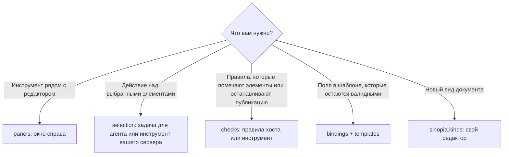
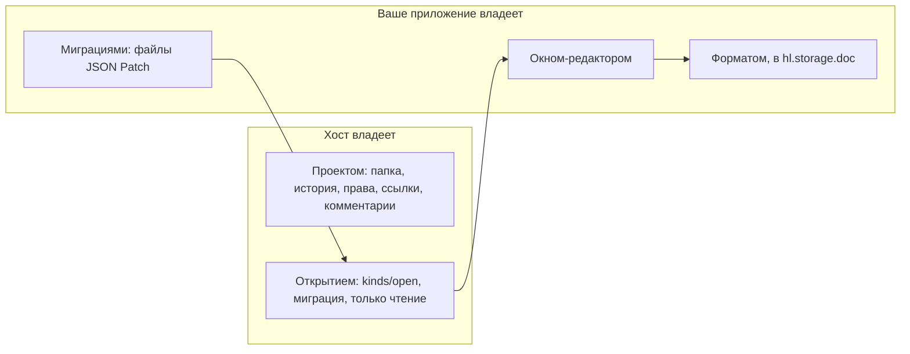

# Sinopia: приложения внутри документов

Приложение может работать внутри документов Sinopia (сайты `site`, презентации `slides`, видео `video`, дизайн-системы `ds`), добавлять панели, проверки и пункты выделения или добавлять целый тип документа. В [справочнике](../../apps.md#sinopia) есть каждое поле.

## Что добавить



## Включение в документах

```json
"targets": ["sinopia.slides"],
"activation": { "on": ["document"] }
```

`document` это рабочее значение `activation.on`: приложение включено в каждом документе тех видов, что указаны в целях. `sinopia.*` означает все виды хоста (но не виды, которые добавляют приложения). Окнам нужна та же цель.

## Панель и проверка без сервера

[`deck-lint`](../../apps/deck-lint) целиком состоит из этого:

```json
"permissions": ["sinopia.read"],
"views": [{ "id": "panel", "entry": "ui/panel.html", "targets": ["sinopia.slides"] }],
"sinopia": {
  "panels": [{ "id": "lint", "view": "panel", "title": "Check" }],
  "selection": [{ "id": "shorten", "title": "Shorten", "agent": "Cut the text in half" }],
  "checks": [{
    "id": "deck", "on": ["save", "share"], "blockShare": "error",
    "rules": [{ "id": "wordy", "select": "p", "level": "error", "maxWords": 30, "message": "{n} words, the limit is {limit}" }]
  }]
}
```

- Проверка запускается при изменении досок (`save`) и при публикации документа или выдаче ссылки (`share`). Находка помечает элемент. `blockShare` (`error` или `warning`) это уровень, начиная с которого кнопки «поделиться» и «опубликовать» показывают находки вместо открытия.
- У правила один предел: `maxWords`, `maxChars` (собственный текст элемента) или `minFontPx` (его встроенный `font-size`). `when` пока не вычисляется.
- Проверка или пункт выделения могут вместо этого вызывать `<server>.<tool>` вашего сервера, и этот сервер **должен быть назван в `agent.mcp`**: ради этого одного поле и существует. Инструмент должен быть удалённым и по https, потому что вызов делает машина. Он отвечает `{findings: [{node, level, message, rule?, fix?}]}`.
- Барьер публикации принадлежит редактору: ссылка, выданная шлюзом или публичным адресом, им не останавливается.

## API документа

Один и тот же для окна и для агента (`app.sinopia.*`). Работает с документами, у которых есть `meta/` и доски `.dc.html`.

| Окно | Инструмент агента | Право | Что делает |
| --- | --- | --- | --- |
| `document()` | `sinopia_document` | `sinopia.read` | Вид, заголовок, доски, ревизия |
| `selection()` | `sinopia_selection` | `sinopia.read` | Что выбрал человек, до 50 |
| `node(id)`, `query(selector)` | `sinopia_node`, `sinopia_query` | `sinopia.read` | Элементы, до 500; текст обрезается на 300 символах |
| `fields()` | `sinopia_fields` | `sinopia.read` | Привязанные поля со значениями |
| `mark(nodes, opts)` | `sinopia_mark` | `sinopia.read` | Метки на доске |
| `patch(ops)` | `sinopia_patch` | `sinopia.write` | `setText`, `setStyle`, `setAttr`, `insert`, `remove`, `setField`: всё или ничего, одна запись в истории |
| `setFields(patch)` | `sinopia_set_fields` | `sinopia.write` | Привязанные поля, проверенные по схеме |
| `boards.add(...)` | `sinopia_boards_add` | `sinopia.write` | Доска из шаблона |
| `comment(node, text)` | `sinopia_comment` | `sinopia.comment` | Заметка на элементе |
| `render()` | `sinopia_render` | `sinopia.export` | Недоступно: `host_unavailable` |

У узла есть отпечаток `fp`: передайте его в изменении, и изменение будет отклонено, если элемент успел измениться. Доска, на которую другой чат держит заявку, отклоняется с `policy_blocked`.

## Привязки и шаблоны

```json
"sinopia": {
  "bindings": { "schema": "schema/card.json", "inspector": "inspector", "lockUnbound": true },
  "templates": ["templates/card"]
}
```

```html
<!-- templates/card/board.dc.html -->
<h2 data-hl-field="title">Title</h2>
<a data-hl-field="link" data-hl-attr="href">Open</a>
```

Клик по привязанному элементу открывает окно `inspector` на этом поле, а открытое окно получает событие `selection`. Каждое записанное значение должно соответствовать JSON Schema, а `lockUnbound` отклоняет ручные правки элементов без привязки. Так сделано в [`cashback`](../../apps/cashback).

## Свой тип документа

```json
"targets": ["sinopia.acme.moodboard"],
"permissions": ["sinopia.kind", "sinopia.read", "storage"],
"views": [{ "id": "editor", "entry": "ui/editor.html", "targets": ["sinopia.acme.moodboard"] }],
"sinopia": { "kinds": [{
  "id": "acme.moodboard", "title": "Moodboard", "icon": "ui/moodboard.svg", "editor": "editor",
  "schema": "schema/moodboard.json", "schemaVersion": 2, "dataKey": "board",
  "migrations": { "1": "migrations/1-to-2.json" }
}] }
```



- Имя это id вашего приложения или он же ещё с двумя сегментами. Приложение добавляет не больше 8 типов, а имя, которое уже занято другим приложением, отклоняется с `kind-taken`.
- `dataKey` называет ключ `hl.storage.doc`, в котором лежит документ; держите его меньше 100 КБ.
- Для каждой версии до текущей есть шаг миграции, каждый это JSON Patch по RFC 6902. Он выполняется при открытии документа, всё или ничего, а старое значение остаётся под `<dataKey>@v<N>`. Документ, который не подходит или новее приложения, открывается только для чтения с указанием причины.
- `hl.context.readOnly === true` приходит и тогда, когда роль человека ниже права редактировать. Хост тогда отклоняет записи.
- Без приложения документ остаётся и показывает, что ему нужно приложение.
- `guest` отклоняется при validate: пока не поддерживается.

Скопируйте [`moodboard`](../../apps/moodboard).
