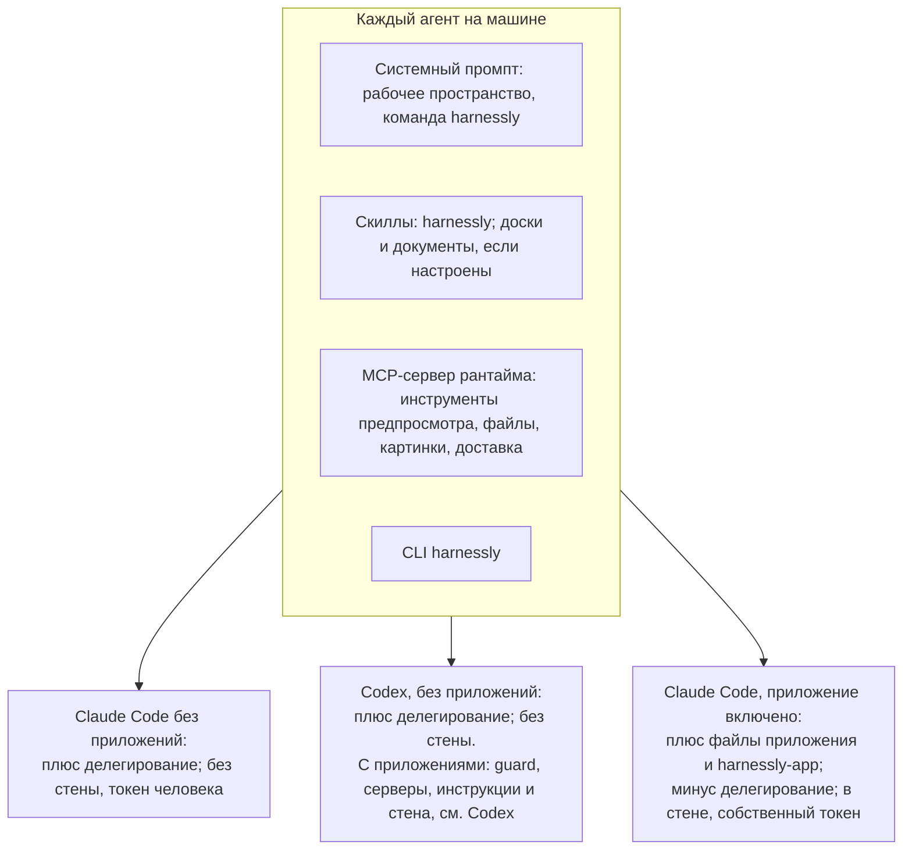
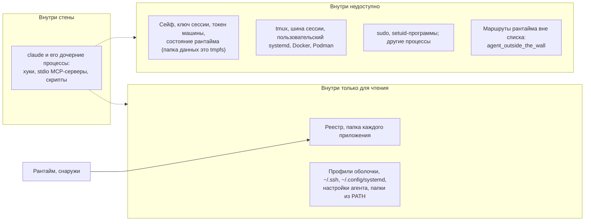

# Агенты: что они получают и как агенту написать приложение

Страница для двух читателей: автора, который решает, что сможет агент его приложения, и агента без памяти, которого попросили написать приложение.

## Если вас, агента, попросили написать приложение

1. `harnessly app docs` перечисляет это руководство. Прочитайте `overview`, затем страницу для вашего уровня. `harnessly app docs export ./hl-docs` даст примеры пакетов, чтобы копировать и искать.
2. **Работайте в чате без приложений.** В чате с любым включённым приложением папка исходников каждого установленного приложения доступна только для чтения, и вы не можете выполнять `app dev`, `install` или `enable`. Проверьте через `harnessly app list` и по тому, задана ли `HARNESSLY_CLI_TOKEN_FILE`; если задана, попросите человека открыть новый чат без приложений либо напишите новую папку и передайте команды.
3. Напишите пакет, затем `harnessly app validate DIR --strict`.
4. `harnessly app dev DIR` его устанавливает. После этого `harnessly open app:<id>` покажет человеку окно.
5. Чтобы проверить сторону агента, напишите `evals/*.json` и запустите `harnessly app eval DIR`. Это стартует настоящего агента в пустой папке. Чтобы проверить в настоящем чате, попросите человека включить приложение в другом чате или запустите такой чат через `delegate_task` и выполните для него `harnessly app enable`.
6. Не включайте приложение в своём чате, пока пишете его: с этого момента ваш чат не сможет править исходники ни одного установленного приложения.
7. Скажите, что вы проверили и чего не смогли: отрисовка окна требует браузера.

## Что получает каждый чат



MCP-сервер по умолчанию называется `harnessly`; развёртывание может переименовать его через `RUNTIME_MCP_SERVER`. Его инструменты:

| Инструменты | Для чего |
| --- | --- |
| `preview_slots`, `preview_network`, `preview_console`, `preview_server_log`, `preview_get_settings`, `preview_set_throttle`, `preview_block`, `preview_set_cache`, `preview_clear` | DevTools страницы, открытой в панели |
| `deliver_file` | Передать файл человеку |
| `generate_images`, `wait_images` | Картинки |
| `file_selection`, `file_show` | Файл рядом с чатом |
| `delegate_task`, `read_conversation`, `send_to_conversation`, `wait_conversation`, `list_children` | Другой агент. Не в чате с приложениями |
| `sinopia_view_*`, `sinopia_frame`, `sinopia_check`, `sinopia_video_render` | Только в чате, который работает в видеопроекте |

## Когда приложение включено

Человек включает приложение в чате строкой над полем ввода. Ещё два способа задаёт `activation.on`:

```json
"activation": { "on": ["always", "command:/tasks"] }
```

- `always`: включено в каждом новом чате Claude на машине, если приложение человек поставил сам (командное не включается). Каждый такой
  чат работает за стеной, так что берите это для плагина, который человеку нужен везде.
- `command:/tasks`: сообщение, которое начинается с `/tasks`, сначала включает приложение в этом чате, потом уходит агенту. Одна команда
  на одно приложение; собственные команды агента (`/clear`, `/model`, ...) проверка не пропускает.

Команды из `chat.commands` видны и в палитре `/` поля ввода чата: отдельной группой с именем приложения, с описанием из строки `description:`
файла `commands/<имя>.md`. Они в списке, пока приложение включено в этом чате. Выбор команды кладёт в поле `/<плагин>:<имя>`, и она уходит
агенту как любая набранная команда. Встроенная команда остаётся при своём имени: если у команды приложения то же имя, палитра покажет её
как `<плагин>:<имя>`.

## Контекст: приложение передаёт агенту

`agent.context` называет тул удалённого MCP-сервера самого приложения (`"<сервер>.<тул>"`), ответ которого агент должен видеть:

```json
"agent": { "context": [{ "id": "queue", "tool": "api.queue", "mode": "on-activation" }] }
```

Хук чата вызывает тул каждого пункта с `on-activation` на `SessionStart` и на каждый `UserPromptSubmit` и отдаёт текст агенту как
`additionalContext`, **только если он отличается от последнего, отправленного в этот чат** (хеш хранится на чат, приложение и пункт).
Так беседа несёт контекст один раз на изменение, а не на каждое сообщение. Очищенный или новый чат получает его снова, возобновлённый
нет. Тул, который упал, ответил ошибкой или ничем, ничего не добавляет и ничего не останавливает. Ответ режется на 16 КБ. Тул
вызывается без аргументов. Пункты `on-demand` проверяются и не отправляются.

## Валидаторы: проверки хода агента

`agent.validators` запускает локальные скрипты, поэтому нужен `trust: "trusted"`: установка и обновление показывают их среди прав (как `hooks/`), а в окружении скриптов только `PATH`, `HOME`, `LANG`, `LC_*`, `TMPDIR` и `HARNESSLY_*`. Он запускает скрипт пакета после вызова тула или перед завершением хода агента и сообщает агенту, что не так:

```json
"agent": { "validators": [
  { "id": "tests", "on": "PostToolUse", "match": "Edit", "run": "checks/tests.py", "maxRetries": 3 },
  { "id": "done", "on": "Stop", "run": "checks/done.sh" }
] }
```

- `id`: строчные буквы, цифры, `-`; уникален в приложении.
- `on`: `PostToolUse` или `Stop`.
- `match`: маска тула, как в `agent.tools` (`Edit`, `Bash(git *)`, `server.*`); только для `PostToolUse`, пусто — любой тул.
- `run`: файл пакета. `.py` запускается как `python3 -I`, остальное должно быть исполняемым. Старт из папки пакета, JSON события хука на stdin, 30 с.
- `maxRetries`: 1..10, по умолчанию 3.

Код `0` — проверка пройдена. Код `2` — провал: первые 4 КБ stdout — замечание, хук отвечает `{"decision":"block","reason":...}`, агент читает его и исправляет (после Stop продолжает, а не завершает ход). Другой код, таймаут или скрипт, который не стартовал, ничего не блокируют и пишутся в stderr хука.

Провалы подряд считаются на чат и валидатор (файл рядом со снимком политики запуска). После `maxRetries` блокировок следующий провал отпускают: Stop завершает ход (счёт начинается заново), `PostToolUse` перестаёт блокировать, пока валидатор не пройдёт хоть раз. Успех сбрасывает счёт. `stop_hook_active` в скрипте учитывать не нужно: повторы считает сам хук.

## Сколько весит приложение

Всё, что лежит в системном промпте, оплачивается на каждом ходу, поэтому это считается:

- `instructions.md`: не больше 16 КБ на приложение (больше не пройдёт проверку), предупреждение после 4 КБ.
- **Бюджет чата** на инструкции всех его приложений вместе: 48 КБ (около 12 тысяч токенов; токен оценивается как байты / 4).
  Приложение, из-за которого чат выходит за бюджет, **всё равно включается**: ответ `harnessly app enable` пишет об этом
  (`warning: ...`), а что убрать, решает человек.
- В «О приложении» стоит строка `~N токенов инструкций`.
- `harnessly app validate --strict` печатает `context weight: ~N tokens per turn` для пакета: инструкции, имена, описания и схемы
  тулов каждого удалённого сервера из `agent.mcp` (первая страница `tools/list`) и собственные `instructions` сервера. Больше 16 КБ
  (~4 тыс. токенов) это предупреждение, на котором `--strict` падает. Сервер, который не ответил, тоже предупреждение: его вес
  неизвестен, а не нулевой.

## Доступ по видам чата

| Возможность | Claude, без приложений | Claude, приложение включено | Codex, без приложений |
| --- | --- | --- | --- |
| `app docs`, `new`, `validate` | да | да | да |
| `app list`, `channels`, `shares` | да | да | да |
| `app dev`, `install` | да | **нет** | да |
| `app enable` в своём чате | да | **нет** | да |
| `app disable` в чате с приложениями | только страницей (`use-page`) | **нет** | только страницей |
| `app remove`, `promote`, `rollback`, `team`, `share`, `public` (любая подкоманда, `public list` тоже), `update` | да | **нет** | да |
| `app publish --channel dev\|beta` | да | да | да |
| `app publish --channel stable`, `--team` | да | **нет** | да |
| `app eval` | да | в стене не проверялось | да (запускает Claude Code) |
| `harnessly open app:<id>` | да | да | да |
| Править исходники установленного или dev-приложения | да | **нет**: любого установленного, даже не включённого здесь | да |
| Править файлы самого чата | да | да | да |
| Инструменты `preview_*` | да | да | да |
| Инструменты делегирования | да | **нет** | да |
| `tab create`, `send`, `close`, `result`, `peers send` | да | **нет** (`agent_outside_the_wall`) | да |
| `tab list`, `tab status`, `workspaces`, `peers` | да | да | да |
| `deliver`, `notify`, `ask`, `secret`, `design`, `site`, `api-guide` | да | да | да |
| Инструменты `harnessly-app` | нет | да | нет |
| Инструкции, скиллы, команды, правила инструментов приложения | нет | да | нет |
| Стена | нет | да, где работает bwrap | нет |

`app eval` использует собственный вход человека в Claude Code. `--agent codex` пока не поддерживается (команда отказывает с пояснением): сценарии идут через print-режим Claude Code и его поток событий, а у `exec` Codex поток другой.

## Codex

Приложения можно включить и в чате Codex. Что там работает и чем отличается от Claude Code:

| | Claude Code | Codex |
| --- | --- | --- |
| Правила инструментов (`allow`, `deny`) | хук app-guard | тот же guard и те же правила, хуком Codex `PreToolUse` |
| `confirm` | у человека спрашивают | **отказ**: в хуке Codex нет «спросить» |
| Инструкции | дописываются к системному промпту | добавляются к developer-инструкциям |
| Скилы | скилы плагина | **список в инструкциях**: путь к `SKILL.md` каждого, прочитать перед использованием |
| MCP-серверы приложения | `.mcp.json` плагина | флаги `mcp_servers.plugin_<приложение>_<сервер>`; сервер с `${secret:}` идёт через прокси рантайма, как у Claude |
| Локальный сервер с секретом | значение в файле запуска | **не подключается**: значение в командной строке Codex прочтёт любой процесс машины |
| Инструменты `harnessly-app` | да | нет |
| Контекст (`agent.context`) | в начале хода | пока нет |
| Стена, собственный токен запуска | да | да, та же стена |

Различия сделаны намеренно:

- **`confirm` становится `deny`.** `PreToolUse` у Codex принимает только отказ; «спросить» отбрасывается, и вызов идёт дальше, то есть
  подтверждение превратилось бы в разрешение. Агент читает причину («у Codex нет шага, где человек подтверждает вызов») и делает иначе.
  Правило, которое не должно блокировать Codex, пишите как `allow`.
- **Инструменты сопоставлены таблицей.** Shell-инструменты Codex (`shell`, `shell_command`, `exec_command`, `local_shell`, `unified_exec`) для
  правил — `Bash`; `apply_patch` — `Edit` и `Write` для каждого файла патча (строки `Add`, `Update`, `Delete`, `Move to`); `read_file`,
  `list_dir`, `grep_files` — `Read` и `Grep`; `mcp__<сервер>__<инструмент>` сохраняет имя. Инструменты, ничего не меняющие
  (`update_plan`, `view_image`, `web_search`), не оцениваются. **Неизвестный таблице инструмент отклоняется**, как и вызов, у которого нельзя
  прочитать команду или патч: guard не пропускает то, что не может прочитать.
- **Хуки агент изменить не может.** Guard — флаг `-c hooks.PreToolUse=[…]` строки запуска, первый среди хуков, раньше хуков рантайма и
  человека. Файла, из которого агент мог бы его убрать, нет. Codex пропускает вызов, если хук упал, поэтому запуск проверяет, что guard
  отвечает, и без такого не стартует.

## Стена

Агент чата с приложениями работает в собственном пространстве имён монтирования. Запись в файл реестра, в пакет или в папку исходников падает в ядре с «Read-only file system», какая бы программа ни писала.

Страж приложений держит то же правило для оболочки: команда, которая называет пакет или реестр, получает отказ, если только
не читает его (`cat`, `ls`, `grep`, `head` и подобные) и не запускает собственный скрипт скилла из пакета
(`python3 -I <папка скилла>/pulse.py KEY`, сам по себе или под
`harnessly secret run --env V=name --`). Путь в такой команде пишите полностью: строка с `$VAR`, `$(…)`, `VAR=x` перед программой или перенаправлением в
пакет получит отказ. Скилл, которому нужно больше (нарисовать виджет, сходить за данными с секретом), делает это внутри
своего скрипта.



Это важно для того, что вы просите у агента приложения:

- `npm i -g` в домашнюю папку, правка профилей оболочки, `sudo` и Docker в чате с приложениями не работают. Делайте это в чате без приложений или в терминале человека.
- Локальная программа из `.mcp.json` тоже работает внутри стены. Она не может читать хранилище приложения или сейф.
- `git` по ssh работает, с `~/.ssh/config` человека.
- Машина без `bwrap` или с запрещёнными пользовательскими пространствами имён запускает чат без стены и говорит об этом: предупреждение в логе, проверка машины `apps_boundary`, строка в «О приложении». Что нужно машине, описано в [справочнике](../../apps.md#what-keeps-the-agent-out-of-the-apps). Установка с `RUNTIME_APPS_REQUIRE_WALL=1` такой чат не запускает: он отказывает с причиной и командой, которая это исправляет.

Что остаётся открытым по природе вещей: агент работает от имени человека, поэтому читает файлы человека вне папки данных, пользуется сейфом по имени и имеет сеть. `network` в манифесте ограничивает окна, не агента. Код, который агент пишет в проекте, позже запускает тот, кто его запускает. У чата без приложений стены нет совсем. У чата Codex с приложениями та же стена, что у Claude Code, вокруг процесса Codex.

## Секреты

Поле манифеста `secrets` нужно вашему серверу, а не агенту: человек кладёт значение из «О приложении», а машина подставляет `${secret:name}` в заголовки сервера (см. [Секреты, ещё раз](03-backend.md#секреты-ещё-раз)). Агент не может ни прочитать такой секрет, ни запросить его. Для собственного секрета агента он просит сейф машины по имени.

```sh
harnessly secret ask my-api-key --why "the bank API for the cashback app"   # человек вводит его вне чата
harnessly secret run --env API_KEY=my-api-key -- ./call-the-api.sh           # значение в окружении команды, в её выводе замаскировано
```

Напишите это в своём `instructions.md`. Никогда не просите человека вставлять секрет в чат. У окна нет способа получить секрет, поэтому бэкенд, который вызывает окно, должен аутентифицироваться иначе: см. [Бэкенд](03-backend.md).
