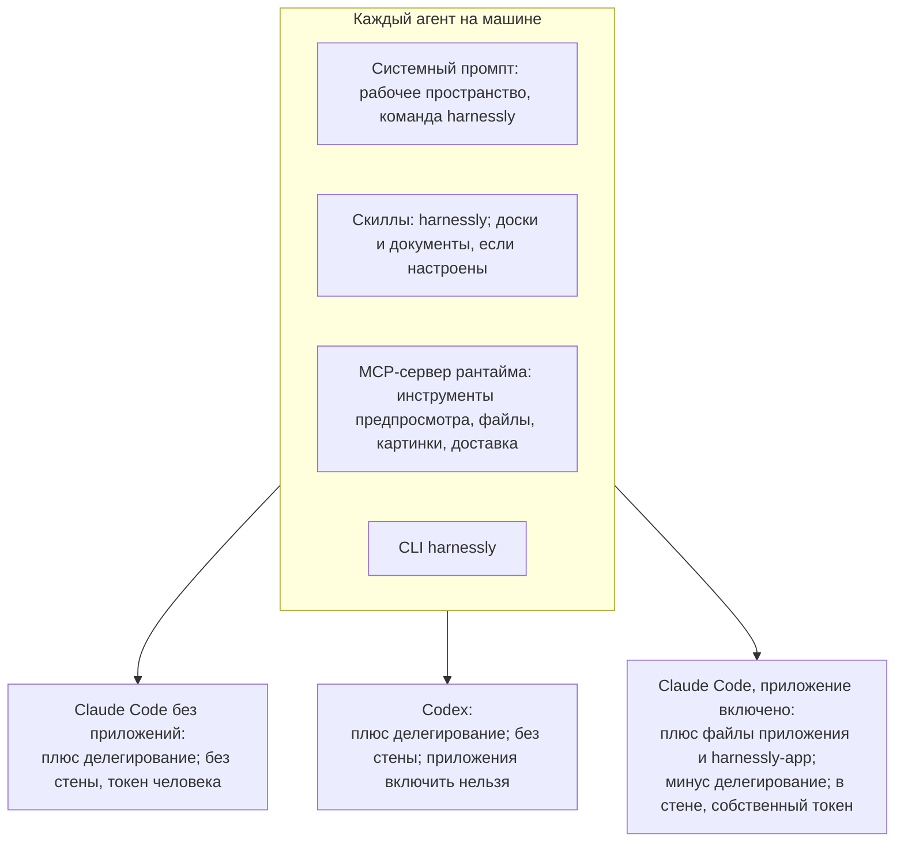
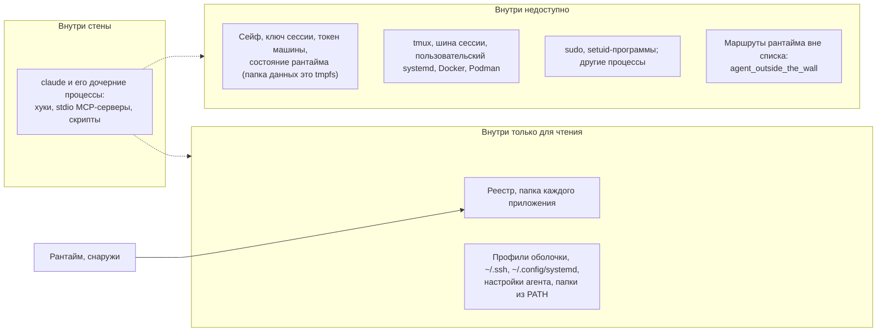

# Агенты: что они получают и как агенту написать приложение

Страница для двух читателей: автора, который решает, что сможет агент его приложения, и агента без памяти, которого попросили написать приложение.

## Если вас, агента, попросили написать приложение

1. `harnessly app docs` перечисляет это руководство. Прочитайте `overview`, затем страницу для вашего уровня. `harnessly app docs export ./hl-docs` даст примеры пакетов, чтобы копировать и искать.
2. **Работайте в чате без приложений.** В чате с любым включённым приложением папка исходников каждого установленного приложения доступна только для чтения, и вы не можете выполнять `app dev`, `install` или `enable`. Проверьте через `harnessly app list` и по тому, задана ли `HARNESSLY_CLI_TOKEN_FILE`; если задана, попросите человека открыть новый чат без приложений либо напишите новую папку и передайте команды.
3. Напишите пакет, затем `harnessly app validate DIR --strict`.
4. `harnessly app dev DIR` его устанавливает. После этого `harnessly open app:<id>` покажет человеку окно.
5. Чтобы проверить сторону агента, напишите `evals/*.json` и запустите `harnessly app eval DIR`. Это стартует настоящего агента в пустой папке. Чтобы проверить в настоящем чате, попросите человека включить приложение в другом чате или запустите такой чат через `delegate_task` и выполните для него `harnessly app enable`.
6. Не включайте приложение в своём чате, пока пишете его: с этого момента ваш чат не сможет править исходники ни одного установленного приложения.
7. Скажите, что вы проверили и чего не смогли: отрисовка окна требует браузера.

## Что получает каждый чат



MCP-сервер по умолчанию называется `harnessly`; развёртывание может переименовать его через `RUNTIME_MCP_SERVER`. Его инструменты:

| Инструменты | Для чего |
| --- | --- |
| `preview_slots`, `preview_network`, `preview_console`, `preview_server_log`, `preview_get_settings`, `preview_set_throttle`, `preview_block`, `preview_set_cache`, `preview_clear` | DevTools страницы, открытой в панели |
| `deliver_file` | Передать файл человеку |
| `generate_images`, `wait_images` | Картинки |
| `file_selection`, `file_show` | Файл рядом с чатом |
| `delegate_task`, `read_conversation`, `send_to_conversation`, `wait_conversation`, `list_children` | Другой агент. Не в чате с приложениями |
| `sinopia_view_*`, `sinopia_frame`, `sinopia_check`, `sinopia_video_render` | Только в чате, который работает в видеопроекте |

## Доступ по видам чата

| Возможность | Claude, без приложений | Claude, приложение включено | Codex |
| --- | --- | --- | --- |
| `app docs`, `new`, `validate` | да | да | да |
| `app list`, `channels`, `shares` | да | да | да |
| `app dev`, `install` | да | **нет** | да |
| `app enable` в своём чате | да | **нет** | нет (`unsupported`) |
| `app disable` в чате с приложениями | только страницей (`use-page`) | **нет** | только страницей |
| `app remove`, `promote`, `rollback`, `team`, `share`, `public` (любая подкоманда, `public list` тоже), `update` | да | **нет** | да |
| `app publish --channel dev\|beta` | да | да | да |
| `app publish --channel stable`, `--team` | да | **нет** | да |
| `app eval` | да | в стене не проверялось | да (запускает Claude Code) |
| `harnessly open app:<id>` | да | да | да |
| Править исходники установленного или dev-приложения | да | **нет**: любого установленного, даже не включённого здесь | да |
| Править файлы самого чата | да | да | да |
| Инструменты `preview_*` | да | да | да |
| Инструменты делегирования | да | **нет** | да |
| `tab create`, `send`, `close`, `result`, `peers send` | да | **нет** (`agent_outside_the_wall`) | да |
| `tab list`, `tab status`, `workspaces`, `peers` | да | да | да |
| `deliver`, `notify`, `ask`, `secret`, `design`, `site`, `api-guide` | да | да | да |
| Инструменты `harnessly-app` | нет | да | нет |
| Инструкции, скиллы, команды, правила инструментов приложения | нет | да | нет |
| Стена | нет | да, где работает bwrap | нет |

`app eval` использует собственный вход человека в Claude Code. `--agent codex` не поддерживается.

## Стена

Агент чата с приложениями работает в собственном пространстве имён монтирования. Запись в файл реестра, в пакет или в папку исходников падает в ядре с «Read-only file system», какая бы программа ни писала.



Это важно для того, что вы просите у агента приложения:

- `npm i -g` в домашнюю папку, правка профилей оболочки, `sudo` и Docker в чате с приложениями не работают. Делайте это в чате без приложений или в терминале человека.
- Локальная программа из `.mcp.json` тоже работает внутри стены. Она не может читать хранилище приложения или сейф.
- `git` по ssh работает, с `~/.ssh/config` человека.
- Машина без `bwrap` или с запрещёнными пользовательскими пространствами имён запускает чат без стены и говорит об этом: предупреждение в логе, проверка машины `apps_boundary`, строка в «О приложении». Что нужно машине, описано в [справочнике](../../apps.md#what-keeps-the-agent-out-of-the-apps).

Что остаётся открытым по природе вещей: агент работает от имени человека, поэтому читает файлы человека вне папки данных, пользуется сейфом по имени и имеет сеть. `network` в манифесте ограничивает окна, не агента. Код, который агент пишет в проекте, позже запускает тот, кто его запускает. У чата без приложений и у чата Codex стены нет совсем.

## Секреты

Поле манифеста `secrets` пока ничего не делает. Работает сегодня вот что: агент просит сейф машины по имени.

```sh
harnessly secret ask my-api-key --why "the bank API for the cashback app"   # человек вводит его вне чата
harnessly secret run --env API_KEY=my-api-key -- ./call-the-api.sh           # значение в окружении команды, в её выводе замаскировано
```

Напишите это в своём `instructions.md`. Никогда не просите человека вставлять секрет в чат. У окна нет способа получить секрет, поэтому бэкенд, который вызывает окно, должен аутентифицироваться иначе: см. [Бэкенд](03-backend.md).
