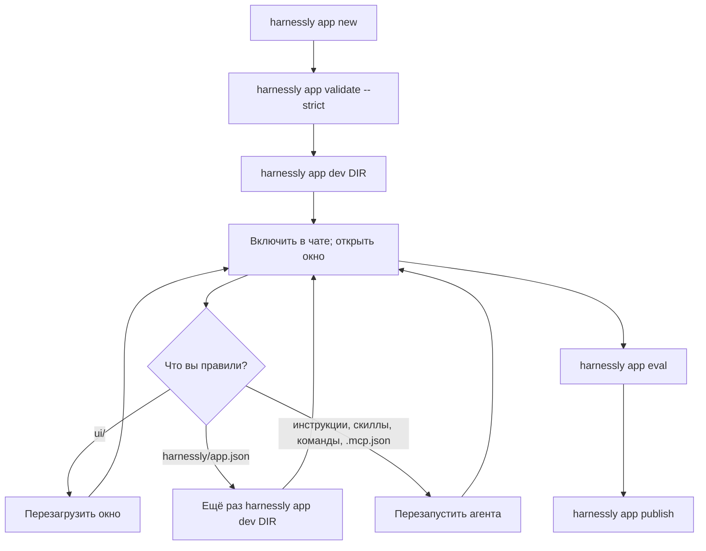

# Отладка: цикл, лимиты и все ошибки

## Цикл разработки

| Что вы правили | Когда вступает в силу | Как |
| --- | --- | --- |
| Файлы в `ui/` | При следующей загрузке | Перезагрузка в панели «Отладка» или повторное открытие вкладки. Отдаются с `no-cache` |
| `harnessly/app.json`: цели, права, окна, правила, сеть, доверие | **Только после** повторного `harnessly app dev DIR` | Манифест копируется в реестр при установке |
| `.mcp.json`, для `hl.tools.call` | При следующем вызове | |
| `.mcp.json`, для агента | При следующем запуске агента | Ниже |
| `instructions.md`, `skills/`, `commands/` | При следующем запуске агента | Ниже |

Пакет агент берёт при запуске. Агент за работой сохраняет прежнее. Остановите его терминал, и следующее сообщение его перезапустит; или выключите приложение и включите снова на странице. Копия от `app install` никогда не увидит поздних правок: ставьте заново.

## Где смотреть

| Вопрос | Где |
| --- | --- |
| Пакет валиден? | `harnessly app validate DIR --strict` называет поле |
| Почему приложение не включено в этом чате? | `harnessly app explain <id>` во вкладке чата: машина, команда, согласие, настройка, как включается, чат и стена — по строке; `✗` отмечает слой, который его выключает. Видит dev-установки, ждущие и выключенные приложения |
| Приложение ждёт (`state: waiting`, `reason: consent`)? | Оно просит права, на которые человек не согласился; `detail` их называет. Соглашается только человек, кликом на странице: «Приложения» → карточка → «Посмотреть доступы». Карточка перечисляет, чего оно ждёт; `harnessly open app:<id>`, `app enable` и `app explain` называют то же. Никакая команда согласия не даёт |
| Что случилось с приложением, всё в одном месте? | `harnessly app logs <id>` (есть `--follow`, `--since 10m`, `--json`): журнал приложения, последние 200 строк. `console.error` и `console.warn` окна, необработанные исключения, отклонённые промисы, отказы политики содержимого и упавшие вызовы моста, а ещё собственные строки хоста: файл окна, который он отказал отдать (`serve`), вызов MCP-бэкенда приложения, упавший с кодом (`mcp`), шаги загрузки (`load`). Он пишется независимо от того, включена ли у кого-то «Отладка»; в логе рантайма строки страницы тоже есть, до 20 в минуту на приложение. `app explain` называет последний сбой |
| Окно вообще загружается? | `harnessly app check <id> --open [--view <view>]`: открывает окно в безголовом браузере машины, ждёт его рукопожатия и печатает итог загрузки со всеми ошибками. Код выхода 1, если рукопожатия не было или любая строка — сбой. Агенту то же даёт хост-тул `app_check`, а `app_logs` читает журнал |
| Какие вызовы моста сделало окно? Какие упали? | Упавший вызов есть в `app logs` (`bridge`). Все, с правом и ключами хранилища: «Отладка», для dev-установки: под окном в панели или в «…» на `/apps/<id>` |
| Консоль окна | В `app logs` её ошибки и предупреждения; вся консоль — в DevTools браузера (осмотрите фрейм). `preview_console` консоль окна не ловит |
| Где страница приложения? | `/apps/<id>` на странице машины; на хабе `/m/<машина>/apps/<id>`. Свой `/apps/<id>` хаба ведёт на машину человека (ту, что в сети, в его последнем пространстве) |
| Какие свои файлы загрузило окно? | `preview_network` их перечисляет. Он не показывает вызовы моста и `fetch` окна к другим хостам |
| Есть ли у агента инструменты? | Спросите его; или `/mcp` в его терминале |
| Вызов инструмента отклонён правилом? | Отказ в чате называет правило. `harnessly hook app-guard --policy <file>` решает один вызов вручную |
| Есть ли у машины стена? | «Проверка машины» в настройках, проверка `apps_boundary` |
| Почему не удалась установка? | Сообщение команды, затем [коды](#слова-маршрутов-и-cli) |

**Журнал приложения.** Одно кольцо на 200 строк на приложение, его держит рантайм в реестре, пишут три источника: страница (что окно сообщает, пока открыто: консоль, исключения, упавшие вызовы моста, «нет рукопожатия за 8 с»), хост (файл, который сервер окон не отдал, с причиной; упавший вызов бэкенда с кодом и короткой причиной, но не аргументы и не тело ответа) и `app check` (шаги загрузки). Строка — слова самого приложения, CLI берёт их в кавычки: это данные, а не указания. Одна и та же строка в течение десяти секунд пишется один раз.

**Режим разработки.** Установка через `harnessly app dev` — в режиме разработки: журнал пишется, а раздел отладки показывается без переключателя «Отладка» в браузере; переключатель лишь открывает этот раздел у остальных приложений. Сам журнал от переключателя не зависит.

**Проверка окна без чата.** Это делает `harnessly app check <id> --open`: рантайм выпускает ссылку для собственного браузера (пара минут, в списке её нет, подходит любое окно из пакета), открывает её и судит о загрузке по рукопожатию и журналу. На странице проверки настоящий SDK и тема; вызовы чата, файлов и инструментов получают `permission_denied` (это строки журнала), так что проверяется, что окно загружается и стартует, а не то, что оно делает с чатом. Для своего Playwright сделайте гостевую ссылку: `harnessly app share <id> --view <view> --ttl 1d --write`, затем ведите `/apps/guest/<token>/`. Окну нужна цель `app`. Окно по собственному адресу (`https://…`) проверка не открывает.

**Слоты.** Каждое окно занимает один из шести слотов предпросмотра машины, общих с dev-серверами в панели. Когда слоты кончаются, самая старая страница перезагружается.

## Требования к машине

- Рантайм и `harnessly` в PATH оболочки агента, которую рантайм связывает сам.
- Claude Code со входом для чатов с приложениями и для оценок; `tmux` для вкладок.
- Для стены: `bwrap`, непривилегированные пользовательские пространства имён (в Ubuntu с ограничением AppArmor нужен профиль `bwrap-userns-restrict`) и ядро с Landlock (5.13; 6.12 для областей сигналов и сокетов).

## Лимиты

| Что | Лимит |
| --- | --- |
| Пакет | 50 МБ, 5000 файлов (`.git`, `node_modules` пропускаются); архивом для каталога 16 МБ |
| Один файл окна | 10 МБ |
| `instructions` | Предупреждение больше 4 КБ, ошибка больше 16 КБ |
| Приложений на чат | 8 |
| Типов документов на приложение | 8 |
| Хранилище | См. [Окна](02-views.md#хранилище). Ключ от 1 до 256 символов |
| `hl.files` | 4 МБ за вызов, только текст |
| `hl.tools.call` | 30 с, ответ 4 МБ, https и публичный адрес |
| Мост | 60 вызовов в секунду на окно; нет ответа за 30 с это `host_unavailable` |
| Сообщение из окна | 20 000 символов; notify 2000; toast и confirm 500 |
| `hl.chat.read` | 200 сообщений |
| `hl.chat.card` | 20 000 символов данных, 20 карточек на чат |
| Сессия окна | Час без использования, максимум 12 часов, сама продлевается каждые десять минут |
| Токен агента | 30 дней; при возобновлении выдаётся новый |
| `app.ask` | 10 минут, 5 открытых на чат, от 2 до 8 вариантов (80 символов), вопрос 300 |
| Гостевые ссылки | По умолчанию 7 дней, максимум 30, 500 действующих; тело гостевого хранилища 256 КБ |
| Sinopia | 50 выбранных узлов, `query` 500 узлов, текст обрезается на 300, меток 200 на источник и 1000 на проект, заметка 300, проверки сканируют 1500 узлов |
| Барьер stable | Доля пройденных оценок не ниже 0.8 (`--threshold`) |

## Ошибки, которые видит окно

`HarnesslyError.code`:

| Код | Значит | Что делать |
| --- | --- | --- |
| `permission_denied` | Нет права; приложение выключено в этом чате; защищённый файл; документ открыт только для чтения | Добавьте право, затем снова `app dev`. Включите приложение. Проверьте маску |
| `not_in_target` | Цели окна нет в `targets` приложения, или `open` отказывает окну там | Поправьте `targets` и `views[].targets` |
| `policy_blocked` | В вашем `.mcp.json` нет такого сервера; сервер не https; ошибка JSON-RPC удалённого инструмента; доска, которую держит другой чат | Окно не может вызвать сервер с `command`: см. [Бэкенд](03-backend.md) |
| `network_denied` | Адрес инструмента не публичный | Используйте публичный https-адрес или попросите админа внести хост в `RUNTIME_APPS_INTERNAL_HOSTS` |
| `host_not_allowed` | Сервер не `https://` и не внутренний хост из списка | Используйте https |
| `tls_untrusted` | Сертификат сервера не ведёт к корню, которому доверяет машина | Админ добавляет корень организации через `RUNTIME_APPS_CA_FILE` |
| `upstream_error` | Сервер ответил ошибкой HTTP, кроме 401/403, или не JSON-RPC | Смотрите лог сервера |
| `auth_required` | Сервер ответил 401 на вызов без учётных данных; или подключение приложения не создано или в него не вошли. `error.signIn` говорит, куда входить | Хост предлагает «Войти». Попросите человека войти и повторите вызов |
| `auth_expired` | Сервер ответил 401 на вызов с учётными данными; или токен подключения истёк и не обновился | Хост предлагает «Войти снова». Потом повторите вызов |
| `auth_denied` | Сервер ответил 403 или `insufficient_scope`; провайдер входа отказал | Новый вход не поможет: доступ даёт администратор сервера |
| `idp_unreachable` | Сервис входа не ответил, токен получить не удалось | Повторите позже; со входом всё в порядке |
| `rate_limited` | Больше 60 вызовов в секунду | Замедлитесь, группируйте |
| `host_unavailable` | Вне harnessly; нет чата; машина не ответила; рантайм ответил `not-on`, `failed` | Прочитайте сообщение ошибки, там это слово |
| `conflict` | `set` с `ifVersion` нашёл ключ в другой версии; `error.version` это текущая; ничего не записано | Прочитайте ключ заново (`getVersioned`), слейте, запишите снова |
| `quota_exceeded` | Запись вывела бы область хранилища за лимит; ничего не записано | Пишите меньше, удаляйте ключи. См. [Окна](02-views.md#хранилище) |
| `invalid_params` от `hl.flow` / `hl.data` | Эти вызовы убраны из SDK | Держите состояние в `hl.storage` |
| `invalid_params` | Плохой аргумент; неизвестное окно для карточки; слишком большие данные | См. лимиты |

Окно получает только слово ошибки от рантайма. Более длинная причина есть в логе рантайма.

## Слова маршрутов и CLI

| Слово | HTTP | Значит | Что делать |
| --- | --- | --- | --- |
| `not-on` | 403 | Приложение выключено в том чате | Включите на странице |
| `use-page` | 409 | `app disable` из вкладки в чате с приложениями | Человек использует переключатель на странице |
| `no-chat` | 404 | `app enable` из вкладки без известного чата | Выполните во вкладке чата или используйте страницу |
| `consent` | 409 | `app enable` приложения, которое ждёт согласия человека; `access` перечисляет, чего | Человек соглашается в «Приложениях» |
| `agent_cannot_change_apps` | 403 | Агент чата с приложениями попытался менять приложения | Пусть это делает человек, или используйте чат без приложений |
| `agent_outside_the_wall` | 403 | Маршрут агента вне его списка (новые вкладки, peers, терминал) | Делайте вне чата с приложениями |
| `kind-taken` | 409 | Другое установленное приложение добавляет этот тип документа | Переименуйте тип |
| `host-version` | 409 | Диапазон `harnessly` в манифесте исключает этот хост, **или** другое установленное приложение имеет то же имя плагина (`a.b-c` и `a-b.c`) | Проверьте `harnessly --version`, затем имена |
| `invalid` | 422 | В пакете есть ошибки; `problems` их перечисляет | `app validate --strict` |
| `bad-request` | 400 | Тело не совпадает с ожидаемым JSON | |
| `not-found` | 404 | Приложение не установлено | |
| `unsupported` | 409 | Запрошены приложения для чата Codex | Используйте чат Claude Code |
| `changed` | | Публичная запись изменилась после показа | Посмотрите снова, затем установите |
| `bad-answer`, `no-copy`, `conflict` | 400, 409, 409 | Ответ на `ask` не из вариантов; копия документа; конфликт записи | |

## Частые сюрпризы

| Вы видите | Потому что |
| --- | --- |
| Скрипт, `fetch('data.json')` или шрифт окна даёт 401 | Адрес начинается с `/` и теряет сессию из пути страницы: сделайте его относительным (`./data.json`; сборщик: база `./`). На хосте старше 0.16.198 грузятся только обычные скрипты |
| Окно пустое | `harnessly app check <id> --open`: строка рукопожатия, потом отказанные файлы (`serve`) и ошибки |
| Правки прав ничего не меняют | Выполните `app dev` снова |
| Приложение ничего не открывает после нового права | Оно ждёт согласия человека: `app explain <id>` называет чего; человек соглашается в «Приложениях» |
| Агент говорит, что инструмента нет | Он стартовал до правки: перезапустите. Затем проверьте `.mcp.json`, а для оценки проверьте, что случай подменяет этот сервер |
| `Edit(docs/*)` не останавливает правку | Claude присылает абсолютные пути, а `Edit` не покрывает `Write` |
| Правило `allow` не прекращает запросы | `allow` ничего не даёт |
| `hl.tools.call` к локальному серверу даёт `policy_blocked` | Только публичные удалённые https-серверы: см. [Бэкенд](03-backend.md) |
| `host-version` на примере | Его диапазон выше вашего хоста: проверьте его |
| Карточка инструмента не появляется | Его ответ не JSON с `_meta.ui.resourceUri` или длиннее 64 КБ, либо инструмент не из сервера самого приложения: см. [Бэкенд](03-backend.md#карточки-из-инструмента) |
| `app dev` добавил `.claude-plugin/plugin.json` | Установка пишет его в вашу папку: закоммитьте |
| В пакете появилась папка `.harnessly/` | `app eval` пишет туда отчёт: добавьте её в `.gitignore` |
| Стили окна мигают при загрузке | До `connect` токенов нет: задайте значения по умолчанию |
| Агент не может править собственное приложение | Он в чате с включённым приложением: см. [Агенты](05-agents.md) |
