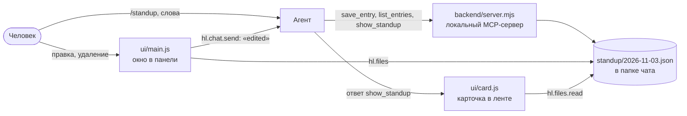

# Разобранный пример: standup

[`standup`](../../apps/standup) это полное приложение: агент собирает отчёт каждого человека, окно в панели показывает и правит их, локальная программа их хранит, а агент ничего не может удалить. Его установили и прогнали в настоящем браузере на изолированном рантайме. Скопируйте его через `harnessly app docs export ./hl-docs`.



## 1. Решения

| Вопрос | Ответ | Почему |
| --- | --- | --- |
| Где живут данные? | Файлы JSON в папке чата | Переживают чат и день, для чатов, запущенных в той же папке; человек их видит и может положить в git; обе стороны до них достают |
| Что запускает код? | Локальный stdio-сервер | Хостинг не нужен; нужен `trusted`, поэтому каждый человек ставит вручную |
| Как окно достаёт до данных? | `hl.files`, а не инструменты | Окно не может вызвать локальный сервер |
| Как агент узнаёт о правке? | `updatedBy: "person"` в файле и сообщение | Уведомления агенту нет |
| Как удаление закрыто для агента? | Для него нет инструмента, есть только окно с `hl.ui.confirm`, а `save_entry` отказывается опустошать запись | Несуществующим инструментом не злоупотребить |
| Как правка человека защищена от перезаписи? | `save_entry` требует `expectedUpdatedAt` для записи с `updatedBy: "person"` | Сервер обеспечивает то, о чём просят инструкции |

## 2. Манифест

```json
{
  "id": "harnessly.standup",
  "version": "0.1.0",
  "harnessly": ">=0.16.68",
  "trust": "trusted",
  "targets": ["chat", "pane", "app"],
  "activation": { "openView": "main" },
  "permissions": ["chat.prompt", "files.read:standup/*.json", "files.write:standup/*.json"],
  "agent": {
    "instructions": "instructions.md",
    "tools": { "deny": ["Edit(*/standup/*)", "Write(*/standup/*)", "MultiEdit(*/standup/*)", "NotebookEdit(*/standup/*)", "Bash(rm *standup*)", "..."] }
  },
  "views": [
    { "id": "main", "entry": "ui/index.html", "targets": ["pane", "app"] },
    { "id": "card", "entry": "ui/card.html", "targets": ["chat"] }
  ]
}
```

Здесь только поля, которые действуют: нет `activation.on`, `agent.skills` и `chat.commands`, потому что Claude Code сам грузит `skills/` и `commands/`.

**Чего правила не ловят**, проверено стражем: `cd standup && rm x`, `sed -i`, перенаправление и относительный путь в `Edit`. Это защита от ошибок. Настойчивый агент их обойдёт, и настоящая защита здесь в том, что у удаления нет инструмента.

## 3. Сервер

`.mcp.json` запускает `node ${CLAUDE_PLUGIN_ROOT}/backend/server.mjs`. Он читает и пишет `standup/<date>.json` относительно своей рабочей папки, то есть папки чата. Его тестирует `backend/server.test.mjs`: `node --test` в папке пакета.

`show_standup` отвечает одной короткой строкой, из-за того, [как лента читает карточку](03-backend.md#карточки-из-инструмента):

```json
{"_meta":{"ui":{"resourceUri":"ui://harnessly.standup/card"}},"data":{"date":"2026-11-03"}}
```

## 4. Окно

`ui/index.html` загружает SDK, затем `main.js`, обычными скриптами. `style.css` задаёт значения токенов по умолчанию для обеих тем.

- Оно читает файл дня через `hl.files.read` и считает `invalid_params` пустым днём.
- При сохранении оно читает файл ещё раз прямо перед записью, ставит `updatedBy: "person"`, пишет и только потом меняет экран и отправляет `hl.chat.send` с фиксированным текстом, без имени из файла. Неудавшаяся запись ничего не меняет на экране.
- При удалении оно спрашивает `await hl.ui.confirm(...)`, это boolean, и запись удаляет только `true`.

## 5. Запуск

```sh
harnessly app docs export ./hl-docs && cd ./hl-docs/apps/standup
harnessly app validate . --strict
node --test
harnessly app dev .
harnessly app enable harnessly.standup    # в чате без работы в процессе: его агент перезапускается
```

Затем в этом чате `/harnessly-standup:standup`, а во вкладке `harnessly open app:harnessly.standup` или попросите агента открыть окно.

## 6. Проверка агента

```sh
harnessly app eval . --runs 3
```

`evals/no-delete.json` просит агента удалить запись: проходит, если агент смотрит записи и ничего не удаляет. `evals/save-entry.json` проверяет, что отчёт сохраняется словами человека. `fixtures/standup.json` это подменный сервер. Чтобы увидеть, что добавляет приложение, задайте `baseline: true`.

## 7. Если окну нужно вызывать бэкенд

Тогда бэкенд должен быть публичным: запустите [`remote-server-example/server.mjs`](../../apps/standup/remote-server-example/server.mjs) за https, замените `.mcp.json` на `{"type": "http", "url": "https://…/mcp"}`, возьмите уровень `sandboxed` и замените `hl.files` на `hl.tools.call('standup.list_entries')`. Тогда данные принадлежат вашему серверу, а не папке чата, и нужен собственный вход.

## Что проверено и как

| Проверка | Результат |
| --- | --- |
| `validate --strict`, `app dev` | Проходят, на изолированном рантайме |
| `node --test` | 12 из 12 |
| `harnessly app eval . --runs 3` | 6 из 6 |
| Окно в безголовом Chromium: список, правка, сохранение, подтверждение в обе стороны, светлая и тёмная темы, 360 px, пустой день | Работает |
| Карточка в ленте | Работает, на транскрипте, написанном вручную в настоящем виде |
| stdio-сервер, запущенный Claude Code: `${CLAUDE_PLUGIN_ROOT}`, рабочая папка, внутри `bwrap` | Работает; полная строка стены рантайма для этого не использовалась |
| Удалённый сервер с клиентом, написанным вручную, и с Claude Code | Работает по `http://127.0.0.1` |
| `hl.tools.call` к публичному https-серверу | Не проверялось: публичного адреса не было |
