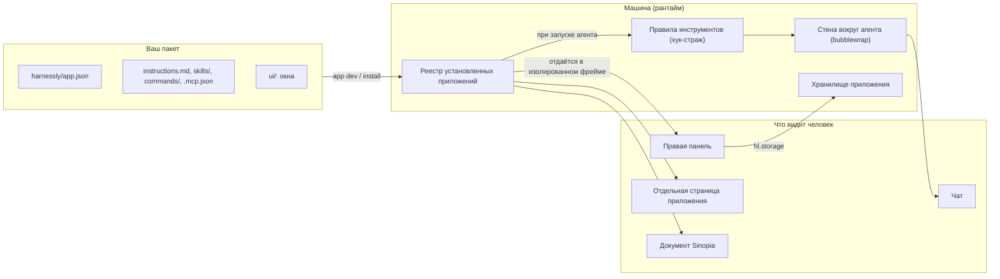
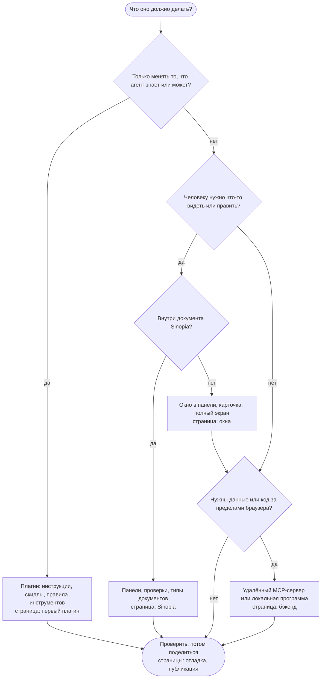

# Как собрать приложение или плагин

Руководство ведёт от пустой папки до опубликованного приложения: плагин, который лишь меняет работу агента, окно в правой панели, отдельный экран, бэкенд, тип документа Sinopia. Каждое утверждение проверено по коду этой версии. Каждая страница прямо говорит, чего пока нет.

Читаете на машине? Руководство встроено в бинарник. Сеть и исходники не нужны:

```sh
harnessly app docs                # страницы
harnessly app docs views          # одна страница
harnessly app docs export ./docs  # страницы и примеры пакетов в папку, чтобы искать и копировать
```

## Что такое приложение

Приложение это папка: плагин Claude Code и один манифест, `harnessly/app.json`. **Плагин** это приложение без окон. Вы включаете его там, где работаете, и только там.



Две стороны приложения напрямую не встречаются. **Сторона агента** (инструкции, скиллы, MCP-серверы, правила инструментов) читается, когда агент стартует. **Сторона окна** (`ui/`) работает в браузере человека, в песочнице. Данные они делят через чат, хранилище чата приложения и файлы рабочей папки.

## Какая страница нужна

Поднимайтесь ровно настолько, насколько требует идея. Каждая ступень добавляет к предыдущей.



| Уровень | Что вы пишете | Уровень доверия | Пример |
| --- | --- | --- | --- |
| 1. Плагин | `instructions.md`, скилл, команда, правила инструментов | `declarative` | [`mr-review`](../../apps/mr-review) |
| 2. Окно | Уровень 1, плюс HTML и JS в `ui/`, хранилище чата | `sandboxed` | [`cashback`](../../apps/cashback) |
| 3. Полный экран и карточки | То же окно с целью `app`, окно с целью `chat` | `sandboxed` | [`cashback`](../../apps/cashback), [`standup`](../../apps/standup) |
| 4. Бэкенд для агента и окон | `.mcp.json`: удалённый сервер или локальная программа | `declarative` или `sandboxed` для удалённого, `trusted` для локальной | [`standup`](../../apps/standup) |
| 5. Дополнения для Sinopia | Панели, пункты выделения, проверки, привязки | `sandboxed` | [`deck-lint`](../../apps/deck-lint) |
| 6. Свой тип документа | Окно-редактор, JSON Schema, миграции | `sandboxed` | [`moodboard`](../../apps/moodboard) |

## Страницы

1. [Первый плагин](01-first-plugin.md): пакет, манифест, инструкции, скиллы, команды, правила инструментов.
2. [Окна](02-views.md): интерфейс в панели, карточки, полный экран, SDK, токены темы, хранилище, файлы.
3. [Бэкенд](03-backend.md): что где может работать и как выбрать. Сервера, запущенного хостом, нет.
4. [Sinopia](04-sinopia.md): панели, проверки, пункты выделения, привязки, типы документов.
5. [Агенты](05-agents.md): что получает агент в каждом виде чата и как агенту написать приложение, не споткнувшись о стену.
6. [Отладка](06-debugging.md): цикл разработки, что подхватывается когда, лимиты, все коды ошибок.
7. [Публикация](07-sharing.md): версии, каналы, каталог команды, публичный каталог, ссылки, оценки как барьер.
8. [Разобранный пример](08-worked-example.md): `standup` от начала до конца.

В [справочнике](../../apps.md) есть каждое поле и каждый вызов.

## Чего нет

Некоторые поля проходят `harnessly app validate` и ничего не делают. Не стройте на них решения. Как обойтись без каждого из них, описано на страницах выше.

| Что | Состояние |
| --- | --- |
| Поля манифеста `secrets`, `settings` | Проверяются, иначе не используются: формы установки нет, значение прочитать нечем |
| Поля манифеста `backend.url`, `when`, `storage`, `activation.template`, `views[].height` | Проверяются, не используются |
| `activation.on`: `manual`, `view`, `always`, `command:/x` | Проверяются, ничего не включают. Действуют только `document` и `openView` |
| `agent.skills`, `agent.context`, `agent.validators`, `agent.flow`, `agent.exclusive` | Проверяются, не используются. Claude Code грузит всё из `skills/`, что бы ни было в списке |
| `hl.flow.*`, `hl.data.*`; события `flow`, `data`, `tool-result`, `tool-input`, `visibility` | В странице не подключены: `host_unavailable` или событие не приходит |
| `hl.sinopia.render()` | `host_unavailable` |
| Права `ai`, `users.read` | Принимаются, ни одному вызову не нужны. `hl.context.user` всегда `null` |
| Серверный процесс, запущенный хостом | Не существует. См. [Бэкенд](03-backend.md) |
| Приложения в чатах Codex | Отклоняются (`unsupported`). Агент Codex всё же может написать и проверить приложение |
