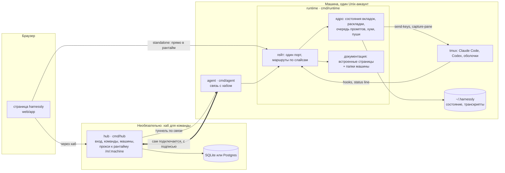
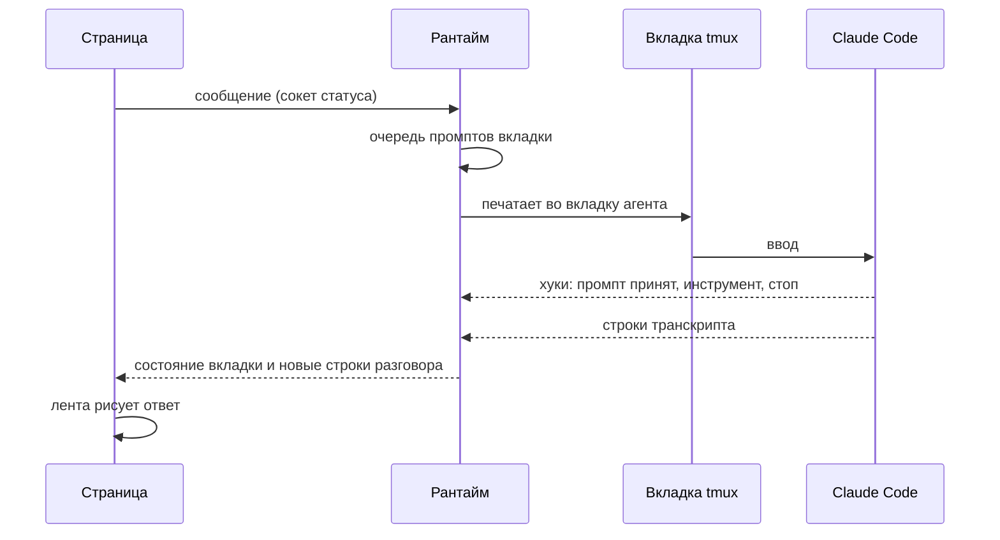
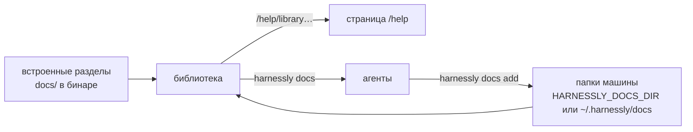

# Как устроен harnessly

harnessly — это несколько статических программ на Go и одна веб-страница. Агенты, код, транскрипты и все входы
агентов остаются на машинах; серверы перед ними только доводят человека до нужной машины.

## Общая картина

| Программа | Где работает | Что делает |
| --- | --- | --- |
| **runtime** (`cmd/runtime`) | одна на человека на машине | API и страница его рабочих пространств: вкладки с агентами, их состояние, промпты, файлы, инструменты правой панели, эта документация |
| **agent** (`cmd/agent`) | одна на Unix-аккаунт | единственная связь машины с хабом: туннели к рантайму, политика, входы агентов |
| **hub** (`cmd/hub`) | один на команду или установку | сервер, куда входят люди: аккаунты, команды, машины и прокси, который доводит браузер до рантайма машины |
| **harnessly** (`cmd/harnessly`) | в каждой вкладке | команда агентов: показать в панели, запустить других агентов, сейф, документация |

Машина работает **без хаба**: рантайм сам отдаёт страницу на своём порту (standalone). Хаб команда добавляет, чтобы
входить откуда угодно и работать с несколькими машинами.

## Сообщение: из поля к агенту и обратно

Рантайм знает, что делает агент, по его хукам, транскрипту, экрану и дереву процессов, и рассылает состояние каждой
вкладки на все открытые страницы. Сообщение, написанное во время работы агента, ждёт в очереди вкладки.

## Сама документация

Раздел — это папка с `section.json`. Библиотека — встроенные разделы, а за ними собственные папки машины, которые
перечитываются при каждом запросе; локальный раздел со встроенным id добавляет в него страницы. Подробнее — в
[Своей документации](../self-host/own-docs.md).

## Глубже

- [Архитектура рантайма](../../architecture.md): гейт и два его режима, ядро, tmux, устройство репозитория.
- [Слайсы](../../slices.md): включение маршрутов по машинам, теневое сравнение.
- [Хаб](../../hub/architecture.md) и [его контракт](../../hub/api.md).
- [Движок дизайна](../../design-engine.md) и [страницы дизайна](../../design-pages.md).
- [Сравнение](../../comparison.md): harnessly рядом с похожими инструментами.
