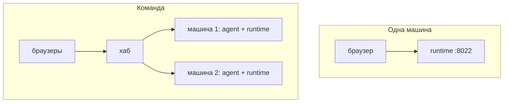

# Свой сервер

harnessly — открытый код (Apache-2.0) и целиком работает на ваших машинах. Выберите подходящий вариант:

| Вариант | Для кого | Что работает | С чего начать |
| --- | --- | --- | --- |
| **Одна машина** | один человек, ноутбук или сервер | рантайм со страницей на одном порту | [Начало работы](../../getting-started.md), [Развёртывание](../../deploy.md) |
| **Команда** | несколько людей и машин, вход откуда угодно | хаб, а на каждой машине — рантайм и агент | [Свой хаб](../../hub/deploy.md), [Подключить машину](../../hub/machine.md) |
| **Kubernetes** | установка, которая растёт | хаб и машины из Helm-чартов | [Развёртывание → Helm](../../deploy.md#kubernetes-helm) |

Страницы про развёртывание пока на английском.

## Дальше

- [Настройка](../../configuration.md): все переменные `RUNTIME_*` и `AGENT_*`.
- [Окружение и каталог](../../hub/environment.md): что хаб раздаёт каждой машине команды.
- [Сейф](../../safe.md), [подключения](../../connections.md), [MCP-серверы](../../mcp-connections.md), [интеграции](../../integrations.md): секреты, сервисы команды, доски и документы рядом с чатом.
- [Голосовой ввод](../../voice.md): встроенное распознавание и как его поменять.
- [Своя документация](own-docs.md): страницы вашей команды на /help и в `harnessly docs` у агентов.
