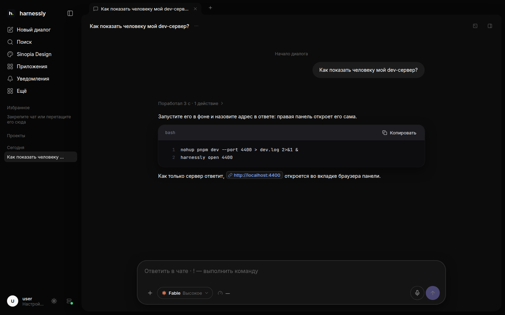

# Первый чат

Напишите, что нужно, в поле главного экрана и нажмите Enter. Откроется чат, агент запустится в папке проекта и
ответит. Чат останется в боковой панели под своим проектом; к нему можно вернуться когда угодно и с любого
устройства.

## Агент и модель

Кнопка рядом с полем выбирает **агента** (Claude Code или Codex), **модель** и **уровень размышлений**: низкий
отвечает сразу, средний — для обычных задач, высокий думает перед каждым шагом. Выбор запоминается для следующих
чатов.

## Что умеет поле

- **Enter** отправляет, **Shift+Enter** — новая строка (или наоборот, если вы поменяли это в настройках).
- **+** добавляет файл (до 50 МБ), фото или скриншот (до 10 МБ), макет, документ, доску или задачу. Файл можно
  также вставить в поле или перетащить на него.
- **Микрофон** превращает голос в текст прямо в поле, пока вы говорите; «стоп» оставляет текст, «отмена» возвращает
  поле как было.
- **↑** в пустом поле возвращает прошлое сообщение; **/** находит сохранённую быструю подсказку.
- Сообщение, начатое с **!**, выполняется как команда на машине.

## Пока агент работает

Ждать не обязательно. Сообщение, написанное во время работы агента, встаёт **в очередь** и уходит, когда ход
закончится; **Ctrl+Enter** передаёт его сразу, в текущий ход. Очередь можно переставлять, править и очищать.
Кнопка «стоп» останавливает агента; следующее сообщение продолжит чат с того же места.

## Когда агент спрашивает

Когда агенту нужно решение (утвердить план, разрешить команду, выбрать вариант), вопрос встаёт над полем с
вариантами ответа. Выберите один или напишите свой ответ в поле.
