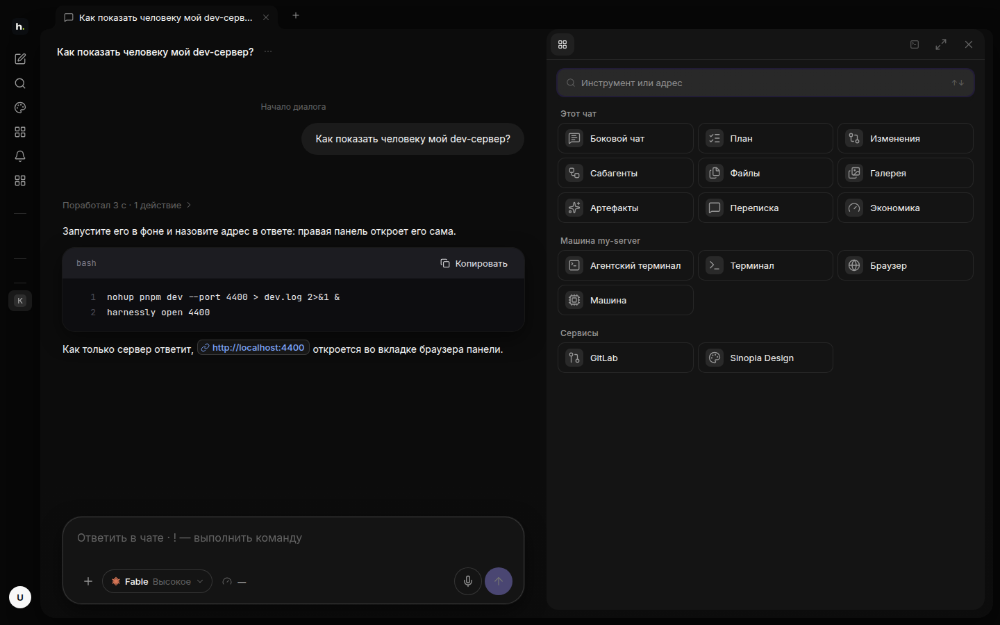

# Правая панель

Правая панель — место, где видно то, что сделал агент, и инструменты чата. Открывается кнопкой в правом верхнем
углу чата; Esc закрывает её.

## Инструменты

Плитки собраны в три группы: то, что относится к этому чату, к его машине, и подключённые сервисы.

| Инструмент | Зачем |
| --- | --- |
| **Боковой чат** | спросить что-то в сторонке, не мешая агенту работать |
| **План** | шаги, которые наметил агент, и где он сейчас |
| **Изменения** | дифф того, что поменял агент |
| **Файлы** | папка проекта: открыть, прочитать, поправить и сохранить файл; Markdown открывается как страница |
| **Сабагенты**, **Переписка** | помощники, которых запустил агент, и что ему писали другие агенты |
| **Артефакты**, **Галерея** | документы, доски и картинки чата |
| **Экономика** | сколько потратил чат |
| **Агентский терминал** | собственный терминал агента, вживую |
| **Терминал** | ваша собственная оболочка на машине |
| **Браузер** | dev-серверы машины и любой адрес в превью |
| **Машина** | нагрузка машины; отсюда можно остановить тяжёлый процесс |
| **GitLab**, **Designly** | MR ваших проектов с диффами; макеты этой установки |

## Агент открывает сам

Когда агент публикует документ, рисует доску или запускает dev-сервер, он сам открывает это в панели командой
`harnessly open`. Ссылка в чате (задача, MR, сайт) — это чип: клик открывает её в своём виде панели, а не в новой
вкладке браузера.
