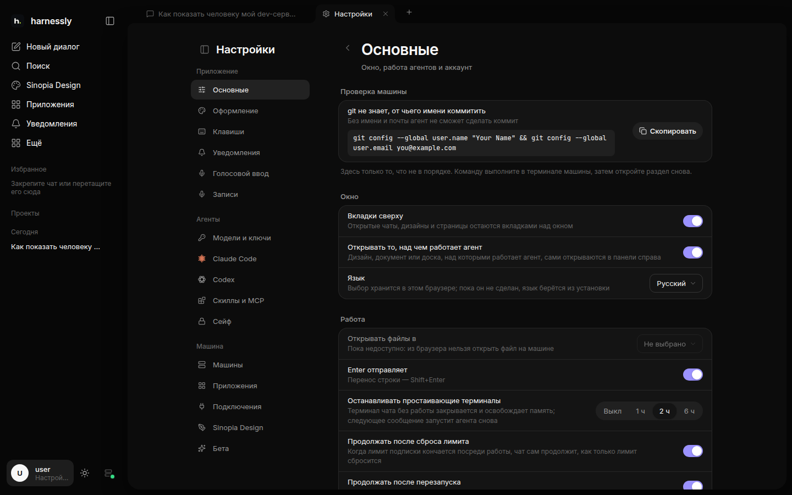

# Настройки и подключения

Настройки открываются из профиля внизу боковой панели.

| Раздел | Что там |
| --- | --- |
| **Основные**, **Оформление**, **Клавиши** | окно: тема, размер текста, язык, в чём открывать файлы, что делает Enter, клавиши; ваш аккаунт |
| **Уведомления** | ваш Telegram и инструкция агентам, когда вам писать |
| **Голосовой ввод**, **Записи** | микрофон в поле сообщения и сделанные записи |
| **Модели и ключи** | как агенты и модели входят и куда идут их запросы |
| **Claude Code**, **Codex** | настройки каждого агента на машине: правила для команд, переменные окружения |
| **Скиллы и MCP** | что агент находит на машине и может использовать; здесь их можно выключить |
| **Сейф** | секреты, которыми агенты пользуются, не видя их |
| **Машины** | где запускаются агенты; новые чаты открываются на основной |
| **Приложения**, **Подключения** | сервисы, с которыми работают агенты: трекер, вики, GitLab или GitHub, удалённые MCP-серверы |
| **Designly** (или как дизайн назван в вашей установке), **Бета** | на чём строятся макеты на этой машине; функции, которые можно попробовать раньше всех |

## Подключения

Трекер, вики и хостинг кода (Jira, Confluence, YouTrack, Linear, GitLab, GitHub) подключаются вставкой ссылки в
**Настройки → Подключения**. Дальше агенты читают их за вас, без собственного токена. Удалённые MCP-серверы (Notion,
Sentry, GitHub…) подключаются так же и входят во всплывающем окне.

## Сейф

Токены, пароли и ключи никогда не попадают в чат. Когда агенту нужен секрет, он просит его у сейфа по имени; вам
приходит карточка, куда вписать значение, вне чата, а агент только пользуется им и никогда не видит его в выводе.
Что лежит в сейфе — в **Настройки → Сейф**.

## Уведомления

Подключите Telegram в **Настройки → Уведомления** и скажите агентам словами, когда вам писать («только если упал
выкат», «когда нужен я»). Они пишут по этой инструкции, а не на каждый шаг.
