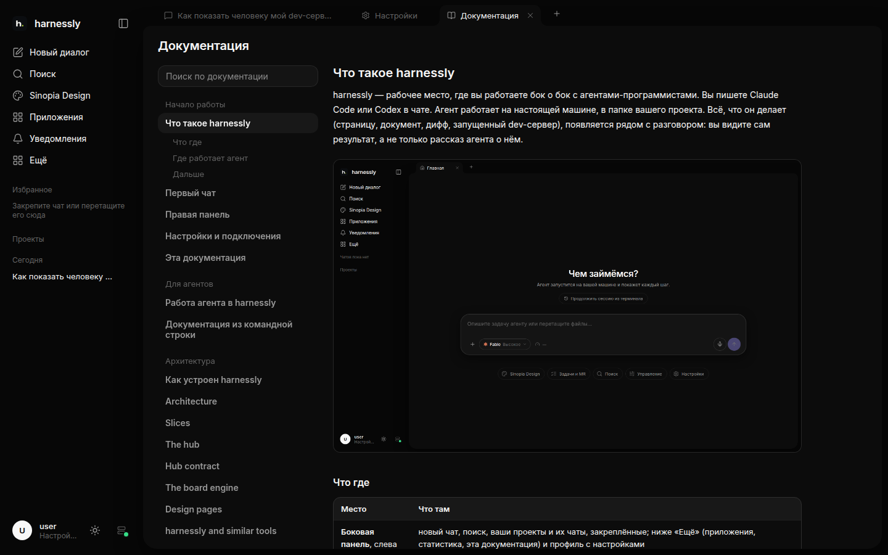

# Эта документация

Документация открывается из «Ещё» в боковой панели. Она встроена в harnessly, поэтому работает и на машине без сети,
и это та же документация, которую агенты читают командой `harnessly docs`.

## Найти нужное

Поле над оглавлением ищет по всем страницам, включая текст, и показывает строку, где нашлось. Разделы:

- **Начало работы** — как пользоваться harnessly, для людей.
- **Для агентов** — как агент работает в harnessly; это читают агенты, а вам полезно знать, что знают они.
- **Архитектура** — как устроен harnessly, со схемами.
- **Свой сервер** — как запустить harnessly на своих машинах и серверах.
- **Приложения и плагины** — как писать свои приложения для harnessly.
- и разделы вашей команды, если она добавила свои.

## Страницы вашей команды

Команда или своя установка добавляет в эту документацию собственные страницы: регламенты, как устроены ваши сервисы,
ваши договорённости. Они стоят рядом со встроенными разделами, а ваша страница может даже заменить встроенную.
Как это сделать — в [Своей документации](../self-host/own-docs.md).

## Попросить агента написать страницу

Быстрее всего — попросить: «запиши, как мы выкатываем API, с командами, которые мы только что запускали». Агент
напишет страницу командой `harnessly docs add`, и она сразу появится здесь, без пересборки.
