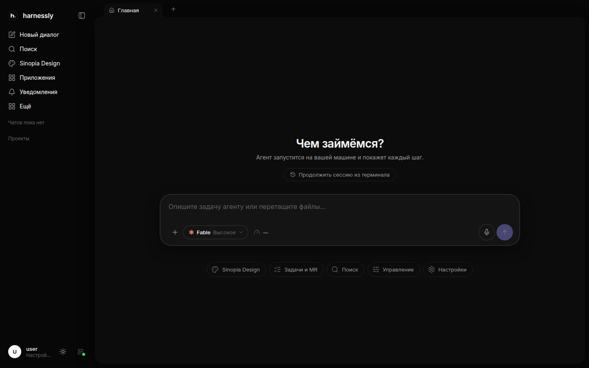
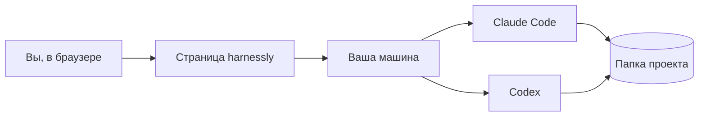

# Что такое harnessly

harnessly — рабочее место, где вы работаете бок о бок с агентами-программистами. Вы пишете Claude Code или Codex в
чате. Агент работает на настоящей машине, в папке вашего проекта. Всё, что он делает (страницу, документ, дифф,
запущенный dev-сервер), появляется рядом с разговором: вы видите сам результат, а не только рассказ агента о нём.

## Что где

| Место | Что там |
| --- | --- |
| **Боковая панель**, слева | новый чат, поиск, ваши проекты и их чаты, закреплённые; ниже «Ещё» (приложения, статистика, эта документация) и профиль с настройками |
| **Чат**, в центре | разговор с агентом: ваши сообщения, его ответы, команды, которые он запускал, вопросы к вам |
| **Правая панель** | то, что агент вам показывает, и инструменты чата: файлы, изменения, терминал, браузер, документы, доски |

## Где работает агент

Каждый чат работает на **машине**: компьютере или сервере с вашими проектами, где установлен harnessly. У человека
может быть несколько машин; новые чаты открываются на основной. Агент работает в папке проекта чата, с теми же
файлами, git и инструментами, что были бы у вас в терминале.

## Дальше

- [Первый чат](01-first-chat.md): начать чат, выбрать агента и модель, отправить файлы и голос.
- [Правая панель](02-right-pane.md): что сделал агент, файлы, терминал, браузер.
- [Настройки и подключения](03-settings.md): ключи и модели, трекер и GitLab, сейф для секретов.
- [Эта документация](04-docs.md): поиск, страницы вашей команды, как попросить агента написать страницу.
