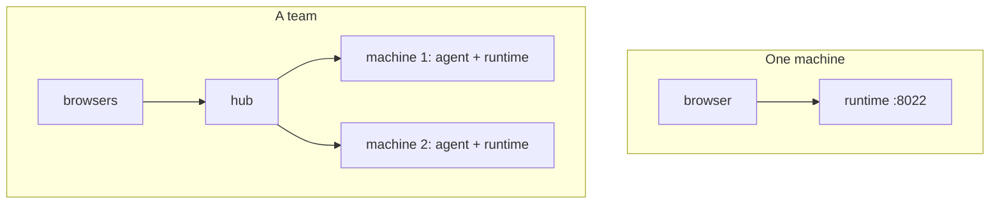

# Running harnessly yourself

harnessly is open source (Apache-2.0) and runs entirely on your own machines. Pick the shape that fits:

| Shape | For | What runs | Start here |
| --- | --- | --- | --- |
| **One machine** | one person, a laptop or a server | the runtime with its page on one port | [Getting started](../getting-started.md), [Deploy](../deploy.md) |
| **A team** | several people and machines, sign-in from anywhere | a hub, and the runtime with the agent on every machine | [Running a hub](../hub/deploy.md), [Connecting a machine](../hub/machine.md) |
| **Kubernetes** | an install that grows | the hub and the machines from Helm charts | [Deploy → Helm](../deploy.md#kubernetes-helm) |

## Then

- [Configuration](../configuration.md): every `RUNTIME_*` and `AGENT_*` variable.
- [Environment and catalog](../hub/environment.md): what a hub gives every machine of a team.
- [The safe](../safe.md), [connections](../connections.md), [MCP servers](../mcp-connections.md), [integrations](../integrations.md): secrets, the team's services, boards and documents beside the chat.
- [Voice input](../voice.md): the built-in recognition and how to change it.
- [Your own documentation](own-docs.md): put your team's pages into the /help page and the agents' `harnessly docs`.
