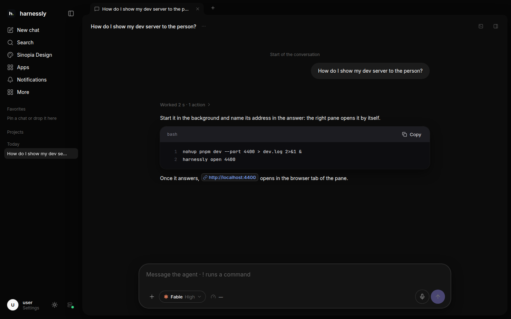

# Your first chat

Write what you need in the field of the home screen and press Enter. A chat opens, the agent starts in the project
folder and answers. The chat stays in the sidebar under its project; come back to it any time, from any device.

## Pick the agent and the model

The button beside the field picks **the agent** (Claude Code or Codex), **the model** and **the thinking level**:
low answers at once, medium is for ordinary tasks, high thinks before every step. The choice is remembered for the
next chats.

## What the field can do

- **Enter** sends, **Shift+Enter** is a new line (the other way round if you changed it in the settings).
- **+** adds a file (up to 50 MB), a photo or a screenshot (up to 10 MB), a design, a document, a board or a task.
  Pasting or dropping a file into the field works too.
- **The microphone** turns your voice into text in the field while you speak; stop keeps the text, cancel leaves the
  field as it was.
- **↑** in an empty field brings back an earlier message; **/** finds a saved quick prompt.
- A message that starts with **!** runs as a command on the machine.

## While the agent works

You do not have to wait. A message written while the agent works goes **into the queue** and is sent when the turn
ends; **Ctrl+Enter** hands it over at once, into the running turn. The queue can be reordered, edited and emptied.
The stop button stops the agent; the next message resumes the chat where it left off.

## When the agent asks

When the agent needs a decision (a plan to approve, a command to allow, a choice between options) the question
stands above the field with its answers. Pick one, or write your own answer in the field.
