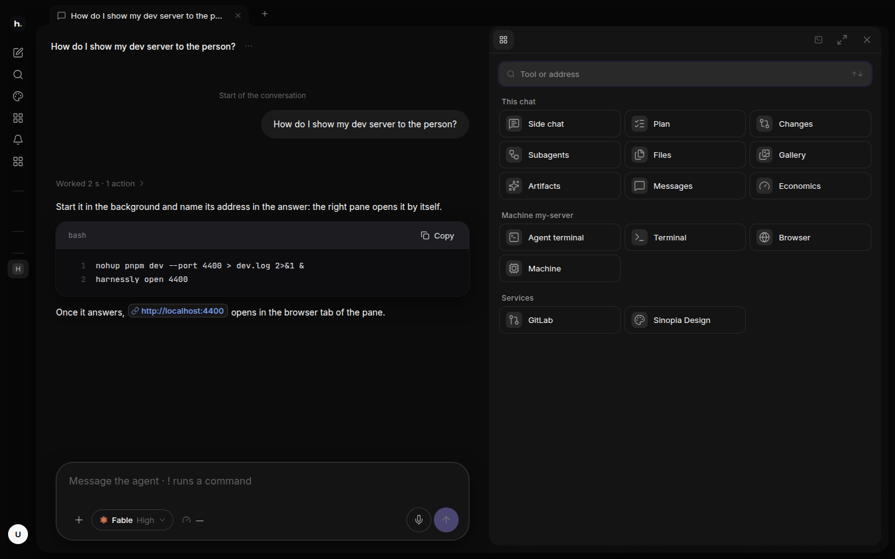

# The right pane

The right pane is where you see what the agent made and the tools of the chat. Open it with the button in the top
right corner of the chat; Esc closes it.

## Its tools

The tiles come in three groups: what belongs to this chat, what belongs to its machine, and the services connected.

| Tool | What for |
| --- | --- |
| **Side chat** | ask something on the side without disturbing the agent's work |
| **Plan** | the steps the agent planned and where it is |
| **Changes** | the diff of what the agent changed |
| **Files** | the project folder: open, read, edit and save a file; Markdown opens as a page |
| **Subagents**, **Messages** | the helpers the agent started, and what other agents wrote to it |
| **Artifacts**, **Gallery** | the documents, boards and pictures of the chat |
| **Economics** | what the chat has spent |
| **Agent terminal** | the agent's own terminal, live |
| **Terminal** | a shell of your own on the machine |
| **Browser** | the dev servers of the machine, and any address in a preview |
| **Machine** | the machine's load; stop a heavy process from here |
| **GitLab**, **Designly** | the merge requests of your projects with their diffs; the designs of this install |

## The agent opens things itself

When the agent publishes a document, draws a board or starts a dev server, it opens it in the pane for you with
`harnessly open`. A link in the chat (a task, a merge request, a site) is a chip: a click opens it in its own view of
the pane, not in a new browser tab.
