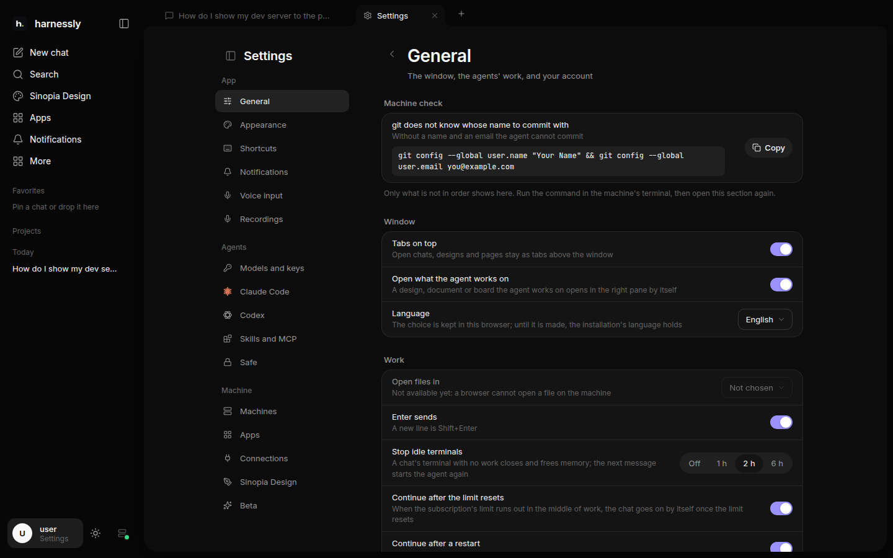

# Settings and connections

The settings open from your profile at the bottom of the sidebar.

| Section | What is there |
| --- | --- |
| **General**, **Appearance**, **Shortcuts** | the window: theme, text size, language, which editor opens files, what Enter does, the keys; your account |
| **Notifications** | your Telegram, and the instruction to the agents of when to write to you |
| **Voice input**, **Recordings** | the microphone in the message field, and the recordings you made |
| **Models and keys** | how the agents and the models sign in, and where their requests go |
| **Claude Code**, **Codex** | each agent's own settings on the machine: rules for commands, environment variables |
| **Skills and MCP** | what the agent finds on the machine and may use; turn a skill or a server off here |
| **Safe** | the secrets the agents may use without seeing them |
| **Machines** | where the agents run; new chats open on the main one |
| **Apps**, **Connections** | the services the agents work with: your tracker, wiki, GitLab or GitHub, remote MCP servers |
| **Designly** (or your install's name for designs), **Beta** | what designs are built on this machine; features to try before they are for everyone |

## Connections

Your tracker, wiki and code host (Jira, Confluence, YouTrack, Linear, GitLab, GitHub) are connected by pasting their
link in **Settings → Connections**. The agents then read them for you, without a token of their own. Remote MCP
servers (Notion, Sentry, GitHub…) connect the same way and sign in in a popup.

## The safe

Tokens, passwords and keys never go into the chat. When an agent needs one it asks the safe by name; you get a card
to put the value in, outside the chat, and the agent only ever uses it, never sees it printed. You see and manage
what is kept in **Settings → Safe**.

## Notifications

Connect your Telegram in **Settings → Notifications**, and tell the agents in words when to write to you ("only when
a deploy fails", "when you need me"). They message you by the instruction, not on every step.
