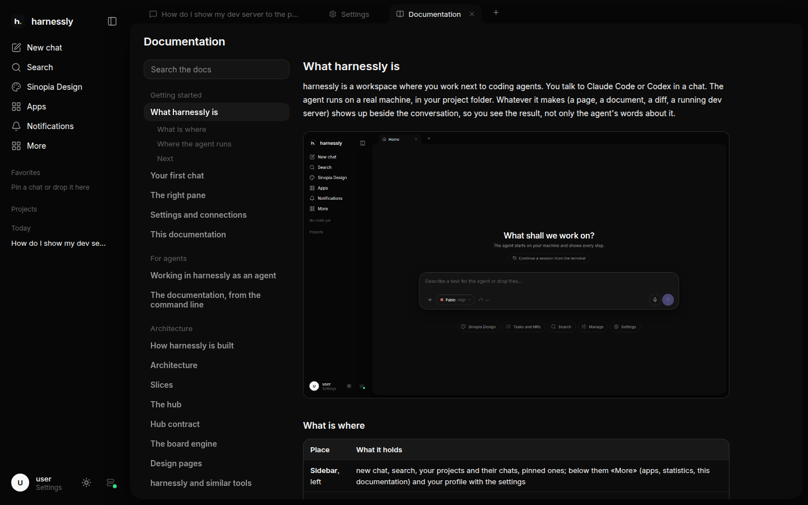

# This documentation

The documentation opens from «More» in the sidebar. It is built into harnessly, so it works on a machine with no
network, and it is the same documentation the agents read with `harnessly docs`.

## Find something

The field above the contents searches every page, its text included, and shows the line that matched. The sections:

- **Getting started**: using harnessly, for people.
- **For agents**: how an agent works in harnessly; the agents read it, and it is useful to you to know what they know.
- **Architecture**: how harnessly is built, with diagrams.
- **Self-hosting**: running harnessly on your own machines and servers.
- **Apps and plugins**: writing your own apps for harnessly.
- and the sections of your team, when it has added its own.

## Your team's pages

A team or a self-hosted install adds its own pages to this documentation: runbooks, how your services are set up,
your conventions. They sit next to the built-in sections, and a page of yours may even replace a built-in one.
[Your own documentation](../self-host/own-docs.md) tells how.

## Ask an agent to write a page

The quickest way to add a page is to ask: "write down how we deploy the API, with the commands we just used". The
agent writes it with `harnessly docs add`, and it shows here at once, without a rebuild.
