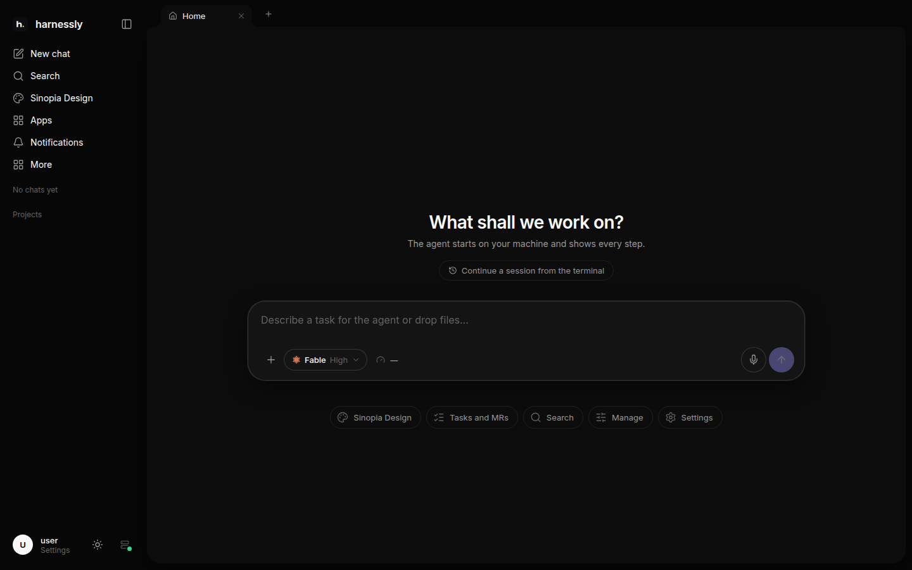
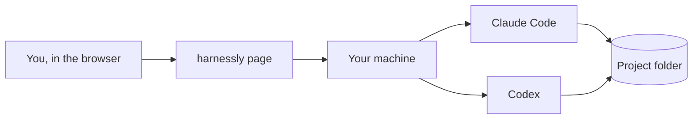

# What harnessly is

harnessly is a workspace where you work next to coding agents. You talk to Claude Code or Codex in a chat. The agent
runs on a real machine, in your project folder. Whatever it makes (a page, a document, a diff, a running dev server)
shows up beside the conversation, so you see the result, not only the agent's words about it.

## What is where

| Place | What it holds |
| --- | --- |
| **Sidebar**, left | new chat, search, your projects and their chats, pinned ones; below them «More» (apps, statistics, this documentation) and your profile with the settings |
| **Chat**, middle | the conversation with the agent: your messages, its answers, the commands it ran, the questions it asks you |
| **Right pane** | what the agent shows you and the tools of the chat: files, changes, a terminal, a browser, documents, boards |

## Where the agent runs

Every chat runs on a **machine**: a computer or a server with your projects on it, where harnessly is installed. One
person may have several machines; new chats open on the main one. The agent works in the folder of the chat's
project, with the same files, git and tools you would have in a terminal there.

## Next

- [Your first chat](01-first-chat.md): start a chat, pick the agent and the model, send files and voice.
- [The right pane](02-right-pane.md): see what the agent made, open files, a terminal, a browser.
- [Settings and connections](03-settings.md): keys and models, your tracker and GitLab, the safe for secrets.
- [This documentation](04-docs.md): search it, add your team's pages to it, ask an agent to write one.
